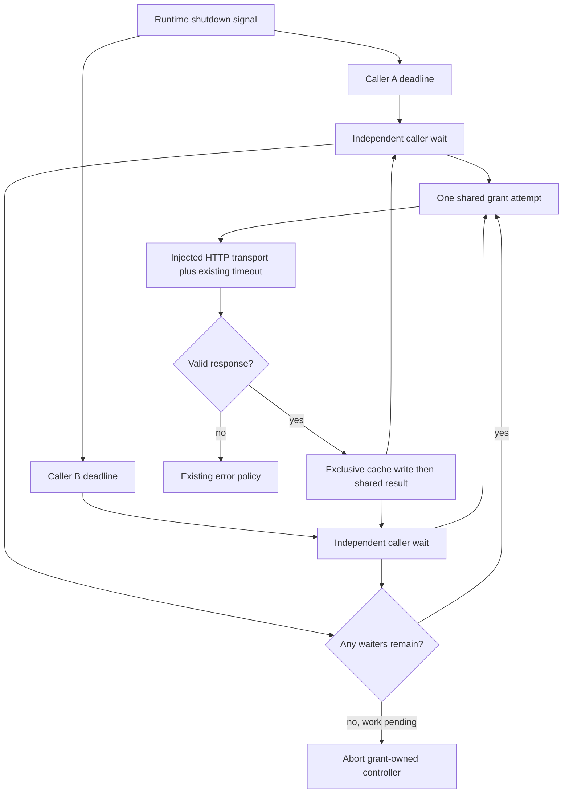

# Phase 1: Known Findings and Loop Proof - Research

**Researched:** 2026-10-13
**Domain:** Existing TypeScript authentication, filesystem tests, and review convergence
**Confidence:** MEDIUM
**Status:** RESEARCH COMPLETE — the maintainer resolved the RED-commit conflict after this research on 2026-10-13. Updated context D-06 is authoritative: commit the complete regression patch and observed failure as a planning-only record before the active test and GREEN fix. Historical conflict analysis and assumption A1 below record the research state before that decision; they are no longer blockers.

<user_constraints>
## User Constraints (from CONTEXT.md)

The following decisions are copied verbatim from the live context. [VERIFIED: .planning/phases/01-known-findings-and-loop-proof/01-CONTEXT.md:16-36,106-108]

<!-- DATA_7e30c8a1_START -->
### Locked Decisions

### File headers

- **D-01:** Keep the SPDX comment on the first line. Follow it with separate copyright and `@fileoverview` JSDoc blocks. Separate each section and imports with one blank line.
- **D-02:** Use `Copyright (c) 2026 Alessandro Colomba` for original work. Preserve existing Apache license classification and template attribution.
- **D-03:** Keep overviews brief: usually one purpose sentence, with essential dependency or safety context where needed. Apply the header to every file touched by this phase.

### Shared authentication cancellation

- **D-04:** Cancel only the caller whose signal aborts. Other callers continue waiting for the same grant.
- **D-05:** Cancel the shared request when no callers remain. Preserve prompt shutdown and the existing request timeout. Do not create duplicate concurrent grants or automatic retries.
- **D-06:** Prove the joined-caller defect with a regression test committed and observed failing before the production fix. Test cancellation when all callers leave as well.

### Review records and stopping

- **D-07:** Write one findings ledger per phase. Give findings stable IDs and record rule, location, severity, outcome, and test/commit evidence. Keep seed IDs SC-01 through SC-05.
- **D-08:** Include a per-round progress summary. Phase 8 assembles the milestone bug ledger from the phase records.
- **D-09:** Pause for the maintainer's decision when a round makes no progress, a fixed finding returns, or the four-round cap is reached. Report unresolved findings and evidence, and offer retry, skip, or stop. Do not continue independent batches past this pause.

### Implementation discretion

Select the smallest implementation that satisfies the decisions and existing interfaces. The roadmap already fixes disjoint batches, atomic commits, regression-first bug fixes, and direct coverage requirements.

### Deferred Ideas

Seed WARNING findings remain assigned to Phases 2, 3, and 5. Hardware gates and live real-pump runs remain outside this milestone's scope.
<!-- DATA_7e30c8a1_END -->
</user_constraints>

<phase_requirements>
## Phase Requirements

Descriptions are copied from the requirements source. [VERIFIED: .planning/REQUIREMENTS.md:15-24]

<!-- DATA_210fca68_START -->
| ID | Description | Research Support |
|----|-------------|------------------|
| SPOT-01 | The auth cache test plants a real stranded temporary file through an injected temporary-name source (SC-01, SC-04). | Inject the complete temporary-path source; plant exactly that path and assert exclusive-create refusal. |
| SPOT-02 | The control refusal-log test asserts the exact line for each refusal row, one `test()` per row (SC-02). | Eight independently named rows with complete warning-array expectations. |
| SPOT-03 | The device-state frozen checks fail when the snapshot is missing, and the stale-version cases assert the stored state (SC-03). | Assert complete expected values before frozen checks; read the store after refused patches. |
| SPOT-04 | An aborted first caller cannot cancel a second caller that joined the same token grant, or the behavior is documented and tested (SC-05). | D-04 selects independent cancellation; shared controller plus per-caller waits. |
| PROC-01 | Each phase writes a findings ledger. Every finding records its rule, location, severity, and outcome (fixed, or rejected with a stated reason). | Stable seed IDs, evidence fields, and per-batch review records. |
| PROC-02 | Each phase converges. The last re-review reports no open finding within about four rounds, or the phase stops and reports why. | Central stop condition applies across independent batches. |
| PROC-03 | One file-header form (SPDX line, then copyright and `@fileoverview` JSDoc) is decided once and applied to every file, and the license-header gate still passes. | Existing licensing gate passes; apply D-01 through D-03 to touched TypeScript files. |
<!-- DATA_210fca68_END -->
</phase_requirements>

## Summary

Keep the three existing ownership batches. Change the auth source and its test together; change the controls and state tests separately. These batches are explicitly disjoint in the roadmap. The loop covers the seed findings and defects introduced by their fixes. [VERIFIED: .planning/ROADMAP.md:46-57]

The auth client shares a grant and cache write, but the first caller supplies its signal. API requests supply individual deadlines before asking for a token. The smallest fix keeps coalescing and gives each waiter independent cancellation. [VERIFIED: src/cloud/auth.ts:414-418,443-493; src/cloud/api.ts:150-155]

The assertion repairs must demonstrate their power against plausible wrong implementations. The current stranded-file name cannot collide with production. Existing frozen checks accept missing values, and stale-version tests only inspect the returned snapshot. [VERIFIED: test/cloud/auth.test.ts:542-563; test/device/state.test.ts:313-328,474-498,596-605]

**Primary recommendation:** Use one grant-owned abort controller and independently cleaned-up caller subscriptions. Retain the shared attempt until it actually settles. Follow the committed RED evidence policy only after the orchestrator resolves the hook conflict below. [VERIFIED: context D-04 through D-06; skills/local-verification/SKILL.md:5-34]

## Architectural Responsibility Map

This is an implementation allocation under the locked phase scope. [VERIFIED: .planning/ROADMAP.md:46-57]

| Capability | Primary Tier | Secondary Tier | Rationale |
|------------|--------------|----------------|-----------|
| Grant coalescing and waiter cancellation | Plugin backend / auth client | REST client / runtime | The auth client owns the shared request; callers own their deadlines. |
| Token-cache exclusive creation | Plugin backend / auth client | Local filesystem | The writer owns permissions and temporary names. |
| Exact refusal-log evidence | Controls paired test | Existing accessory binder | Preserve the existing control behavior and assert complete output. |
| Frozen snapshots and stale-state evidence | State paired test | Existing state store | Observe stored state through the public store contract. |
| Findings ledger and stop conditions | GSD orchestration | Batch reviewer/fixer agents | Central orchestration owns pauses across batches. |

## Project Constraints (from AGENTS.md)

Apply these directives from the source instructions. [VERIFIED: AGENTS.md, read this session]

- Read each file before editing. Trace callers before modifying a function. Research before editing.
- Keep changes surgical. Do not fix deferred WARNING findings in this phase.
- Consult the primary Homebridge or Cucumber documentation when behavior depends on those systems. Follow pinned definitions if current docs differ.
- Never commit to main. Use feature or release branches. Prefer isolated worktrees for new feature work.
- Use Conventional Commits; titles contain 5–72 characters and body lines stay within 80 characters. Do not mention GSD milestones or phases in titles.
- Before committing, run `SKIP=npm-check pre-commit run --files <changed files>`. Restage hook changes and repeat until clean.
- Commit in the foreground with plain `git commit`. Its hook runs `npm run check:commit`. Fix failed hooks; never use `--amend` or `--no-verify`.
- Never rebase or rewrite history. Merge branch updates. Use squash for PR merges.
- Run Fallow symbol impact before refactoring exact consumers, guard before changing files, and audit before commits or PRs.
- Read the TypeScript style and comments rules for source and tests. Read both test-writing and test-review rules for tests.
- Preserve `.js` relative imports and compiled test layout.
- Require isolated 100% line, function, and branch coverage for each touched source/test pair.
- Run the full `npm run check` on the combined tree at wave and phase gates. Commit-hook evidence alone is insufficient.
- Reuse evidence only from this session and unchanged inputs. Record command, status, commit, Node version, and scope.
- Include `## Threat Flags` in every plan SUMMARY, even when no additional threat exists.
- Prefix windows append descriptions with the milestone. Do not hand-edit WINDOWS.
- Start changes through an authorized GSD workflow. This research belongs to the active autonomous planning workflow.
- Before a PR, offer the version bump and changelog update. Use Simple English Plain mode and Humanizer for PR descriptions. Audit and close the milestone before its squash merge.
- Use only Homebridge-supplied HAP objects at runtime. Preserve safety semantics, identity, privacy, and existing persistence boundaries.
- Hardware and release validation remain separate from this phase's completion.

The project's quoted runtime constraint is `^22.10.0 || ^24.0.0`; the installed manifest also declares Node 26. Do not alter either in this phase. [VERIFIED: AGENTS.md runtime constraint; package.json:28-31: `"node": "^22.10.0 || ^24.0.0 || ^26.0.0"`]

## Standard Stack

Retain the installed stack. This phase installs no package and changes no version. Registry currency and publish dates are irrelevant to that bounded decision. [VERIFIED: .planning/ROADMAP.md:46-57; package.json:62-86]

| Component | Installed / declared version | Purpose | Evidence |
|-----------|------------------------------|---------|----------|
| Node built-in test and assertion APIs | Runtime probe: v26.11.1 | Runner, abort primitives, real filesystem | `node --version`; `Object.isFrozen(undefined)` probe returned `true`. |
| TypeScript | `"version": "6.0.3"` | Compile source and mirrored tests | [VERIFIED: node_modules/typescript/package.json:2-5] |
| strong-mock | `"version": "9.2.2"` | Existing strict interaction mocks | [VERIFIED: node_modules/strong-mock/package.json:2-3] |
| Homebridge | `"version": "2.4.0"` | Pinned lifecycle and HAP types | [VERIFIED: node_modules/homebridge/package.json:2-4] |
| Fallow | `"version": "3.27.0"` | Symbol consumers and required analysis | [VERIFIED: node_modules/fallow/package.json:2-3] |

**Installation:** None. Do not add runners, mocking libraries, cancellation packages, or filesystem fakes. [VERIFIED: skills/typescript-unit-testing/SKILL.md:12-32,182-209]

## Package Legitimacy Audit

Not applicable: no external package installation is recommended. Existing package identities came from read installed manifests; no package is presented as registry-verified. [VERIFIED: installed manifests in Standard Stack]

## Architecture Patterns

### Data flow

This diagram describes the recommended allocation under D-04 and D-05. Existing API deadlines and the runtime root signal establish the entry points. [VERIFIED: src/cloud/api.ts:150-155; src/runtime/accountRuntime.ts:1149-1174]



### Shared grant lifecycle

Current coalescing remains the starting point. Verbatim source: [VERIFIED: src/cloud/auth.ts:455-460]

<!-- DATA_604bb087_START -->
```ts
function sharedGrant(signal: AbortSignal): Promise<CachedToken> {
  inFlight ??= grantAndCache(options, policy, signal).finally(() => {
    inFlight = undefined;
  });

  return inFlight;
}
```
<!-- DATA_604bb087_END -->

Use a factory-owned attempt record: controller, shared promise, and active waiter count. This is a recommended design within the context's implementation discretion. [VERIFIED: context D-04, D-05 and implementation discretion]

1. Reject an already aborted caller before it starts work. Check again after the asynchronous cache read before joining or starting a grant.
2. Give each caller its own wait promise and abort handler. Caller cancellation rejects that waiter promptly and releases its subscription exactly once.
3. Abort the grant-owned controller when the final pending waiter leaves. Keep the existing request timeout on the transport.
4. Keep the attempt occupying the shared slot until its underlying grant/cache promise settles. A caller arriving during abort teardown must not start a concurrent replacement grant.
5. Do not silently retry a caller attached to an aborting attempt. A later explicit call can start a new attempt after settlement.
6. Remove caller listeners on success, failure, and cancellation. Observe the shared rejection even when all caller waits already rejected.
7. Avoid storing or registering a token as a canceled caller's successful result. Preserve ordinary token registration and cache coalescing for surviving callers.

Native cancellation primitives are available in the Node 22 documentation and installed definitions. `AbortSignal.any` propagates the first abort reason; `throwIfAborted` throws the signal's reason. Check pre-aborted signals and use once listeners. Remove still-attached listeners after successful settlement. [CITED: https://nodejs.org/download/release/v22.15.0/docs/api/globals.html#class-abortsignal] [VERIFIED: node_modules/@types/node/web-globals/abortcontroller.d.ts:16-39,55-57: `readonly reason: any;`, `throwIfAborted(): void;`, `any(signals: AbortSignal[]): AbortSignal;`, `timeout(milliseconds: number): AbortSignal;`]

**Caller trace:** Production `createAuthClient` is consumed by the account-runtime composition. Fallow type-aware symbol impact returned complete, high-confidence consumer evidence for that relationship. The REST client calls `idToken(deadline)` before issuing each vendor request. [VERIFIED: src/runtime/accountRuntime.ts:1240-1255; src/cloud/api.ts:150-155; Fallow symbol-impact output this session]

**Shutdown trace:** Platform shutdown calls `runtime.stop()`, which sets stopped state, publishes transport trust, aborts the root signal, and closes the shadow connection. Preserve prompt caller rejection and grant cancellation when all root-derived signals abort. [VERIFIED: src/platform.ts:611-613: `this.api.on('shutdown', () => { void runtime.stop(); });`; src/runtime/accountRuntime.ts:1149-1174: `root.abort();`]

Pinned Homebridge declares `SHUTDOWN = "shutdown"` after accessories are unpublished and saved. The developer documentation entry was consulted but yielded no readable lifecycle content; use the installed definition. [VERIFIED: node_modules/homebridge/dist/api.d.ts:128-132: `SHUTDOWN = "shutdown"`]

### Temporary-name injection

Production currently computes the complete temporary path with hidden PID and entropy. The occupied-name test omits entropy. Verbatim values: [VERIFIED: src/cloud/auth.ts:211-225; test/cloud/auth.test.ts:545-548]

<!-- DATA_c738e526_START -->
```ts
return `${target}.${String(process.pid)}.${randomBytes(TEMPORARY_SUFFIX_BYTES).toString('hex')}.tmp`;
await writeFile(temporary, contents, { mode: OWNER_ONLY_MODE, flag: 'wx' });
const strandedPath = `${cachePath}.${String(process.pid)}.tmp`;
await writeFile(strandedPath, 'stranded', 'utf8');
await chmod(strandedPath, GROUP_READABLE_MODE);
```
<!-- DATA_c738e526_END -->

Inject the complete temporary-path producer through the existing options interface. Prefer an optional member with a local entropy default to preserve existing composition callers and the four-file ownership boundary. Keep that fallback lazy. Do not export private helpers. This is a design recommendation under implementation discretion, not a locked new API name. [VERIFIED: context reusable assets and implementation discretion; src/cloud/auth.ts:72-89; src/runtime/accountRuntime.ts:1240-1252]

The revised collision case must expect refusal to create the occupied path, not an owner-only target written successfully. Grant success remains usable in memory. Seed a wider occupied temporary file and optionally an expired target; assert both remain byte-for-byte unchanged, exact directory contents, and the cache-write warning. No retry should choose a second name. [VERIFIED: src/cloud/auth.ts:224-252]

The cache-write log is exactly `The token cache could not be written; the token is held in memory only.` Existing mode constants are `OWNER_ONLY_MODE = 0o600` and `GROUP_READABLE_MODE = 0o644`. [VERIFIED: src/cloud/auth.ts:53,66; test/cloud/auth.test.ts:29-30]

Node documents that `wx` fails for an existing path, while `w` truncates it. This makes removal of exclusivity a useful negative control. [CITED: https://nodejs.org/download/release/v22.15.0/docs/api/fs.html#file-system-flags]

### Exact control logs

Create one sibling test per existing refusal row. Use independently authored expected strings, never the production formatter. Assert the full warning array contains exactly one expected line. This directly proves privacy as well as the cause. [VERIFIED: skills/typescript-unit-testing/SKILL.md:89-109,160-162; test/accessories/controls.test.ts:418-504,591-623]

The local cause values and log templates are quoted verbatim. [VERIFIED: src/accessories/controls.ts:328-342,519-534]

<!-- DATA_0289b1cd_START -->
```text
the plugin has no way to reach the vendor right now
the live connection is quiet, so the plugin cannot see the device confirm the command
only an on request is supported, and the device reports when the condition ends
the plugin has no fresh state for it
the device is confirmed offline
it already reads active
Refused ${capability} on ${deviceId}: ${refusal.cause}.
The ${capability} request on ${deviceId} did not take effect: ${failure}. It is not retried.
```
<!-- DATA_0289b1cd_END -->

The test fixture uses `DEVICE_ID = 'account-1_serial-1'`; its existing independent vendor expectation reads `The self-test request on ${DEVICE_ID} did not take effect: timed-out. It is not retried.` Vendor failure values are `'vendor-error'` and `'timed-out'`. Local statuses include `NOT_ALLOWED_IN_CURRENT_STATE = -70412` and `RESOURCE_BUSY = -70403`. [VERIFIED: test/accessories/controls.test.ts:14,29-32,401,481-500]

Do not derive expectations from the row's informal cause label. That label describes the scenario; it is not the production wording. Add a literal expected-line field to test rows, or use a separate typed table with independently written lines. Preserve the eight existing scenarios. [VERIFIED: test/accessories/controls.test.ts:418-504]

### State assertions

Assert complete expected snapshots or nested values before `Object.isFrozen`. Presence checks may narrow types, but must not replace exact value assertions. Apply this to discovery, merged snapshots, nested telemetry, nested metadata, and released snapshots. [VERIFIED: test/device/state.test.ts:224-247,474-498,596-605; skills/typescript-unit-testing/SKILL.md:89-109]

The version rows are exactly `{ version: 4, waterLevel: 1, applied: 5 }`, `{ version: 5, waterLevel: 1, applied: 5 }`, and `{ version: 6, waterLevel: 31, applied: 6 }`. Read `store.snapshot(DEVICE_ID)` after each action and assert the complete stored snapshot, independently built from fixtures. [VERIFIED: test/device/state.test.ts:313-328]

The store refuses `incoming <= applied` and returns the previous snapshot. That return can look correct while a broken implementation corrupts the map. Assert the stored snapshot after the metadata-watermark stale case too. [VERIFIED: src/device/state.ts:159-160: `return applied !== undefined && incoming !== undefined && incoming <= applied;`; src/device/state.ts:363-374; test/device/state.test.ts:450-459]

## Don't Hand-Roll

| Problem | Do not build | Use instead | Source |
|---------|--------------|-------------|--------|
| Cancellation notification | Polling or timers for waiter detection | Native controller and per-caller abort listeners | [CITED: Node globals documentation] |
| File collision evidence | Mock filesystem graph or guessed PID-only path | Real temporary directory plus injected full path | [VERIFIED: test/cloud/auth.test.ts:104-112; skills/typescript-unit-testing/SKILL.md:122,194-209] |
| Log privacy evidence | Boolean substring summaries | Complete warning-array equality | [VERIFIED: skills/typescript-unit-testing/SKILL.md:89-109] |
| Coverage selection | New aggregate coverage harness | Existing isolated direct-coverage script | [VERIFIED: scripts/test-coverage-direct.mjs:64-84,157-190] |
| Review workflow | New automation package or PR tooling | The phase ledger and existing reviewer/fixer agents | [VERIFIED: .planning/ROADMAP.md:57] |

## Runtime State Inventory

This is a behavioral refactor, with no rename or schema migration. The inventory covers what this phase could affect; no live account or OS configuration was queried. [VERIFIED: .planning/ROADMAP.md:46-57]

| Category | Items found | Required action |
|----------|-------------|-----------------|
| Stored data | Token cache; format stays unchanged. Existing filename is `'.basement-guardian-token.json'`. [VERIFIED: src/cloud/auth.ts:69,117-122,236-244] | Code-only writer/cancellation changes; no data migration. |
| Live service configuration | None requiring change under this scope; grant body and routes remain unchanged. [VERIFIED: src/cloud/auth.ts:257-265,362-369] | No service configuration task; live configuration was not inspected. |
| OS-registered state | None requiring change under this scope; platform keeps its shutdown callback. [VERIFIED: src/platform.ts:611-613] | No registration task; OS registrations were not inventoried. |
| Secrets and environment | Existing option fields `email`, `password`, and `registerSecret` remain. [VERIFIED: src/cloud/auth.ts:76-77,87] | No secret-key or environment migration; keep logs sanitized. |
| Build artifacts / installed packages | Compiler output directory is `"outDir": "dist-test"`. [VERIFIED: tsconfig.test.json:5] | Rebuild through the existing `build:test` script; no package reinstall. |

## Common Pitfalls

1. **Starting a replacement grant during teardown.** Clearing the slot when the last waiter leaves can overlap a new request with an aborting old request. Clear only on underlying settlement. Test a new explicit caller during delayed rejection. [VERIFIED: context D-05; current settlement boundary src/cloud/auth.ts:455-458]
2. **Racing only the first waiter.** Every caller needs its own rejection and cleanup, including joined callers. Test each direction of cancellation. [VERIFIED: context D-04; src/cloud/auth.ts:455-477]
3. **Counting a pre-aborted caller.** An abort event is not replayed to a late listener. Check before joining and after awaited cache reads. [CITED: Node globals documentation]
4. **Leaking listeners or unhandled rejections.** A successful request need not fire an abort event. Clean all wait listeners; keep a rejection consumer on the shared promise. [CITED: Node globals documentation] [VERIFIED: context D-05]
5. **Assuming an exclusive collision should succeed on disk.** Current writer logs and keeps the token in memory. Pin the existing occupied file and target bytes. [VERIFIED: src/cloud/auth.ts:224-252]
6. **Calling missing values frozen.** The runtime probe returned `true` for `Object.isFrozen(undefined)`. Exact value assertions must precede freeze assertions. [VERIFIED: Node v26.11.1 probe this session; affected tests cited above]
7. **Accepting archived progress or empty commits.** Live phase artifacts govern this milestone. STATE records the unsafe pathspec commit helper and requires checking committed paths. [VERIFIED: context integration points; .planning/STATE.md:464-483]

## Code Examples

These are current, source-verified patterns to retain. They are not a complete production patch.

### Existing transport deadline

[VERIFIED: src/cloud/auth.ts:368]

<!-- DATA_f5a9c028_START -->
```ts
signal: AbortSignal.any([signal, AbortSignal.timeout(options.requestTimeoutMs)]),
```
<!-- DATA_f5a9c028_END -->

Retain the deadline expression; supply the grant-owned signal instead of the first waiter's signal. [VERIFIED: context D-04, D-05]

### Independent complete expected state

[VERIFIED: test/device/state.test.ts:104-112]

<!-- DATA_9dd1ae20_START -->
```ts
assert.deepStrictEqual(snapshot, {
  identity: geminiIdentity(),
  connectivity: { connected: true, timestamp: DEVICE_TIME },
  data: { water_level: 1, primary_pump_running: false, ac_power: true },
  metadata: {},
  shadowVersion: undefined,
  deviceTimestamp: DEVICE_TIME,
  receivedAt: FIRST_RECEIPT,
});
```
<!-- DATA_9dd1ae20_END -->

Use this whole-value pattern before frozen checks. Extend the independently constructed expected snapshot for metadata and versioned cases. [VERIFIED: skills/typescript-unit-testing/SKILL.md:89-109]

## Review Loop and Ledger Contract

Plan a review → triage → fix → re-review loop for each of the three ownership batches. Reviewers and fixers receive the project skills and current source/test evidence. Seed WARNING findings stay deferred. [VERIFIED: .planning/ROADMAP.md:57; context D-07 through D-09]

Use one phase findings ledger, written by one assigned owner. Parallel workers return batch records to that owner instead of concurrently editing the ledger. Recommended columns: stable ID, requirement, rule, exact location, severity, round first seen, outcome/rejection reason, regression or mutation evidence, test commit, fix commit, verification command/status. [VERIFIED: context D-07, D-08 and implementation discretion]

Each round records opening count, fixed/rejected/new/reopened findings, closing count, commands, and commit evidence. Any no-progress round, returning fixed finding, or fourth-round cap pauses all further batches until the maintainer selects retry, skip, or stop. Do not mark an open finding fixed merely because execution reached the cap. [VERIFIED: context D-09]

## Validation Architecture

Validation is enabled: `"nyquist_validation": true`. Security is enabled: `"security_enforcement": true`. [VERIFIED: .planning/config.json workflow block, read this session]

### Test framework and exact commands

The compiler creates `"outDir": "dist-test"`, and the coverage script maps source names with `return \`dist-test/${file.slice(0, -3)}.js\`;`. This establishes the compiled paths used below. [VERIFIED: tsconfig.test.json:5; scripts/test-coverage-direct.mjs:35-36]

Verbatim script values: `"build:test": "rimraf ./dist-test && tsc -p tsconfig.test.json"`, `"test:coverage:direct:compiled": "node scripts/test-coverage-direct.mjs"`, and `"test:coverage:direct": "npm run --silent build:test && node scripts/test-coverage-direct.mjs"`. [VERIFIED: package.json:35,51,54]

| Property | Value |
|----------|-------|
| Framework | Installed Node built-in runner and strict assertions; TypeScript 6.0.3 |
| Compilation | `npm run build:test` |
| Auth owner | `node --test dist-test/test/cloud/auth.test.js` |
| Controls owner | `node --test dist-test/test/accessories/controls.test.js` |
| State owner | `node --test dist-test/test/device/state.test.js` |
| License header gate | `node --test dist-test/test/packaging/licenseHeaders.test.js` |
| Auth direct coverage | `npm run test:coverage:direct:compiled -- src/cloud/auth.ts test/cloud/auth.test.ts` |
| Controls direct coverage | `npm run test:coverage:direct:compiled -- src/accessories/controls.ts test/accessories/controls.test.ts` |
| State direct coverage | `npm run test:coverage:direct:compiled -- src/device/state.ts test/device/state.test.ts` |
| Static gate | `npm run check:static` |
| Combined wave / phase gate | `npm run check` |

The full gate script includes static checks, compilation, unpaired tests, Cucumber, and all isolated pairs. Verbatim value: `"check": "npm run --silent check:static && npm run --silent build:test && npm run --silent test:unpaired:compiled && cucumber-js && npm run --silent test:coverage:direct:compiled -- --all --lcov coverage/direct.lcov"`. [VERIFIED: package.json:36]

### Baseline evidence from this session

At source HEAD `961b18880f465f3ea9a78cbcc35401fcf1000dad`, with Node v26.11.1:

- `npm run build:test` exited 0.
- Combined four-file owner/license run passed 166 tests after loopback permission, exiting 0.
- `npm run test:coverage:direct:compiled -- src/cloud/auth.ts test/cloud/auth.test.ts src/accessories/controls.ts test/accessories/controls.test.ts src/device/state.ts test/device/state.test.ts` exited 0.
- The same auth-containing commands in the sandbox failed with `Error: listen EPERM: operation not permitted 127.0.0.1`. That failure is environmental, not regression RED evidence.

[VERIFIED: commands and outputs this session; scripts/test-coverage-direct.mjs:157-190 enforces complete direct line/function/branch coverage]

The direct-coverage script accepted three isolated pairs. This evidence does not prove a full combined-tree gate, supported-major matrix, or SC-05 regression. [VERIFIED: command scopes above; skills/local-verification/SKILL.md:24-34]

### Requirements to tests

| Req ID | Behavior | Test type | Automated command | Exists / gap |
|--------|----------|-----------|-------------------|--------------|
| SPOT-01 | Occupied exact temporary path is not overwritten; grant remains usable | Unit + real temporary filesystem | Auth owner command | Existing test must be rewritten; injected path seam missing |
| SPOT-02 | Every refusal emits exactly its own line | Unit, eight sibling cases | Controls owner command | Existing boolean-summary case must be replaced |
| SPOT-03 | Snapshots/nested values exist and freeze; stale patches preserve actual store | Unit | State owner command | Existing cases need whole-value and stored-state assertions |
| SPOT-04 | Per-caller cancellation, all-callers cancellation, one grant, no retries | Unit with controlled deferred transport | Auth owner command | New regression matrix needed |
| PROC-01 | Every seed and introduced finding has full evidence | Manual artifact audit | Review phase findings ledger | Create the single-owner ledger |
| PROC-02 | Converged round or recorded maintainer pause | Manual orchestration audit | Inspect round summaries and decisions | Record review/fix/re-review rounds |
| PROC-03 | Header form and existing license classification | Unit + manual touched-file scan | License header command | Gate exists; touched test headers require manual check |

Test mappings are implementation recommendations supported by the source cases and locked requirements. Process records require human-readable artifact checks because source unit tests cannot establish actual review rounds or commit ordering. [VERIFIED: requirements and context quoted above; test/packaging/licenseHeaders.test.ts:82-102]

### RED-first and negative-control strategy

**SC-05:** Before changing shared cancellation, add a controlled fetch that observes its supplied signal and can be resolved/rejected by the case. Start two callers; wait until the transport is active; abort the first; resolve a valid grant. Assert the first rejected, the second received the token, the shared transport remained active, and only one request/cache outcome occurred. The existing code must fail that regression for the joined caller, not because of timing or a sandbox error. Attach rejection handling before aborting. [VERIFIED: src/cloud/auth.ts:455-477; context D-04 through D-06]

Cover: joined caller cancellation while first survives; both callers cancel; shared root abort; already-aborted input; abort while cache read is pending; grant rejection; post-settlement fresh attempt; and arrival while a canceled transport has not yet rejected. Preserve existing concurrent-cache, concurrent-grant, redaction, and abort-silent cases. Avoid real sleeps or fake private state. [VERIFIED: context D-04, D-05; test/cloud/auth.test.ts:322-349,950-975; skills/typescript-unit-testing/SKILL.md:182-209]

**SC-01 / SC-04:** After injecting the complete path, remove only `flag: 'wx'` in a temporary local mutation. Rebuild and run the named collision test; capture the failure, restore exclusivity, rebuild, and get GREEN. Assert occupied file bytes/mode and target preservation. [VERIFIED: roadmap success criterion 1; src/cloud/auth.ts:224-252]

**SC-02:** Temporarily replace a local refusal's cause with another row's cause while retaining its status. The corresponding exact-line named case must fail. Restore and rebuild before coverage. [VERIFIED: roadmap success criterion 2; src/accessories/controls.ts:336-342]

**SC-03:** Use temporary mutations that return a missing snapshot/nested record, and one that corrupts stored state while returning the earlier snapshot for a stale patch. Exact expectations must fail. Restore and rebuild each time. Do not commit mutations. [VERIFIED: roadmap success criterion 2; src/device/state.ts:363-374; identified state test locations above]

Keep mutation evidence separate from production-bug RED evidence. Record test title, exact command, expected failure/output, tested source revision, restoration, and GREEN command. New bugs raised by review require the same pre-fix regression evidence. [VERIFIED: context D-06 through D-08; .planning/REQUIREMENTS.md:40]

### Commit-order conflict requiring resolution

D-06 says the regression test must be committed before the fix and observed failing. The required hook runs the staged auth pair, which will reject that active RED test. Both obligations cannot be met by simply staging and committing a failing active test. [VERIFIED: context D-06; .pre-commit-config.yaml:104-109; package.json:37; scripts/test-coverage-direct.mjs:124-134]

Recommended resolution for the orchestrator to approve: run the complete regression against unchanged source, then commit a planning-only RED artifact containing its exact test diff, failing output, and source HEAD. Next commit the active test and production fix after GREEN. That preserves committed pre-fix test evidence and passing hooks. Do not silently substitute this interpretation for D-06. [ASSUMED: committing the complete regression diff as evidence satisfies the maintainer's intended test-commit wording]

If literal active-test commits are mandatory, obtain an explicit compatible commit policy before execution. Do not disable hooks, hide the test from discovery, or claim that an empty commit records it. [VERIFIED: AGENTS.md commit rules; .planning/STATE.md:464-483]

### Sampling and Wave 0 gaps

- Per implementation task: rebuild, owner test, isolated pair coverage, required pre-commit, and actual commit-hook status.
- Per combined wave and phase gate: full `npm run check`.
- Before completion: ledger audit, no-open-findings re-review or recorded maintainer stop, license gate, and touched-file header check.

[VERIFIED: skills/local-verification/SKILL.md:14-34; context D-01 through D-09]

Wave 0 needs no framework installation or shared test-support module. Add the local controlled auth transport and missing assertion cases within their owner tests. Resolve RED commit interpretation first. [VERIFIED: existing test infrastructure and source cases above]

## Environment Availability

| Dependency | Available | Version / observation | Execution fallback |
|------------|-----------|-----------------------|--------------------|
| Node | Yes | v26.11.1 | Keep APIs compatible with the locked supported runtime floor |
| npm | Yes | 11.20.0 | None needed |
| TypeScript | Yes | 6.0.3; compilation passed | Local installed compiler |
| pre-commit | Yes | 4.5.1 | Run required hooks; do not bypass |
| Fallow | Yes, local binary | 3.27.0 | Use `./node_modules/.bin/fallow` in shell commands |
| Loopback TLS server | Permission-dependent | Sandbox returned listen EPERM; permitted run passed | Request local loopback permission for auth/full gates |
| Context7 / ctx7 | Not available in this agent | Tool inventory and command probe | Official web documentation plus installed definitions |
| GSD research cache | Write denied in sandbox | `EPERM` opening the home research-cache file | Digests and sources are recorded in this canonical research artifact |

[VERIFIED: tool inventory, runtime/CLI probes, and command outputs this session]

Missing dependencies with no implementation fallback: none identified. Missing permission with a proven fallback: loopback listening. No vendor credentials or live hardware are needed for these owner tests. [VERIFIED: successful permitted owner runs; assigned scope and requirements]

## Security Domain

Use ASVS 4.0.3 terminology explicitly; the official repository lists the category names below. This is an applicability map for this change, not a certification claim. [CITED: https://github.com/OWASP/ASVS/tree/v4.0.3/4.0/en]

| Category | Applies | Existing control to preserve |
|----------|---------|------------------------------|
| V2 Authentication | Yes | One grant, no accidental retries, terminal refusal/throttle policy |
| V3 Session Management | Token lifecycle only | Existing expiry margin and cache reuse |
| V4 Access Control | Local file access | Owner-only exclusive cache creation |
| V5 Validation, Sanitization and Encoding | Yes | Existing cache and grant payload narrowing |
| V6 Stored Cryptography | Existing fingerprint only | Retain built-in hash and random entropy; add no cryptography |
| V7 Error Handling and Logging | Yes | Abort-silent auth behavior and exact secret-free refusal logs |
| V8 Data Protection | Yes | Unchanged occupied files and sanitized public evidence |

Applicability follows the read auth writer, cache reader, grant policy, and control log code. [VERIFIED: src/cloud/auth.ts:128-204,224-252,323-344,362-377,481-493; src/accessories/controls.ts:519-534]

| Threat pattern | STRIDE | Mitigation / regression evidence |
|----------------|--------|----------------------------------|
| Wider-mode stranded file becomes token cache | Information disclosure / tampering | Real path collision and exclusive creation negative control |
| One canceled request terminates another caller | Denial of service | Independent waits and shared cancellation only with zero active waiters |
| Cancel/teardown launches duplicate grants | Denial of service | Keep the shared slot until settlement; no automatic retry |
| Incorrect refusal cause conceals actual fault | Tampering of diagnostic meaning | Full literal log equality for each refusal row |
| Missing or corrupted canonical state passes tests | Tampering / safety impact | Complete snapshots and store-after-action assertions |

These threat mappings are planning analysis of the verified defects and locked decisions. [VERIFIED: seed findings SC-01 through SC-05; context D-04, D-05]

## State of the Art

No dependency migration is part of this phase. Native abort composition is documented for the supported Node floor. Preserve the current ESM and isolated-coverage architecture. [CITED: Node 22 globals documentation] [VERIFIED: package.json:5,35,51-54; skills/local-verification/SKILL.md:5-12]

## Assumptions Log

| ID | Claim | Section | Risk if wrong |
|----|-------|---------|---------------|
| A1 | A committed planning artifact containing the full regression diff and observed RED output satisfies D-06's pre-fix test-commit intent. | Commit-order conflict | Executor could violate the maintainer's literal requirement; resolve before locking the plan. |

## Open Questions — RESOLVED

1. **RESOLVED — How must the failing regression be committed while hooks remain mandatory?** The maintainer selected the evidence-first approach on 2026-10-13. Updated D-06 requires an active regression observed failing against unchanged source, followed by a planning-only commit with its complete patch, failing command/output, and source commit. The active test and production fix are committed together after GREEN and passing hooks. A1 is approved; no further confirmation is pending.
2. **RESOLVED — When must cancellation arriving after the HTTP grant finish stop filesystem work?** Under implementation discretion, reject the cancelled caller promptly, allow already-started cache work to settle safely, and retain the shared attempt until it settles. Cancel the network request when no callers remain; do not add filesystem cancellation APIs without a demonstrated defect. This preserves D-04/D-05 and the existing writer semantics. [VERIFIED: src/cloud/auth.ts:224-252,414-418; context D-05; 01-01-PLAN.md]

## Sources

- Live context, requirements, roadmap, seed findings, PROJECT, handoff, STATE, config, and AGENTS: read this session.
- Auth, API caller, account-runtime composition/shutdown, platform callback, controls, state, and paired test ranges cited inline: read this session.
- Installed Node abort and Homebridge API definitions; package manifests; direct-coverage and hook scripts: read this session.
- [Node 22.15 globals](https://nodejs.org/download/release/v22.15.0/docs/api/globals.html#class-abortsignal): cancellation semantics and listener guidance.
- [Node 22.15 filesystem](https://nodejs.org/download/release/v22.15.0/docs/api/fs.html#file-system-flags): exclusive creation semantics.
- [Homebridge plugin docs](https://developers.homebridge.io/): consulted; lifecycle text unavailable through this fetch. Installed 2.4.0 definitions supply that evidence.
- [OWASP ASVS 4.0.3](https://github.com/OWASP/ASVS/tree/v4.0.3/4.0/en): category labels for the applicability map.

## Metadata

The research-plan seam selected Context7 for documentation and websearch for ASVS. Context7 MCP and CLI were unavailable; official web retrieval supplied the fallback. `classify-confidence --provider websearch --verified` returned `MEDIUM`. Source facts are tagged separately from proposed design and A1. The global research-cache write failed with permission errors; no cache entry is claimed saved. [VERIFIED: seam/tool outputs this session]

| Area | Confidence | Basis |
|------|------------|-------|
| Standard stack | MEDIUM | Installed versions, existing scripts, official-source fallback |
| Architecture | MEDIUM | Read caller chain, locked decisions, native API documentation |
| Pitfalls | MEDIUM | Read defective assertions and cancellation wiring, successful owner/coverage baseline |

**Research date:** 2026-10-13
**Valid until:** Source, runtime, test infrastructure, or context changes; otherwise recheck within 30 days.
**Commit:** Not committed, as explicitly requested by the orchestrator.
**Terminal result:** RESEARCH COMPLETE after maintainer resolution. The historical research return was RESEARCH BLOCKED; updated D-06 and the explicit resolutions above remove that blocker.
