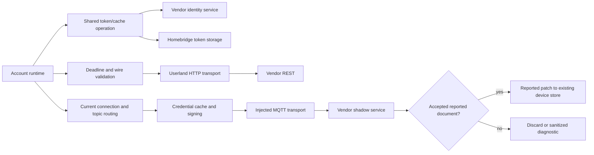

# Phase 2: Cloud Conformance - Research

**Researched:** 2026-10-13
**Domain:** TypeScript cloud source/test conformance and bounded review execution
**Confidence:** MEDIUM — external documentation fallback tier returned by `query classify-confidence --provider websearch --verified`; repository findings have direct source/consumer evidence.

<user_constraints>
## User Constraints (from CONTEXT.md)

The following decisions, discretion, and deferred ideas are copied verbatim from the phase context. [VERIFIED: .planning/phases/02-cloud-conformance/02-CONTEXT.md:18-37,92-94]

<!-- DATA_a47cf280_START -->
### Carry-forward decisions

- **D-01:** Apply the Phase 1 header form to every cloud source/test/helper file: SPDX first, separate copyright and overview JSDoc blocks, one blank line between sections. Original-work copyright is `Copyright (c) 2026 Alessandro Colomba`. Use a brief purpose and essential context; retain license classification and attribution.
- **D-02:** Use the Phase 1 ledger and review protocol. Each finding has a stable ID, rule, location, severity, disposition, and evidence. Reviewers and fixers use the project skills; fixes use atomic passing-hook commits.
- **D-03:** Pause all work for the maintainer if a review round with open findings makes no progress, a fixed finding returns, or round four is reached. Preserve accurate counts and unresolved items. Rejected findings require a reason; a pause or skip is not a fix.
- **D-04:** For each genuine bug, observe an active regression fail against unchanged production. Commit a planning-only record with the complete patch, actual failure command/output, and source commit before the active test and GREEN fix commit. This maintainer-approved sweep policy preserves all hooks. Record negative-control mutations separately and restore them exactly.
- **D-05:** Preserve independent auth caller cancellation, shared request cancellation only after all callers leave, slot ownership through settlement, and no duplicate concurrent grants or automatic retries. Phase 1's verified behavior is the baseline for this sweep.
- **D-06:** Fix confirmed conformance findings at their cause with minimum code. Do not create product features, speculative abstractions, new API integrations, or protocol assumptions. Existing privacy and unknown/stale telemetry rules remain locked.
- **D-07:** Keep each modified source/test pair at 100% direct line/function/branch coverage. Run the full combined-tree gate after waves and at phase end; reuse evidence only for unchanged inputs under local-verification. Do not use live vendor services or real hardware.

### Implementation discretion

Use the rulebooks and caller evidence to select routine fixes and batch boundaries. Re-verify the auth length-only/negative assertions, optional fields, global-fetch default, and test-only filename export. Reject a warning only with source/rule evidence. Trace exact consumers before changing exports or signatures; an export being used in tests alone is not a substitute for checking its intended contract.

No unresolved design preference was identified after scouting the cloud modules. The maintainer selected continuation to Phase 2; discussion does not re-ask settled milestone scope or Phase 1 policy.

## Deferred Ideas

Device/runtime/accessory/root/Cucumber sweeps remain in their own phases. Hardware gates, live vendor runs, and unrelated repository gate-test review remain outside this phase.
<!-- DATA_a47cf280_END -->
</user_constraints>

## Summary

Use four disjoint code batches, then a coordinator-owned combined gate and ledger audit. Give auth and shadow separate batches. Group API/errors/types and transport/signing/ALPN support into two smaller batches. These are scheduling recommendations based on the source inventory, not completed reviews. Source lengths at the researched revision are auth 584, shadow 475, API 197, MQTT transport 206, types 180, signing 87, errors 70, and HTTP dispatcher 39 lines; roadmap estimates predate the auth expansion. [VERIFIED: source files opened this session; `wc -l src/cloud/*.ts test/cloud/*.ts`]

Keep the settled Phase 1 protocol. Research inspected implementation boundaries and seed warnings; execution must review every owned file against the complete rulebooks, fix confirmed findings, and independently re-review. Do not convert this research into an exhaustive finding count or pre-approve unreviewed tests. [VERIFIED: .planning/phases/02-cloud-conformance/02-CONTEXT.md; .planning/phases/01-known-findings-and-loop-proof/01-REVIEW-PROTOCOL.md]

**Primary recommendation:** Assign exclusive file ownership, fail closed on missing HTTP test injection, preserve auth cancellation and reported-only shadow semantics, and keep complete real-hash evidence for any genuine regression. [VERIFIED: skills/typescript-unit-testing/SKILL.md; src/cloud/auth.ts:444-581; src/cloud/shadow.ts:185-202; phase context D-04/D-05]

## Architectural Responsibility Map

| Capability | Primary tier | Secondary tier | Responsibility and evidence |
|---|---|---|---|
| Token reuse, grant ownership, cancellation | Plugin backend | Local token storage | Auth factory owns grant/cache state; each caller waits independently. [VERIFIED: src/cloud/auth.ts:509-583] |
| Request deadlines, sanitization, route validation | Plugin backend | Vendor REST | API obtains token under the operation deadline and validates response before returning. [VERIFIED: src/cloud/api.ts:89-155] |
| Shadow routing, connection ownership, recovery | Plugin backend | Vendor MQTT | Current-connection checks guard notifications; only reported sections enter patches. [VERIFIED: src/cloud/shadow.ts:194-202,388-408] |
| HTTP/MQTT mechanics and signing | Transport adapters | TLS/crypto runtime | Adapters carry explicit dependencies and signing uses Node crypto primitives. [VERIFIED: src/cloud/httpDispatcher.ts:20-39; src/cloud/mqttTransport.ts:156-206; src/cloud/sigv4.ts:37-87] |
| Family telemetry meaning and HomeKit projection | Existing device/accessory tier | Cloud wire guards | Cloud carries opaque telemetry; this phase does not move family validation into transport. [VERIFIED: src/cloud/types.ts:21-25; phase context D-06] |

## Project Constraints (from AGENTS.md)

These directives apply to plans and their execution. [VERIFIED: AGENTS.md, read in full this session]

- Read before editing; trace callers before changing a function; research first. Make minimum changes and preserve existing conventions where rules are silent.
- Use the applicable complete TS style/comment and unit writer/reviewer skills. Keep relative `.js` imports and compiled test layout. Read local-verification before selecting checks.
- Consult official Homebridge/Cucumber documentation only for behavior the fix actually depends on; compare it with installed types and pinned versions. Preserve `api.hap` ownership and the Homebridge constructor contract.
- Work within the active GSD workflow. Reuse this existing feature worktree; do not lose Phase 1 changes. Never commit to main, rebase, rewrite history, amend after a failed hook, or use `--no-verify`.
- Conventional Commit subjects/PR titles are 5–72 characters, body lines at most 80; omit milestone/phase mentions. Run the AGENTS-required `SKIP=npm-check pre-commit run --files <changed files>`, restage fixers until clean, then foreground `git commit`; its actual successful hook is required. Run other hooks without SKIP overrides.
- Run required Fallow guard/consumer/trace/audit probes at their task boundaries. Check live help first, use machine-readable output, and preserve nonzero outcomes. An audit may need permission for its temporary Git worktree; missing permission is not a clean audit.
- Full combined wave/phase/merge and PR/release gates use `npm run check`, including Cucumber and all isolated source pairs. Incremental hooks do not replace them. Reuse only exact unchanged-input evidence.
- Preserve privacy, immutable device identity, token storage location, stale/unknown semantics, mixed licensing, and locked official-control behavior. Hardware release gates do not skip current phase work.
- Every plan SUMMARY includes Threat Flags. Coordinator owns GSD state/windows/roadmap; prefix window descriptions with the milestone. Workers do not hand-edit those records.
- If later creating a PR: use Plain simple-english plus humanizer for its description; offer the specified version/changelog update. Merge PRs with squash; audit/close a shipping milestone before merge. These are later handoff duties, not research actions.

## Standard Stack

Retain installed dependencies and tools; this phase needs no installation or upgrade. The following are observed versions, not registry-latest claims. [VERIFIED: `npm ls --depth=0 --json`; package.json]

| Tool/library | Installed version | Use |
|---|---|---|
| TypeScript | 6.0.3 | Existing strict ESM build |
| Node built-in test/strict assertions | Node 26.11.1 | Existing owner tests and isolated coverage |
| strong-mock | 9.2.2 | Promised interactions, exact parameters, explicit verification |
| undici | 7.29.1 | Existing paired userland fetch/Agent |
| mqtt | 5.16.0 | Existing injected MQTT adapter |
| Fallow | 3.27.0 | Existing consumer, boundary, and changed-code probes |
| Homebridge / Cucumber | 2.4.0 / 13.2.1 | Existing integration types/full gate; no behavior redesign |

Package metadata includes `"node": "^22.10.0 || ^24.0.0 || ^26.0.0"`, whereas PROJECT/AGENTS prose names only 22/24. Preserve installed configuration; recording this discrepancy does not authorize a support-policy edit. [VERIFIED: package.json:29-31; .planning/PROJECT.md Constraints]

## Package Legitimacy Audit

Not applicable: no new external package installation is recommended. Installed-version inventory is not a package-legitimacy approval or a reason to update dependencies. [VERIFIED: phase context D-06; package.json]

## Architecture Patterns



The diagram describes the existing call/data flow. Commands stay on REST; shadow requested state never becomes safety state. [VERIFIED: src/runtime/accountRuntime.ts:1240-1268; src/cloud/api.ts:185-195; src/cloud/shadow.ts:259-280; src/cloud/shadow.ts:185-202]

### Scoped inventory and exclusive batch ownership

The inventory below contains all eight existing source/test pairs and the helper. Paths are observed source/test files, not new generated-path promises. [VERIFIED: files opened/inspected this session; `rg --files src/cloud test/cloud`]

| Batch | Source | Paired test | Planning risk / exact callers |
|---|---|---|---|
| A: Auth | `src/cloud/auth.ts` | `test/cloud/auth.test.ts` | Grant/cache cancellation, filesystem bytes, seed warnings; runtime factory calls auth. |
| B: Shadow | `src/cloud/shadow.ts` | `test/cloud/shadow.test.ts` | Old-connection events, pending subscriptions, reported patch shape; runtime factory wires callbacks. |
| C: REST/wire/errors | `src/cloud/api.ts` | `test/cloud/api.test.ts` | Deadlines encompass auth; exactly-once commands and sanitized failures. |
| C | `src/cloud/types.ts` | `test/cloud/types.test.ts` | Wire normalization and shared type consumers; guard layer is not family decoding. |
| C | `src/cloud/errors.ts` | `test/cloud/errors.test.ts` | Typed error fields used by auth/API/runtime; preserve discrimination. |
| D: Transports/signing | `src/cloud/httpDispatcher.ts` | `test/cloud/httpDispatcher.test.ts` | Preserve fetch/Agent pairing, injected interface, local ALPN proof. |
| D | `src/cloud/mqttTransport.ts` | `test/cloud/mqttTransport.test.ts` | Callback deadlines, timer cancellation, forced end before connected. |
| D | `src/cloud/sigv4.ts` | `test/cloud/sigv4.test.ts` | Exact URL/signature bytes; preserve signing behavior. |
| D only | — | `test/cloud/alpnServer.ts` | Shared helper used by auth, API, HTTP tests. No new helper meta-test. |

Own auth 584/1301 and shadow 475/992 line source/test pairs independently. C owns 447/1135 lines; D owns 332/611 plus 128 helper lines. These sizes guide batch scope; findings can require multiple atomic commits within a batch. [VERIFIED: `wc -l` inventory]

Independent reads/reviews may overlap. In this shared checkout, the coordinator serializes builds, source mutations, staging, hooks, commits, and ledger writes. D alone edits the ALPN helper; dependent A/C tests use the stable helper until its edit and rebuild finish. Do not give reviewers or fixers concurrent ledger ownership. Copy Phase 1's round accounting and all-work pause behavior. [VERIFIED: 01-REVIEW-PROTOCOL.md Critical sections/Review rounds; phase context D-02/D-03]

### Exact consumer evidence

- Auth/API/MQTT/shadow are composed in the account runtime; the factory passes fetch/clock/storage, creates the cloud API, and provides MQTT transport creation. Preserve those public signatures unless a confirmed finding requires a narrow change. [VERIFIED: src/runtime/accountRuntime.ts:1240-1268]
- Fallow production type-aware impact for ApiDevice reports API, device state, and account runtime as its three direct type consumers. A shared type change therefore needs consumer typecheck and their applicable evidence; cloud pair coverage alone cannot prove consumer compatibility. [VERIFIED: complete Fallow `--symbol-impact src/cloud/types.ts:ApiDevice`, this session]
- FailurePolicy is private: Fallow symbol-impact returned exit 2 with `export or class method 'FailurePolicy' not found in 'src/cloud/auth.ts'`. This is unavailable analysis, not a no-consumer result. Direct source reads show initialization, checks, writes, and clearing all stay in auth. [VERIFIED: src/cloud/auth.ts:120-123,317-354,510,548-549; observed probe output]
- Filename impact with the production tsconfig reports no consumers; the same query with `--type-aware-project tsconfig.test.json` is complete and reports four: auth test, platform test, authentication steps, and real-pump World support. The broad trace confirms those four named imports. [VERIFIED: complete Fallow probes this session; test/cloud/auth.test.ts:22,153-154; test/platform.test.ts:820; features/support/steps/authentication.ts:14,64-67; features/real-pump/support/realWorld.ts:207-213]

## Seed WARNING Revalidation

These are planning dispositions, not final ledger closure. Review/fix/re-review evidence remains execution work. [VERIFIED: phase context Implementation discretion]

| Seed warning | Current evidence | Required task/disposition |
|---|---|---|
| Auth length-only request assertions | Existing token assertions precede count checks at 325–386; count checks distinguish grant deduplication but omit exact request content. | Review each site against the actual promise. Compare a complete independently expected request record where request content is promised; preserve meaningful deduplication observations. Do not label every length access a bug. [VERIFIED: test/cloud/auth.test.ts:325-386; unit-testing-review Assertions/Test doubles] |
| Negative privacy includes assertions | The privacy case only checks two absent substrings and one present token. | Replace with complete expected cache bytes/record as the consumer contract permits; use an independently built expectation. Keep temporary-file exclusive-write proof. Assertion strengthening uses negative-control evidence, not invented production RED. [VERIFIED: test/cloud/auth.test.ts:758-771; unit-testing Assertions; phase context D-04] |
| Auth optional fields | Current definitions are `haltedReason: string | undefined;` and `lastTransient: string | undefined;`; clear assigns explicit undefined. | Convert private policy members to true optional fields, initialize an empty policy, and remove the transient property on recovery. Trace all local sites and run typecheck. This preserves absence semantics without widening a shared public type. [VERIFIED: src/cloud/auth.ts:120-123,324-332,354,510,548-549] |
| Global fetch default | Current helper has `httpFetch: (input, init) => globalThis.fetch(input, init),`. | Make default test HTTP fail closed; explicitly inject each case's canned/controlled fetch. Keep real HTTP adapter proof only against case-owned loopback. Do not rely on a remembered global stub to prevent network. [VERIFIED: test/cloud/auth.test.ts:126-140,157-172; unit-testing Hermeticity/Production design] |
| Test-only filename export | Definition is `export const TOKEN_CACHE_FILENAME = '.basement-guardian-token.json';`; production creates that location through cachePath and storeCache. Four support/test consumers depend on it. | Decide by intended contract and record evidence. See tradeoff below; test use alone does not resolve the warning. [VERIFIED: src/cloud/auth.ts:77-78,141-142,241-264] |
| Headers | Auth pair already has the settled form; other source/test/helper openings do not consistently have it. | Inspect and record all 17 files, including helper/test headers the source-only license gate cannot prove. Apply missing form without changing SPDX classification. [VERIFIED: opened cloud file beginnings; 01-VALIDATION.md Four-file header inspection] |

### Filename retain/remove tradeoff

Prefer removal if the executor confirms the filename export exists only to give tests privileged knowledge. Make it private, let expectations name the stable filesystem contract independently, and explicitly assign the three additional consumers to the auth batch for surgical import/expectation changes. Preserve the on-disk name: `.basement-guardian-token.json`. This is a bounded consumer edit, not permission to sweep platform/Cucumber code now. The cost is broadened changed-input coverage and an all-pair commit selector when feature TS changes. [VERIFIED: src/cloud/auth.ts:77-78,141-142,241-264; unit-testing Production design; scripts/test-coverage-direct.mjs:112-121]

Retaining is valid only with a concrete intended production/public contract rationale and evidence-backed rejection of the test-only-export finding. Existing use proves dependency, not purpose. Retaining avoids consumer churn but leaves the warning unresolved until that rationale is recorded. Do not add a getter or new production persistence module solely to hide a test hook. [VERIFIED: unit-testing-review Production design; phase context Implementation discretion]

## Don't Hand-Roll

| Problem | Use existing mechanism | Why |
|---|---|---|
| Review convergence/evidence | Phase 1 protocol and ledger | Carries real hashes, exact counts, pause rules, and accepted RED history. [VERIFIED: 01-REVIEW-PROTOCOL.md] |
| HTTP default in tests | Explicit typed dependency with fail-closed default | Offline rule excludes live fallback. [VERIFIED: unit-testing Types and hermeticity] |
| Assertion interactions | Strict strong-mock where calls are the promise; plain stubs otherwise | Do not turn canned-response stubs into incidental call-count mocks. [VERIFIED: unit-testing Test doubles] |
| Timer teardown | Test-context mocks and existing injected clocks | Test runner restores context mocks; no process-wide trackers/reset exports. [CITED: https://nodejs.org/api/test.html#mocking] |
| Crypto primitives | Existing Node createHash/createHmac | Scope is conformance, not replacement signing stack. [VERIFIED: src/cloud/sigv4.ts:37-53; phase context D-06] |

## Common Pitfalls

1. **Blind optional conversion.** The compiler enables `"exactOptionalPropertyTypes": true`; a question-mark property does not automatically allow assignment of undefined. Read clear/init sites and shared shape builders before editing. [VERIFIED: tsconfig.json:8-9; src/cloud/auth.ts:332,510] [CITED: https://www.typescriptlang.org/tsconfig/exactOptionalPropertyTypes.html]
2. **Production-only trace mistaken for whole-project trace.** Tests/features are included by `"include": ["src", "test", "features"]` in the test config. The filename probe demonstrated why both configs matter. [VERIFIED: tsconfig.test.json:8; complete Fallow output this session]
3. **Transport documentation drift.** Current undici site serves version 8 documentation; use the fetched 7.29.1 tag and installed declarations. The installed declarations contain `allowH2?: boolean;` and `dispatcher?: Dispatcher`; preserve the current explicit HTTP/1.1 transport. Do not infer universal cross-major fetch incompatibility solely from comments. [VERIFIED: node_modules/undici/types/client.d.ts:85-89; node_modules/undici/types/fetch.d.ts:142-146; src/cloud/httpDispatcher.ts:28-39] [CITED: https://raw.githubusercontent.com/nodejs/undici/v7.29.1/docs/docs/api/Client.md]
4. **Convenience tests hide defects.** Compare whole public results, exact bytes where bytes are the contract, and structured errors. Use independent expected values. Comments/titles describe behavior, not prior fixes or planning artifacts. [VERIFIED: complete unit-testing/style/comment rulebooks]
5. **Changing connection behavior as style cleanup.** Shadow owns current-connection identity and MQTT factory currently opens a handshake on creation. Review the constructor/lifecycle rule against this explicit existing contract; any redesign must be a confirmed scoped cause, traced through callers, and tested. Do not silently move networking or change ordering to satisfy a generic rule. [VERIFIED: src/cloud/mqttTransport.ts:149-169; src/cloud/shadow.ts:415-442; phase context D-06]
6. **False RED/full pass.** Local listener EPERM, missing build output, unrelated failure, zero tests, canceled runner, timeout, or failed hook are not passing evidence or intended RED. Stop conditions apply to all batches. [VERIFIED: 01-REVIEW-PROTOCOL.md; phase context D-03/D-04]

## Code Examples

The private policy replacement below is a recommended minimal adaptation of read source. Existing member names are quoted verbatim above; the optional spelling is proposed, not an assertion that it already exists. The compiler's semantics are documented by TypeScript. [VERIFIED: src/cloud/auth.ts:120-123,324-332,510] [CITED: https://www.typescriptlang.org/tsconfig/exactOptionalPropertyTypes.html]

```ts
interface FailurePolicy {
  haltedReason?: string;
  lastTransient?: string;
}
const policy: FailurePolicy = {};
// Existing recovery branch removes the optional transient member.
delete policy.lastTransient;
```

Default a test transport to a function that throws a fixed synthetic error, then explicitly supply the case's transport through the existing httpFetch option. This is recommended implementation guidance from the project's offline/no-live-default rules, not a new production API. Return a fresh Response for every fake request; retain controlled cancellation behavior. [VERIFIED: unit-testing Types and hermeticity/HTTP adapters; src/cloud/auth.ts:90-91]

## Runtime State Inventory

This phase is a conformance refactor; preserve existing identities/paths/configuration. The inventory scopes migration risk and does not claim to inspect the maintainer's live environment. [VERIFIED: phase context D-06]

| Category | Evidence / action |
|---|---|
| Stored data | Token cache writes the unchanged filename under injected storage. No cache format/name migration planned. Keep existing account fingerprint and permissions behavior. [VERIFIED: src/cloud/auth.ts:141-142,241-264] |
| Live service config | No change to vendor endpoints or account configuration is authorized. Live vendor configuration was not inspected; no live patch needed for the scoped recommendations. [VERIFIED: phase context D-06/D-07] |
| OS-registered state | No registration rename is proposed. OS state was not inventoried; this phase changes no launch/bridge registration contract. [VERIFIED: phase context Phase Boundary] |
| Secrets/env vars | Preserve existing injected credentials and redaction. No secret/env rename is proposed; private credential stores were not read. [VERIFIED: src/cloud/auth.ts:80-99; phase context D-06] |
| Build artifacts | Rebuild compiled tests after edits; never run stale compiled owners. Test build configuration says `"outDir": "dist-test"`; coverage compiler mapping returns `dist-test/${file.slice(0, -3)}.js`. [VERIFIED: tsconfig.test.json:3-6; scripts/test-coverage-direct.mjs:35-36] |

## Validation Architecture

Enabled by both workflow validation and security settings. Retain Node test runner, tsconfig.test.json, the mirrored eight owner modules, and local-verification scheduling. No scaffold is missing. [VERIFIED: .planning/config.json; package.json scripts; opened inventory]

| Property | Command / requirement |
|---|---|
| Compile | `npm run build:test` |
| Focused owner | `node --test dist-test/test/cloud/<module>.test.js` |
| Isolated coverage | `npm run test:coverage:direct -- src/cloud/<module>.ts test/cloud/<module>.test.ts` |
| Already compiled isolated coverage | `npm run test:coverage:direct:compiled -- src/cloud/<module>.ts test/cloud/<module>.test.ts` |
| Header gate | `node --test dist-test/test/packaging/licenseHeaders.test.js` plus explicit inspection of all test/helper headers |
| Full combined gate | `npm run check` |

The package defines `"build:test": "rimraf ./dist-test && tsc -p tsconfig.test.json"`, `"test:coverage:direct": "npm run --silent build:test && node scripts/test-coverage-direct.mjs"`, and `"test:coverage:direct:compiled": "node scripts/test-coverage-direct.mjs"`. These prove compiled path/selector behavior. [VERIFIED: package.json:35,51,54; scripts/test-coverage-direct.mjs:35-36,64-85]

| Requirement | Behavior / test type | Exact automated owner command | Existing |
|---|---|---|---|
| CLOUD-01 | Auth cache/grant/cancellation, unit + local adapter | `node --test dist-test/test/cloud/auth.test.js` | Yes |
| CLOUD-01 | Shadow routing/connection/patch, unit | `node --test dist-test/test/cloud/shadow.test.js` | Yes |
| CLOUD-01 | REST request/error/deadline, unit + local adapter | `node --test dist-test/test/cloud/api.test.js` | Yes |
| CLOUD-01 | Wire validation/normalization, unit | `node --test dist-test/test/cloud/types.test.js` | Yes |
| CLOUD-01 | Error classes/fields, unit | `node --test dist-test/test/cloud/errors.test.js` | Yes |
| CLOUD-01 | HTTP request/ALPN, local integration | `node --test dist-test/test/cloud/httpDispatcher.test.js` | Yes |
| CLOUD-01 | MQTT callbacks/deadlines/end, unit | `node --test dist-test/test/cloud/mqttTransport.test.js` | Yes |
| CLOUD-01 | Signing bytes, unit | `node --test dist-test/test/cloud/sigv4.test.js` | Yes |
| PROC-03 applied | Header preservation, gate + manual | `node --test dist-test/test/packaging/licenseHeaders.test.js` | Yes |
| BUG-01 applied | Intended regression RED and source/evidence/fix ancestry | `node .codex/gsd-core/bin/gsd-tools.cjs check tdd-red-evidence <record.json> --raw` plus actual Git objects/paths | Add only for discovered bug |

Commands/path mappings come from the script/compiler rules quoted above; coverage uses the corresponding source/test arguments for each of the eight module stems. Require each pair alone at 100% lines/functions/branches; aggregate coverage cannot close a pair. Shared ALPN helper or feature-support edits select all pairs for the staged commit hook. Keep that potentially expensive commit critical section separate from parallel reads. [VERIFIED: unit-testing Pairing and coverage; scripts/test-coverage-direct.mjs:112-121]

**Sampling:** compile and owner after edits; isolated pair coverage before code completion; required pre-commit and foreground hook per commit; full check after combined wave and at phase gate. Plan findings/rounds/header completeness and real evidence ancestry also need manual review. No assumption is made that compilation/full coverage fits a 30-second command. [VERIFIED: local-verification; 01-REVIEW-PROTOCOL.md]

**Wave 0 gaps:** no framework/package setup; create coordinator-owned findings/round inventory and batch records by copying Phase 1's structure. Research creates none of those shared records. Apply confirmed assertion/default/export fixes during execution, with independent reviews. [VERIFIED: phase context D-02; existing inventory]

**Reusable baseline:** Phase 1 validation records full gate exit 0, 104 scenarios/1156 steps, all 43 isolated pairs, at source commit 218ab0cac702c5699ced277aaf499fe5f5194d54 on Node v26.11.1, log `/private/tmp/guardian-phase1-full-check.log`. Research at 2592a7e55f052710f68a5877180aace4ac04fd52 found no source/test/features/dependency/compiler/tool/script changes and no untracked executable inputs; only planning state differs. No broad tests were repeated for research. After any build-input edit, that baseline cannot prove the changed tree. [VERIFIED: 01-VALIDATION.md Measured commands/reuse evidence; session git diff/status probes]

## Environment Availability

| Dependency | Observed availability/version | Use / fallback |
|---|---|---|
| Node/npm | v26.11.1 / 11.20.0 | Existing test/build runtime; observed command output |
| pre-commit | 4.5.1 | Mandatory hooks; observed command output |
| Fallow | 3.27.0 | Installed signed local binary; probes completed |
| OpenSSL | 4.0.3 | Existing helper's case-owned certificate generation; observed version |
| Loopback listen | Baseline passed; sandbox can refuse listening | Request execution permission if needed; EPERM is environmental, never RED |
| Context7 / ctx7 | No matching callable MCP tools; CLI command not found | Official web documentation used; no package installed |
| Vendor/hardware | Not used | Synthetic fixtures and case-owned loopback only |

Environment versions are observations, not compatibility claims about untested runtimes. [VERIFIED: session command probes; 01-VALIDATION.md; test/cloud/alpnServer.ts:24-54,101-103]

## Security Domain

Security enforcement is enabled. The requested V2–V6 numbering below explicitly uses ASVS 4.0.3, not an implicit claim about newer numbering. Official tagged category index verified the taxonomy; controls here are scoped engineering checks, not certification. [VERIFIED: .planning/config.json] [CITED: https://github.com/OWASP/ASVS/tree/v4.0.3/4.0/en]

| ASVS category | Applies | Existing standard control to preserve |
|---|---|---|
| V2 Authentication | Yes, cloud client | Independent grant waiters; refusal/throttle policy; no duplicate grants |
| V3 Session Management | Token lifecycle | Expiry/renewal, redaction registration, private cache |
| V4 Access Control | Client scope, no new server authorization | Fixed route/topic surface and opaque device path encoding |
| V5 Validation | Yes | Unknown wire values narrowed before use; reported-only patch |
| V6 Cryptography | Yes | Node crypto primitives, existing signing behavior, secret exclusion |
| V8 Data Protection / V9 Communication | Yes | Owner-only atomic cache and existing TLS transport |

The controls above map to auth, API, wire guard, signing, and transport code read this session. [VERIFIED: src/cloud/auth.ts:241-264,410-438,521-581; src/cloud/api.ts:73-75,102-155; src/cloud/types.ts:104-180; src/cloud/shadow.ts:194-202; src/cloud/sigv4.ts:37-87]

| Threat pattern | STRIDE | Planning mitigation |
|---|---|---|
| Cache/token/raw response disclosure | Information disclosure | Preserve exclusive owner-mode writes, sanitized errors, fixed diagnostic messages, exact privacy expectations. |
| Stale connection or requested state overwrites reported safety state | Tampering | Keep current-connection checks and reported-only patches; test observable store-bound callbacks. |
| Grant/retry storms or stranded operations | Denial of service | Preserve shared slot until settlement, independent caller cancellation, transport deadlines, retry ownership, teardown. |
| Hidden live fetch in tests | Information disclosure / unintended external action | Fail-closed test default and explicit typed transport per case. |

Threats are review targets grounded in existing control boundaries, not newly discovered vulnerabilities. [VERIFIED: cited controls above; unit-testing Hermeticity; phase context D-05/D-06]

## State of the Art

This phase follows existing repository policy: test-context mocks instead of process-wide state, injected offline boundaries instead of live defaults, per-pair coverage instead of aggregate proof, and evidence-first bug history instead of phase-subject parsing. No framework modernization or package replacement is recommended. [VERIFIED: complete rulebooks; phase context D-04/D-07; 01-REVIEW-PROTOCOL.md]

## Assumptions Log

No new product/protocol/compatibility assumption is proposed. Existing source comments containing protocol assumptions remain locked background; this conformance research does not revalidate or expand them. Final reviewers must ground their own findings. [VERIFIED: phase context D-06; src/cloud/auth.ts:503-507; src/cloud/shadow.ts:205-212]

## Open Questions

1. **RESOLVED — planning responsibility:** Plan 02-01-02 authorizes the executor's routine cause assessment of the filename export under D-06. Complete four-consumer evidence and the retain/remove tradeoff above define both bounded outcomes: remove privileged test knowledge with the narrow consumer edits, or retain it with concrete intended production/public-contract evidence. The executor records the evidence-backed disposition; this planning resolution chooses neither outcome and closes no finding.
2. **RESOLVED — execution responsibility:** Full-file conformance counts, discovered bugs, negative-control targets and final round outcomes are outputs of the planned independent reviews in 02-01 through 02-04 and the evidence audit in 02-05. They are planned execution work rather than unanswered research questions. Their actual results remain pending; research does not assert zero findings or close any execution outcome.

These remaining tasks follow the locked review/discretion contract. [VERIFIED: phase context Implementation discretion/D-02/D-06]

<phase_requirements>
## Phase Requirements

| ID | Description | Research support |
|---|---|---|
| CLOUD-01 | `src/cloud/**` and `test/cloud/**` conform. | Complete 17-file inventory, four disjoint batches, seed revalidation, exact caller boundaries, owner/direct/full validation and review stop contract. |

Description copied from the requirement definition. Cross-phase process and bug obligations remain applicable without prematurely completing milestone gate requirements. [VERIFIED: .planning/REQUIREMENTS.md Conformance/Traceability]
</phase_requirements>

## Sources and Metadata

- Repository primary evidence: all eight cloud sources; cloud test/helper inventory and relevant seed cases; account composition; all four filename consumers; AGENTS, PROJECT, CONTEXT, ROADMAP, REQUIREMENTS, seed findings, Phase 1 review/validation records; complete applicable rulebooks and installed Fallow skill. [VERIFIED: files read this session]
- TypeScript exact optional property semantics: [official TSConfig page](https://www.typescriptlang.org/tsconfig/exactOptionalPropertyTypes.html). [CITED: www.typescriptlang.org/tsconfig/exactOptionalPropertyTypes.html]
- Node context mocks and cancellation: [test runner](https://nodejs.org/api/test.html#mocking), [AbortSignal](https://nodejs.org/api/globals.html#static-method-abortsignalanysignals); installed node declarations opened at test.d.ts:1308-1311,2176-2241. [CITED: nodejs.org/api/test.html; nodejs.org/api/globals.html]
- Undici pinned behavior: [7.29.1 Client docs](https://raw.githubusercontent.com/nodejs/undici/v7.29.1/docs/docs/api/Client.md), plus opened installed client/fetch/agent declarations. Current site shows v8.10.0, so pinned sources govern this phase. [CITED: raw.githubusercontent.com/nodejs/undici/v7.29.1/docs/docs/api/Client.md] [VERIFIED: installed declaration reads]
- ASVS taxonomy: [tagged 4.0.3 category index](https://github.com/OWASP/ASVS/tree/v4.0.3/4.0/en). [CITED: github.com/OWASP/ASVS/tree/v4.0.3/4.0/en]

Research-plan input was written to a private temporary file; seam selected Context7 for three API questions and websearch for ASVS. No Context7/ctx7 was available, so official web sources were fetched. The classifier returned MEDIUM for verified websearch and LOW for unrecognized webfetch/codebase provider identifiers; local provenance therefore identifies actual source reads instead of pretending a provider classification. No shared research-store, state, source/test, or Git mutation was made: the orchestrator explicitly restricted this agent to research output. [VERIFIED: research-plan/classify-confidence/probe outputs; task authorization]

**Confidence:** stack and caller facts are directly observed; external API guidance is MEDIUM; final conformance outcomes are intentionally pending. **Validity:** recheck after any source/test/dependency/rulebook/runtime change; no registry-latest or release compatibility conclusion is implied. [VERIFIED: local-verification unchanged-input policy]
