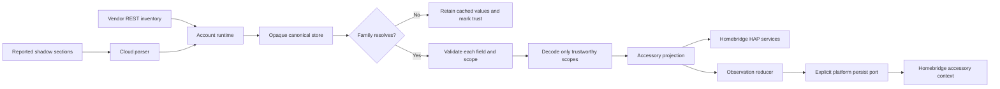

# Phase 03: Device and Persistence Conformance - Research

**Researched:** 2026-10-14
**Domain:** TypeScript device contracts, scoped decoding, immutable snapshots and typed Homebridge persistence
**Confidence:** MEDIUM

<user_constraints>
## User Constraints (from CONTEXT.md)

The following decision, discretion and deferred blocks are copied verbatim from the current context. [VERIFIED: .planning/phases/03-device-and-persistence-conformance/03-CONTEXT.md:21-87,176-185]

DATA_936d08bf_START
### Carry-forward decisions

- **D-01:** Apply the approved header to every source/test/helper touched:
  SPDX first, separate copyright and overview JSDoc blocks, one blank line
  between sections. Original-work copyright is Copyright (c) 2026 Alessandro
  Colomba. Keep a brief purpose and essential context; preserve license and
  attribution, including existing template-derived boundaries.
- **D-02:** Use stable finding IDs, exact rules, revision-qualified locations,
  severity, disposition and actual test/commit evidence in a phase ledger.
  Full-file reviewers and cause fixers use the complete project rulebooks.
  Each cause fix is atomic and passes the required pre-step and normal hooks.
- **D-03:** Pause ALL work if an independent correction round with open findings
  does not reduce the open count, a previously fixed finding reopens, or round
  four is reached, even if clean. Report accurate IDs/counts before any further
  repair or dispatch. A new cause never resets an existing batch's counter.
  Tracer checks and initial clarifications are not correction rounds.
- **D-04:** For a genuine bug, observe an active intended regression failure
  against unchanged production. Commit planning-only complete patch/native
  output/command/exit/source-commit/version evidence BEFORE the minimum GREEN
  production and active-test commit. This is the maintainer-approved sweep
  policy. Preserve every earlier record and actual Git ancestry. No failing
  code commit, hidden/skipped regression or hook bypass. Assertion controls
  are separate and restore exact source bytes before rebuilt GREEN.
- **D-05:** Preserve the locked safety and identity contracts: opaque canonical
  telemetry, current reported-only patches, monotonic watermark behavior,
  immutable public snapshots, narrow invalid-scope trust, last valid values,
  deviceId physical identity, deviceTypeId adapter selection, and distinct
  local/device clocks. Keep persisted observations and invalid-record recovery
  semantics. No new family meaning, fallback normal state or persistence
  migration is inferred from a type/style change.
- **D-06:** Fix confirmed findings at their cause with minimum code. Trace exact
  consumers before changing shared/exported types, names or signatures. An
  owning plan includes narrowly required external consumer edits in its wave;
  those edits do not imply a completed later subsystem sweep. Re-verify
  undefined/optional and readonly warnings against actual public shape,
  exhaustiveness and mutation contracts before choosing a repair or rejection.
  Preserve privacy, opaque identity, existing features and ADR-locked behavior.
- **D-07:** Every modified source/test pair alone keeps 100% direct lines,
  functions and branches. Run the full combined gate after waves and at phase
  end; reuse only exact unchanged inputs under local-verification. Serialize
  build output, mutation experiments, shared helpers, Git and shared records.
  Use offline synthetic inputs; no live vendor or hardware runs or installs.

### Implementation discretion

The rulebooks and exact caller evidence determine routine cause fixes and
batch ownership. State and Gemini may each own a batch; group the smaller
modules without splitting a shared-type repair across concurrent owners.
Research/planning chooses the dependency order and tracer slices. Reused fresh
test seeds belong to their concern module when the rulebook requires it; any
new helper joins the reviewed/header inventory and broad staged selector.

The seed review's six state WARNING categories remain candidates, not automatic
findings: optional fields, snapshot readonly members, missing/implementation
JSDoc, the value named data, in-case rationale comments, and length/single-field
assertions. Preserve SC-03's verified whole snapshots, frozen-shape presence
checks and canonical store reads after refused patches. A confirmed reopening
triggers D-03; merely re-reading that file is not a new defect.

No new product preference is unresolved. The original all-remaining-phases
request authorizes continuation; Phase 2's three human decisions are bounded
to Phase 2 and do not preapprove Phase 3 taxonomy or prohibition judgments.
DATA_936d08bf_END

### Deferred Ideas (OUT OF SCOPE)

DATA_08c543ac_START
Runtime, accessory, root and Cucumber whole-subsystem sweeps remain in Phases
4–7, except narrow consumers required by an owned repair. Phase 8 performs
the final whole-repository review and milestone bug audit. Hardware/release
gates, new family adapters or alert mappings, existing product proposals,
live vendor runs and unrelated repository gate-test reviews stay outside.
DATA_08c543ac_END
</user_constraints>

## Summary

Use three serial implementation batches and a final coordinator audit. Review every owned file before triage; repair one confirmed cause per commit. Research observations below are candidates, not accepted findings. The phase context requires complete review of nine pairs and preservation of all locked behavior. [VERIFIED: .planning/phases/03-device-and-persistence-conformance/03-CONTEXT.md:10-14,23-68]

The largest risk is changing a shared type to satisfy a style warning while changing the public contract. Required members that can hold undefined, runtime-frozen snapshots, and mutable persisted observations have different purposes. Preserve those differences. Exact consumer analysis and the opened definitions support the boundaries below. [VERIFIED: src/device/state.ts:24-63,181-188; src/device/family.ts:141-165; src/accessories/pumpRecords.ts:204-206,249-258,269-313]

**Primary recommendation:** Complete state first, then family/Gemini/water-level, then the remaining small modules and persistence; serialize all executable work and finish with the combined gate. This is a planning recommendation within D-06/D-07, not a new product decision. [VERIFIED: .planning/phases/03-device-and-persistence-conformance/03-CONTEXT.md:51-82]

## Architectural Responsibility Map

| Capability | Primary tier | Secondary tier | Rationale and evidence |
| --- | --- | --- | --- |
| Opaque discovery/report reconciliation | Backend device store | Cloud parser and account runtime | The store merges records and versions without decoding telemetry; runtime feeds discoveries and reports. [VERIFIED: src/device/state.ts:153-160,215-288,354-374; src/runtime/accountRuntime.ts:393-425,825-866] |
| Family validation, scope decoding and command construction | Backend family adapter | Accessory projection and runtime command port | Adapter selects valid groups; accessory preserves values for absent groups; runtime asks the selected family for the command. [VERIFIED: src/device/gemini.ts:219-222,360-402; src/accessories/basementGuardian.ts:988-1057; src/runtime/accountRuntime.ts:253-261] |
| Physical identity and profile lookup | Backend platform and registry | Homebridge accessory cache | UUID generation uses device identity; profile lookup governs family selection separately. [VERIFIED: src/platform.ts:282-305; src/device/registry.ts:51-70] |
| Observations and watermark persistence | Homebridge-owned storage | Accessory observation reducer and platform persist port | Reducer mutates typed records and requests persistence; platform calls the Homebridge update API. [VERIFIED: src/accessories/pumpRecords.ts:249-258,269-313,318-349; src/platform.ts:126-155] |
| Trust and last valid measurements | Accessory projection | Family validation and runtime freshness | Scope validity, freshness and publication are distinct responsibilities. Do not move clock policy into family decoding. [VERIFIED: src/device/family.ts:141-165; src/accessories/basementGuardian.ts:1022-1057; test/device/gemini.test.ts:538-551] |

## Project Constraints (from AGENTS.md)

The following directives are mandatory. The research assignment is already inside the parent GSD planning workflow. The researcher writes only this document and does not commit; the coordinator owns Git and shared records. [VERIFIED: AGENTS.md:9-63,125-135; parent assignment]

- Read every file before editing; trace callers before changing a function; research before edits. Use minimum cause fixes and preserve surrounding style. [VERIFIED: AGENTS.md:11; user-provided behavioral instructions]
- Consult applicable primary Homebridge/Cucumber documentation when their behavior matters. Compare it with pinned packages and installed definitions; record differences and follow the pinned contract. [VERIFIED: AGENTS.md:13-20]
- Never commit to main. Use approved branch names and the existing feature checkout for this phase. Do not rebase, rewrite history, amend after failed hooks, or bypass hooks. Use Conventional Commits with 5–72-character titles and body lines at most 80 characters; omit GSD milestone/phase language. [VERIFIED: AGENTS.md:22-34; skills/local-verification/SKILL.md:17-23]
- Before each commit, run the required SKIP=npm-check pre-commit pre-step, restage fixes, and repeat until clean. Then commit in the foreground with normal hooks. Other hook invocations have no SKIP override. [VERIFIED: AGENTS.md:28-31]
- Preserve the license boundary and attribution. Original work gets the approved separate SPDX/copyright/overview sections. Independently inspect tests and helpers, beyond the source-only license gate. [VERIFIED: AGENTS.md:51-55; LICENSE:1-10; test/packaging/licenseHeaders.test.ts:93-101; phase context D-01]
- Read full style/comment rulebooks for every TypeScript file, both writer/reviewer rulebooks for unit tests, and Cucumber rules plus feature instructions for any narrowly necessary feature edits. Preserve relative .js imports and compiled tests. [VERIFIED: AGENTS.md:47-55]
- Run checks at local-verification scope. Modified pairs require isolated complete lines/functions/branches; every combined wave and phase gate requires npm run check. Reuse only exact unchanged same-session inputs. [VERIFIED: AGENTS.md:57-59; skills/local-verification/SKILL.md:7-34]
- Keep immutable device identity, family-neutral opaque telemetry, last valid values, narrow trust loss, typed context and explicit persistence. Keep private material out of logs and committed artifacts. Use only Homebridge-provided HAP objects at runtime. Do not infer a new persistence migration or vendor meaning. [VERIFIED: AGENTS.md:75-84; phase context D-05/D-06]
- Prefix WINDOWS append descriptions with the milestone; do not edit that ledger manually. Every plan SUMMARY includes Threat Flags, even when none. [VERIFIED: AGENTS.md:36-45]
- Before a PR, offer the specified version bump; maintain CHANGELOG. Use the specified prose skills for PR text. Squash PR merges; audit/close the milestone before its shipping merge. These are later handoff obligations, not research edits. [VERIFIED: AGENTS.md:32-34,61-63]
- Use Fallow guard before file changes, exact symbol-impact before shared symbol refactoring, trace before export/file/dependency deletion, and audit against a recorded base before commits/PRs. Use trace for module reachability, health for ownership/hotspots/coverage gaps, dupes trace for consolidation, flags for feature flags, security for candidates, and explain for finding rationale when those actions apply. Preserve raw exits and semantic completeness; no telemetry opt-in or remote configuration authorization. [VERIFIED: AGENTS.md:151-169; node_modules/fallow/skills/fallow/SKILL.md:39-60]

The current package declares a broader Node range than AGENTS' embedded project summary. Verbatim current declaration: `"node": "^22.10.0 || ^24.0.0 || ^26.0.0"`. Record this existing difference; changing support policy is outside this phase. [VERIFIED: package.json:29-32; AGENTS.md:77]

<phase_requirements>
## Phase Requirements

| ID | Description | Research support |
| --- | --- | --- |
| DEV-01 | `src/device/**`, `src/persistence/**`, and their tests conform. | Nine-pair full-file inventory, six explicit state-warning dispositions, exact type consumers, serial ownership, meaningful owner/pair commands, independent convergence and final combined gate. |

The description is copied from REQUIREMENTS. PROC-01, PROC-02, BUG-01 and the isolated coverage/header policies apply to this phase too. [VERIFIED: .planning/REQUIREMENTS.md:1-110; .planning/ROADMAP.md:89-100]
</phase_requirements>

## Standard Stack

### Existing core and supporting tools

Keep installed versions; install no package and change no dependency. This is conformance work, not ecosystem selection. The table reports observed installed versions, not latest registry releases or new package endorsements. [VERIFIED: phase context D-07; opened package manifests]

| Tool | Observed version | Purpose and provenance |
| --- | --- | --- |
| Node.js | v26.11.1 | Current host runtime, observed with node --version. node:test and node:assert/strict are required by the rulebook. [VERIFIED: runtime probe; skills/typescript-unit-testing/SKILL.md:10-24] |
| TypeScript | 6.0.3 | Installed compiler; verbatim `"version": "6.0.3"`. [VERIFIED: node_modules/typescript/package.json:1-6] |
| Homebridge | 2.4.0 | Installed API/types; verbatim `"version": "2.4.0"`. [VERIFIED: node_modules/homebridge/package.json:1-7] |
| strong-mock | 9.2.2 | Existing strict interaction mock when a promised interaction requires one; verbatim `"version": "9.2.2"`. [VERIFIED: node_modules/strong-mock/package.json:1-4; skills/typescript-unit-testing/SKILL.md:131-145] |
| Fallow | 3.27.0 | Installed exact-symbol analysis; CLI version and signed verification observed. Declaration `"fallow": "3.27.0"`. [VERIFIED: package.json:73; Fallow CLI probe] |
| Cucumber | 13.2.1 | Existing combined behavioral gate; verbatim `"version": "13.2.1"`. No Cucumber behavior change is recommended. [VERIFIED: node_modules/@cucumber/cucumber/package.json:1-12; package.json:36] |

**Compiler contract:** Verbatim settings `"module": "nodenext"`, `"strict": true`, `"exactOptionalPropertyTypes": true`, and `"noUncheckedIndexedAccess": true` apply. Compiled output is created by `"build:test": "rimraf ./dist-test && tsc -p tsconfig.test.json"` and the test config's `"outDir": "dist-test"`. [VERIFIED: tsconfig.json:6-14; package.json:35; tsconfig.test.json:1-9]

**Installation / Package Legitimacy Audit:** Not applicable. No external package is added or upgraded; no registry-current version or publish-date claim is made. Do not add another assertion, runner, schema or immutability library. [VERIFIED: phase context D-07; skills/typescript-unit-testing/SKILL.md:10-23]

## Architecture Patterns

### Data flow

The diagram summarizes opened call chains; it introduces no new component. [VERIFIED: src/runtime/accountRuntime.ts:393-425,825-866; src/device/state.ts:354-374; src/accessories/basementGuardian.ts:988-1060; src/platform.ts:126-155]



### Component and batch ownership

| Serial batch | Full-file implementation ownership | Closest existing pattern / tracer |
| --- | --- | --- |
| 1: state | State source and owner; conditional exact consumer edits from its own type repair | Preserve the SC-03 whole-snapshot plus canonical-store read pattern. Tracer: strengthen one remaining incomplete public assertion and prove its discrimination before expansion. [VERIFIED: test/device/state.test.ts:342-375,497-518; .planning/phases/01-known-findings-and-loop-proof/01-STATE-REVIEW.md] |
| 2: family and decoding | Family, Gemini and waterLevel sources and mirrored owners | Keep required scoped absence and per-field validation. Tracer: one invalid-scope row with independently expected complete decoded state. Keep lookup/threshold values. [VERIFIED: src/device/family.ts:141-165; src/device/gemini.ts:360-374; test/device/gemini.test.ts:285-301] |
| 3: small contracts and persistence | Events, health, HALO, registry, accessoryContext and mirrored owners | Type-only compile contracts; literal public registry outcomes; mutable observation records. Tracer: header/type-contract or registry case with complete outcome. [VERIFIED: test/device/events.test.ts:14-33; test/device/health.test.ts:6-26; test/device/registry.test.ts:19-65; src/accessories/pumpRecords.ts:204-206] |
| 4: coordinator seal | Central ledger, validation, security/provenance audit and final SUMMARY; no routine implementation ownership | Phase 2's actual ledger/current appendices and six-history validation are the process model. Audit all nine pairs, helpers, narrow consumers, warning dispositions, round counts and required gates. [VERIFIED: .planning/phases/02-cloud-conformance/02-FINDINGS.md:10-65; .planning/phases/02-cloud-conformance/02-VERIFICATION.md:172-208] |

Assign family.ts to the Gemini batch because their required public scope shape is coupled. Keep each owning cause and necessary consumer edits in one serial wave. Do not split a shared-type repair across owners. Add fresh concern seed modules only when confirmed test-data organization requires them; those helpers join full review/header inventory and trigger the broad staged selector. [VERIFIED: phase context D-06/D-07; skills/typescript-unit-testing/SKILL.md:167-172; scripts/test-coverage-direct.mjs:100-121]

### Complete source/test inventory

All files below were opened in this research session. Counts are current line counts, not review-completion claims. Independent execution reviewers must read their whole assigned files. [VERIFIED: full file reads and wc -l; phase context boundary]

| Pair | Source lines | Test lines | Primary review concern |
| --- | ---: | ---: | --- |
| device/events | 53 | 33 | Declaration-only event semantics and allowed intentional non-consumption |
| device/family | 197 | 108 | Required scope presence, generic adapter contract, union shape |
| device/gemini | 402 | 552 | Narrow validation/decoding, independent expectations, guard controls |
| device/halo | 26 | 23 | Intentional unsupported identity; runtime constant expectations |
| device/health | 55 | 26 | Type-only trust/monitoring declarations |
| device/registry | 83 | 115 | Whole outcomes, per-device explanation cadence |
| device/state | 403 | 1011 | Six WARNING categories; immutable public state and ordering |
| device/waterLevel | 64 | 82 | Explicit provisional lookup; scalar/whole-map assertion contracts |
| persistence/accessoryContext | 108 | 144 | Typed mutable records, units, privacy and type-only test policy |

There are no new event emitters, HALO adapters, storage services or migrations to implement. The events declaration is intentionally listed in Fallow's configuration: verbatim `"ignoreFindings": ["src/device/events.ts"]`; its own overview records its declaration-only role. Do not remove declarations merely because tests are their present consumers. [VERIFIED: .fallowrc.json:1-6; src/device/events.ts:13-15; phase context D-05/D-06]

### Shared type consumers and bounded external ownership

Checker-backed Fallow commands completed with exit 0, status complete and the test project explicitly selected. Production-only DeviceSnapshot analysis returned four direct consumers; test-project analysis returned eleven. These counts are tool observations, not inferred from import grep. The exact commands are below. [VERIFIED: current Fallow symbol-impact output]

| Symbol | Exact direct consumers from test-project analysis | Planning implication |
| --- | --- | --- |
| DeviceSnapshot | device family/Gemini; accessory basementGuardian; platform; device state/Gemini tests; accessory basementGuardian/runtime accountRuntime tests; normal World/shadow steps and real-pump World | State owner owns any narrowly required adaptation. Read all constructors before adding readonly or changing presence. |
| ReportedPatch | cloud shadow; account runtime; cloud shadow/device state/platform/accountRuntime tests | Public shape changes cross the completed cloud boundary; own only necessary compatibility edits, without reopening a whole cloud sweep. |
| ScopedDomainState | Gemini and family owner test | Keep with family/Gemini batch; generic accessory consumers read structurally, so exact direct counts alone do not describe all behavior reachability. |
| PumpObservation | accessory pumpRecords and persistence owner test | Do not make live mutable observation members readonly without changing the required reducer contract. |
| AccessoryContext | platform and persistence owner test | Platform uses indexed record types; preserve actual stored shape rather than inventing a storage replacement. |
| TrustScope | family/Gemini; accessory basementGuardian/serviceCatalogue; health/Gemini/basementGuardian/serviceCatalogue tests | No new scope values are authorized; include exact adaptations only if a confirmed type cause demands them. |

[VERIFIED: Fallow exact symbol-impact output for all six targets; src/accessories/basementGuardian.ts:250-259,268-280; src/platform.ts:48-57]

Run again at the owning revision if changing one of these symbols:

```text
./node_modules/.bin/fallow dead-code --type-aware --symbol-impact src/device/state.ts:DeviceSnapshot --format json --quiet
./node_modules/.bin/fallow dead-code --type-aware --type-aware-project tsconfig.test.json --symbol-impact src/device/state.ts:DeviceSnapshot --format json --quiet
./node_modules/.bin/fallow dead-code --type-aware --type-aware-project tsconfig.test.json --symbol-impact src/device/state.ts:ReportedPatch --format json --quiet
./node_modules/.bin/fallow dead-code --type-aware --type-aware-project tsconfig.test.json --symbol-impact src/device/family.ts:ScopedDomainState --format json --quiet
./node_modules/.bin/fallow dead-code --type-aware --type-aware-project tsconfig.test.json --symbol-impact src/persistence/accessoryContext.ts:PumpObservation --format json --quiet
./node_modules/.bin/fallow dead-code --type-aware --type-aware-project tsconfig.test.json --symbol-impact src/persistence/accessoryContext.ts:AccessoryContext --format json --quiet
./node_modules/.bin/fallow dead-code --type-aware --type-aware-project tsconfig.test.json --symbol-impact src/device/health.ts:TrustScope --format json --quiet
```

### Optional and readonly decisions must preserve the contract

The optional-property compiler setting distinguishes omission from a present undefined property. A mechanical conversion changes accepted literals and property-presence behavior. This is documented by TypeScript, and the repository enables the setting. [CITED: https://www.typescriptlang.org/tsconfig/exactOptionalPropertyTypes.html] [VERIFIED: tsconfig.json:9]

Required scope presence is intentional. Verbatim declaration excerpts:

DATA_b638d210_START
```typescript
water: WaterState | undefined;
pump: PumpState | undefined;
'self-test': SelfTestState | undefined;
'alarm-mute': AlarmMuteState | undefined;
metadata: DeviceMetadataState | undefined;
```
DATA_b638d210_END

[VERIFIED: src/device/family.ts:152-165]

The family owner already contains a negative compile contract for omitted scopes. Preserve it. Recommend retaining required undefined members where whole public shape or exhaustiveness requires them; record a concrete rejection of the optional-field candidate where applicable. That judgment comes from D-06 and actual public contracts, not blanket permission to ignore the style rule. [VERIFIED: src/device/family.ts:149-150; test/device/family.test.ts:98-101; phase context D-06]

State has required absence members. Verbatim excerpts:

DATA_283f541a_START
```typescript
shadowVersion: number | undefined;
deviceTimestamp: number | undefined;
data: Readonly<Record<string, unknown>> | undefined;
state: Readonly<Record<string, unknown>> | undefined;
version: number | undefined;
```
DATA_283f541a_END

[VERIFIED: src/device/state.ts:38-62]

The cloud parser deliberately builds all patch members, including explicit undefined, and the state constructors build complete snapshots. Do not change these public keys through cosmetic optionalization. Trace supplied literals and type negatives first; preserve complete return/store expectations. [VERIFIED: src/cloud/shadow.ts:197-205; src/device/state.ts:223-231,280-288; test/device/state.test.ts:320-339,355-374]

Readonly checking does not freeze nested objects or prevent modification through writable aliases. Retain runtime deep freezing and SC-03 presence proofs even if public type declarations gain readonly members. [CITED: https://www.typescriptlang.org/docs/handbook/2/objects.html#readonly-properties] [VERIFIED: src/device/state.ts:167-188; test/device/state.test.ts:234-276,532-575,673-692]

The style rule's mandatory readonly wording concerns class properties, while DeviceSnapshot is an interface. Re-verify the seed against the actual immutable API promise and consumer writes; do not cite the class rule as automatic proof of an interface violation. A contract-alignment readonly repair is a potential minimum change, not an accepted finding here. [VERIFIED: skills/typescript-google-style-review/SKILL.md:49-60; src/device/state.ts:24-43,81; phase context D-06]

Persisted records have the opposite mutation contract. Verbatim members `activationCount: number;`, `lastActivationAt: number | undefined;`, `lastActivationWasTestActivity?: boolean;`, `backupPumpTimestamp: number | undefined;`, `testTimestamp: number | undefined;` are updated by the reducer. Context's `primaryPump?: PumpObservation;`, `backupPump?: PumpObservation;`, and `watermarks?: ActivationWatermarks;` admit first-run absence. Keep this distinction. [VERIFIED: src/persistence/accessoryContext.ts:36-64,80-83,101-105; src/accessories/pumpRecords.ts:204-206,249-258,269-313]

Homebridge's installed context member is mutable: verbatim `context: T;`; its update API is `updatePlatformAccessories: (accessories: PlatformAccessory[]) => void;`. The official template explicitly calls the update API after changing cached context. The pinned types agree on this API; they do not promise deep immutability. The rendered developer-doc site returned no readable body, so no nonexistent documentation comparison is claimed. [VERIFIED: node_modules/homebridge/dist/platformAccessory.d.ts:19-31; node_modules/homebridge/dist/api.d.ts:497-499] [CITED: https://github.com/homebridge/homebridge-plugin-template/blob/latest/src/platform.ts]

### Re-verify all six state WARNING categories

These are review targets. Record stable IDs, revision-qualified exact locations, rule, severity and fixed/rejected rationale during execution. Do not copy seed line numbers as current locations. [VERIFIED: phase context D-02/D-06; .planning/research/SPOT-CHECK-FINDINGS.md]

| Category | Current evidence | Required triage |
| --- | --- | --- |
| Optional fields | State members and complete parser/constructor shape above | Decide each contract, preserving explicit presence and exhaustion. |
| Snapshot readonly | Freeze envelope/identity/connectivity/opaque records; interface lacks readonly members | Trace all consumers and mutations; separate interface promise from class-only rule. |
| Missing/implementation JSDoc | Store method declarations at state:83-85; long removal/release explanations at 93-145 | Add useful public method descriptions; move only implementation material. Preserve safety rationale and specification IDs. |
| Value named data | state owner:220-231 | Role-specific local rename is bounded; do not rename the public vendor/canonical field. |
| In-case rationale comments | Current rationale blocks around 465-469,493-496,644-647,694-697,722-724 | Judge setup necessity; retain essential rationale in the correct location. Some old seed locations moved after Phase 1. |
| Incomplete whole promises | State owner:378-400,450-462,579-602,617-629,897-915 | Match assertion scope to the title. Scalar promises may use scalar equality; envelope/store promises need whole independently authored expectations. |

[VERIFIED: src/device/state.ts:83-145; test/device/state.test.ts:220-231,378-400,450-469,493-518,579-602,617-647,694-724,897-915]

Preserve SC-03 at the current locations: discovered frozen envelope 234-256; nested telemetry 258-276; version rows 342-375; metadata watermark refusal 497-518; nested metadata 532-552; merged envelope 554-575; release presence 673-692. Phase 1's report records six distinct restored assertion controls and no production bug in this bounded state repair. A confirmed reopening invokes the global D-03 stop; normal complete review is not itself a reopening. [VERIFIED: test/device/state.test.ts:234-276,342-375,497-575,673-692; .planning/phases/01-known-findings-and-loop-proof/01-STATE-REVIEW.md]

### Further research candidates, not accepted findings

- Gemini's guard comment says decoding follows validation of every field; the implementation gates each scope itself and the public contract permits partially invalid snapshots. Review the comment against those actual facts. Also, metadata is read by the accessory information projection despite several comments saying published services do not read it. Distinguish validity scope assignment from actual metadata use. [VERIFIED: src/device/gemini.ts:102-104,195-197,225-227,360-374; src/device/family.ts:38-45,181-192; src/accessories/basementGuardian.ts:256-265,1041-1043]
- Gemini's changing-read fixture uses Object.defineProperty to reach decoder guards. This is a style quick-scan candidate, not evidence that real vendor JSON behaves this way. Review the permitted testing design and existing coverage before proposing a minimal repair; no test-only production hook, inferred protocol, or untested guard deletion. [VERIFIED: test/device/gemini.test.ts:230-244,473-503; skills/typescript-google-style-review/SKILL.md:15-17,53-55; skills/typescript-unit-testing/SKILL.md:195-209]
- Gemini's age-independence case compares two production outputs. Several cases inspect only one scope/absence projection. Judge whether independently authored whole values are required by the stated behavior. Do not strengthen tests by deriving expectations from production output. [VERIFIED: test/device/gemini.test.ts:270-282,335-398,463-470; skills/typescript-unit-testing/SKILL.md:104-121]
- Persistence is declaration-only, but its owner includes runtime source-docblock scans. Review these against the type-only test policy and determine whether they protect a distinct untyped documentation contract. A confirmed repair must preserve units and cover behavior at its true owner; do not automatically delete checks or add new runtime storage code. [VERIFIED: src/persistence/accessoryContext.ts:27-108; test/persistence/accessoryContext.test.ts:68-144; skills/typescript-unit-testing/SKILL.md:211-223]
- Existing numeric validators and persistence readers should be inspected against accepted value contracts before calling an input a bug. No timestamp unit/range, vendor field domain, serializer behavior or recovery change is inferred from the mere use of typeof. Any genuine bug follows unchanged-production RED before repair. [VERIFIED: src/device/gemini.ts:147-153; src/accessories/pumpRecords.ts:103-133; phase context D-04/D-05]

## Don't Hand-Roll

| Problem | Use instead | Why / source |
| --- | --- | --- |
| Regression provenance | Existing native TAP classifier plus approved full-patch planning evidence and actual Git ancestry | Summary/type heuristics do not validate a genuine bug history. [VERIFIED: .planning/phases/02-cloud-conformance/02-REVIEW-PROTOCOL.md:68-96; .planning/phases/02-cloud-conformance/02-VERIFICATION.md:191-208] |
| Coverage selection | Existing direct-pair runner and staged selector | It handles type-only output and broad helper/feature inputs. [VERIFIED: scripts/test-coverage-direct.mjs:91-161] |
| Exact consumer analysis | Existing Fallow checker-backed symbol-impact in both relevant configs | Import occurrence alone does not prove symbol identity or full test scope. [VERIFIED: current Fallow outputs; node_modules/fallow/skills/fallow/SKILL.md:52-60,294-311] |
| New test framework or generic helpers | Existing node:test/assert and concern-local fresh seeds | Required tooling and organization are already specified. [VERIFIED: skills/typescript-unit-testing/SKILL.md:10-23,167-172,189-193] |
| Device semantics or storage migration | Existing family boundary, lookup constants and observation reducer | The phase explicitly forbids inventing meaning, reset policy or migrations. [VERIFIED: phase context D-05/D-07; .planning/intel/decisions.md:28-36,481-503] |

## Runtime State Inventory

This is a conformance/refactor phase; all five categories are answered. Runtime services were deliberately not contacted. No runtime-state absence is claimed from a code grep. The planned changes retain current identifiers and stored formats. [VERIFIED: phase context D-05/D-07]

| Category | Observed evidence / scope limitation | Action |
| --- | --- | --- |
| Stored data | Homebridge context stores mutable observation records; product D-020 requires restart preservation and invalid-record new epochs. Real cache files were not inspected. [VERIFIED: src/persistence/accessoryContext.ts:27-108; .planning/intel/decisions.md:481-503] | Preserve names/shape/recovery; no data migration authorized. |
| Live service config | Vendor endpoints belong to existing cloud/runtime paths. No live account, vendor UI or external configuration was inspected. [VERIFIED: AGENTS.md:79; phase context D-07] | No live configuration change; retain synthetic review inputs. |
| OS-registered state | No launchd/systemd/global package registration was inspected; phase scope covers source/tests only. [VERIFIED: phase context boundary/D-07] | No re-registration task; do not infer host-wide absence. |
| Secrets/env vars | Token/cache handling is outside these pairs; private inputs are prohibited in records/logs. No secret files or live environment values were read. [VERIFIED: AGENTS.md:82-83; .planning/intel/decisions.md:538-549,614-627] | Retain identifiers; no secret migration; redact all evidence. |
| Build artifacts / installed packages | Test build removes/recreates compiled output; package installs are prohibited. [VERIFIED: package.json:35; phase context D-07] | Rebuild serially after edits or restored experiments; no global reinstall. |

## Common Pitfalls

1. **Optionalization weakens required shape.** A present undefined member and an omitted member are different contracts. Preserve complete scope presence and explicit parser construction; inspect exact callers before any repair. [VERIFIED: src/device/family.ts:149-165; src/cloud/shadow.ts:201-205] [CITED: https://www.typescriptlang.org/tsconfig/exactOptionalPropertyTypes.html]
2. **Readonly substitutes for runtime freezing.** It does not. Keep frozen-value presence and nested expected-shape assertions plus runtime freeze. [VERIFIED: src/device/state.ts:167-188; test/device/state.test.ts:234-276] [CITED: https://www.typescriptlang.org/docs/handbook/2/objects.html#readonly-properties]
3. **A stale-patch test sees only the return value.** The store could be corrupted while returning the old snapshot. Preserve canonical readback after refusal. [VERIFIED: .planning/phases/01-known-findings-and-loop-proof/01-STATE-REVIEW.md; test/device/state.test.ts:355-374,515-518]
4. **Assertion controls become alleged production bugs.** Keep mutations separate; restore exact source bytes, rebuild and prove GREEN. Genuine RED must use unchanged production and the active intended failing test. [VERIFIED: phase context D-04; .planning/phases/02-cloud-conformance/02-REVIEW-PROTOCOL.md:68-96]
5. **New findings reset the loop or fourth round silently passes.** Neither is allowed. Reconcile opening minus fixed/rejected plus new/reopened; pause ALL work on non-reduction with open findings, reopening, or fourth correction round even if clean. Do not dispatch further repair until maintainer resolution. [VERIFIED: phase context D-03; .planning/phases/02-cloud-conformance/02-REVIEW-PROTOCOL.md:54-66]
6. **Header gate is overstated.** It checks source license classification, not complete copyright/overview separation or test/helper inventory. Inspect every touched header independently. [VERIFIED: test/packaging/licenseHeaders.test.ts:93-102; phase context D-01]
7. **A selected coverage command proves merged coverage.** It does not refresh the final all-pair merged artifact unless explicitly requested. Quote fresh native pair counts or selector success; use the combined gate for all-pair merged evidence. [VERIFIED: phase context code_context; package.json:36,51-54]
8. **Prior human judgments leak into new scope.** Phase 2's taxonomy/prohibition decisions are explicitly bounded. New genuine judgment items remain flagged for Phase 3; ordinary evidence-based cause triage does not become a product question. [VERIFIED: phase context implementation discretion; .planning/phases/02-cloud-conformance/02-VERIFICATION.md:264-274]

## Code Examples

These excerpts are verbatim source patterns, not new implementation skeletons.

### Whole refused-patch result and canonical state

DATA_ef62a815_START
```typescript
assert.deepStrictEqual(snapshot, expectedSnapshot);
assert.deepStrictEqual(store.snapshot(DEVICE_ID), expectedSnapshot);
```
DATA_ef62a815_END

[VERIFIED: test/device/state.test.ts:501-518]

The expected snapshot is independently declared before the action. Preserve both observations; a stored-state corrupting control must fail the second assertion. [VERIFIED: test/device/state.test.ts:501-518; .planning/phases/01-known-findings-and-loop-proof/01-STATE-REVIEW.md:68-111]

### Type-only negative contract

DATA_051fb69a_START
```typescript
// @ts-expect-error the self-test scope carries the device's own timestamp beside the running flag
void ({ running: true } satisfies SelfTestState);
```
DATA_051fb69a_END

[VERIFIED: test/device/family.test.ts:100-101; src/device/family.ts:110-121]

Use compiler contracts where meaningful. Do not put them in artificial runtime test cases or add runtime assertions merely to make type-only modules look active. [VERIFIED: skills/typescript-unit-testing/SKILL.md:211-223; test/device/state.test.ts:320-339]

## State of the Art

| Current project pattern | Phase action | Evidence |
| --- | --- | --- |
| Immutable canonical snapshots, guarded scoped family decoding | Preserve behavior; align declarations/comments only with proven contracts | [VERIFIED: src/device/state.ts:167-188; src/device/gemini.ts:360-374] |
| Required members may explicitly hold undefined | Reject blanket optionalization; prove each public shape | [VERIFIED: src/device/family.ts:149-165; tsconfig.json:9] |
| Mutable typed observation context and explicit persist port | Keep data shape and current reset/recovery boundary | [VERIFIED: src/accessories/pumpRecords.ts:228-258; src/platform.ts:149-154] |
| Planning-only complete RED evidence then active fix/test commit | Preserve actual history; no failing-code commits or subject rewriting | [VERIFIED: .planning/phases/02-cloud-conformance/02-REVIEW-PROTOCOL.md:68-96; .planning/phases/02-cloud-conformance/02-VERIFICATION.md:191-208] |

No new technology migration or deprecation is proposed. The water lookup remains provisional; HALO remains unsupported. Verbatim identities are `'wayneWaterGemini'` and `'wayneWaterHalo'`. Registry's outcome discriminants are `'implemented'`, `'unsupported'` and `'unknown'`. [VERIFIED: src/device/gemini.ts:41,394-397; src/device/halo.ts:19-26; src/device/registry.ts:19-22; .planning/intel/decisions.md:15-24,138-145]

## Environment Availability

| Dependency | Available evidence | Fallback / limitation |
| --- | --- | --- |
| Node/npm | node v26.11.1, npm 11.20.0 observed | No matrix-wide or older-runtime test claim |
| TypeScript and installed dependencies | Manifests read; existing Fallow typed probes complete | Use existing installation; no install task |
| Fallow semantic backend | Complete analysis for production and test configs, exit 0 | Use local binary; a bare PATH lookup did not find it |
| pre-commit | Resolved executable from command -v | Execute mandated pre-step and normal foreground hooks during implementation |
| Context7 / ctx7 | No Context7 MCP tool available; ctx7 not found on PATH | Official TypeScript/OWASP/Homebridge primary pages via web tool |
| Live vendor / hardware | Not probed, intentionally out of scope | Offline synthetic fixtures; no credential or hardware dependency |

[VERIFIED: recorded availability probes, installed manifests and Fallow output; phase context D-07]

No missing tool blocks planning. No shared build, gate, hardware experiment or production test mutation was run for this research. Those results are not claimed. Prior gate reports are contextual evidence; execution must establish valid same-session exact-input evidence under local-verification. [VERIFIED: this research tool record; skills/local-verification/SKILL.md:26-34]

## Validation Architecture

Enabled settings are explicit: `"nyquist_validation": true`, `"test_command": "npm run check"`, `"security_enforcement": true`, `"security_asvs_level": 1`, `"security_block_on": "high"`. [VERIFIED: .planning/config.json:22-25,50-52]

### Test Framework

| Property | Value |
| --- | --- |
| Framework | Existing node:test / node:assert/strict on observed Node v26.11.1 |
| Compiler/config | TypeScript 6.0.3; nodenext strict test build, existing test config |
| Quick command after fresh serialized build | node --test --test-reporter=tap dist-test/test/device/state.test.js |
| Named SC-03 tracer | node --test --test-reporter=tap --test-name-pattern='leaves water level at 1 and the applied version at 5 for a patch at version 4' dist-test/test/device/state.test.js |
| Pair coverage | npm run test:coverage:direct -- src/device/state.ts test/device/state.test.ts |
| Full suite | npm run check |

[VERIFIED: package.json:35-38,51-59; test/device/state.test.ts:342-375; skills/local-verification/SKILL.md:17-34]

The quick commands are owner-sized checks. Their duration was not measured in this research; do not invent a sub-30-second timing result. Compile once in the critical section, then use the compiled selector for repeated focused feedback when inputs remain unchanged. [VERIFIED: package.json:35,54; local-verification scheduling]

### DEV-01 → exact owner/direct coverage map

Every row requires full-file independent review plus matching header inspection. The exact commands below are execution commands, not reported passing research runs. [VERIFIED: phase context D-01/D-02/D-07; package.json:51,54]

| Requirement slice | Owner command after build:test | Isolated direct command | Existing? |
| --- | --- | --- | --- |
| State + six warning categories + SC-03 | node --test --test-reporter=tap dist-test/test/device/state.test.js | npm run test:coverage:direct -- src/device/state.ts test/device/state.test.ts | Yes |
| Family public shape | node --test --test-reporter=tap dist-test/test/device/family.test.js | npm run test:coverage:direct -- src/device/family.ts test/device/family.test.ts | Yes, type-only |
| Gemini validation/decoding | node --test --test-reporter=tap dist-test/test/device/gemini.test.js | npm run test:coverage:direct -- src/device/gemini.ts test/device/gemini.test.ts | Yes |
| Water lookup/threshold | node --test --test-reporter=tap dist-test/test/device/waterLevel.test.js | npm run test:coverage:direct -- src/device/waterLevel.ts test/device/waterLevel.test.ts | Yes |
| Event shape | node --test --test-reporter=tap dist-test/test/device/events.test.js | npm run test:coverage:direct -- src/device/events.ts test/device/events.test.ts | Yes, type-only |
| Trust/health shape | node --test --test-reporter=tap dist-test/test/device/health.test.js | npm run test:coverage:direct -- src/device/health.ts test/device/health.test.ts | Yes, type-only |
| HALO identity | node --test --test-reporter=tap dist-test/test/device/halo.test.js | npm run test:coverage:direct -- src/device/halo.ts test/device/halo.test.ts | Yes |
| Registry resolution/cadence | node --test --test-reporter=tap dist-test/test/device/registry.test.js | npm run test:coverage:direct -- src/device/registry.ts test/device/registry.test.ts | Yes |
| Persistence contract/units | node --test --test-reporter=tap dist-test/test/persistence/accessoryContext.test.js | npm run test:coverage:direct -- src/persistence/accessoryContext.ts test/persistence/accessoryContext.test.ts | Yes, source type-only |
| Source licensing compatibility | node --test --test-reporter=tap dist-test/test/packaging/licenseHeaders.test.js | Independent complete 18-file/helper header inspection | Yes |
| Combined compatibility / offline scenarios | npm run check | All pairs run independently in the full gate | Yes |

The runner generates compiled paths with the verbatim formula ``return `dist-test/${file.slice(0, -3)}.js`;`` and mirrors source/test members. Its type-only branch allows no executable coverage record after compiler transpilation confirms declaration-only output. Do not describe that as numeric 100% runtime counts or fabricate cases for type declarations. [VERIFIED: scripts/test-coverage-direct.mjs:35-37,64-84,137-161]

For a genuine new regression, capture the complete native owner TAP output and true exit against unchanged production. Keep source/evidence/fix commits, full patch, target and versions. Validate the record with the existing check tdd-red-evidence command; then inspect actual ancestry and paths. Do not use a filtered run with zero selected targets as RED. [VERIFIED: phase context D-04; .planning/phases/02-cloud-conformance/02-REVIEW-PROTOCOL.md:70-88]


Before accepting a later bug, preserve every earlier RED record in full and inspect source → planning-evidence → fix ancestry. A later record update must not overwrite the only surviving evidence for an earlier bug. Complete evidence commits contain only planning records; active regression and production fixes commit together after GREEN. This is the approved D-04 policy. [VERIFIED: phase context D-04; .planning/phases/02-cloud-conformance/02-REVIEW-PROTOCOL.md:77-94; .planning/phases/02-cloud-conformance/02-VERIFICATION.md:193-206]

### Narrow external consumer validation

If a shared change edits its consumers, include the owner's exact compiled tests and isolated direct pair checks for those edited production modules. The available owners are cloud/shadow, runtime/accountRuntime, accessories/basementGuardian, accessories/pumpRecords, accessories/serviceCatalogue and platform. Shared feature/helper edits select all pairs; the combined gate exercises offline Cucumber. Real-pump behavior remains static only in this phase; any necessary step-resolution check is dry-run only, never a live profile run. [VERIFIED: traced consumer table; scripts/test-coverage-direct.mjs:100-121; phase context D-07/deferred ideas]

### Sampling and Wave 0

- Per task: serialized fresh build, focused owner and edited direct pairs; reuse only exact applicable unchanged evidence. [VERIFIED: local-verification:17-34]
- Per commit: Fallow guard/impact as applicable, recorded-base audit, required pre-step, normal foreground hooks and actual commit-path inspection. [VERIFIED: AGENTS.md:28-31,151-169]
- Per code wave and phase gate: npm run check on combined inputs, with command/exit/revision/Node/scope recorded. No concurrent build or experiment may overlap it. [VERIFIED: phase context D-07; local-verification:26-34]
- Wave 0 framework gaps: none; all nine owners and the direct selector exist. Execution must create its phase protocol/ledger/validation records before dispatch; no new runner setup is needed. Concern-local seeds are conditional review remedies, not mandatory speculative infrastructure. [VERIFIED: opened nine owners; phase context D-02/D-07; skills/typescript-unit-testing/SKILL.md:167-172]

## Security Domain

Security is enabled at level 1/high blocking. The GSD template's category names match ASVS v4.0.3; OWASP currently publishes 5.0.0 and recommends version-qualified identifiers. The table therefore labels its legacy categories explicitly and does not claim current-standard certification or silently mix numbering. [VERIFIED: .planning/config.json:50-52] [CITED: https://github.com/OWASP/ASVS/tree/v4.0.3/4.0/en] [CITED: https://owasp.org/projects/asvs]

### Applicable ASVS categories

| ASVS v4.0.3 category | Applies here? | Existing control / review target |
| --- | --- | --- |
| V2 Authentication | No new authentication surface | Preserve account-boundary contract; cloud owns credentials/tokens. [VERIFIED: AGENTS.md:79,82-83; opened device/persistence files] |
| V3 Session Management | No session implementation in owned modules | No new session/cookie/storage abstraction. [VERIFIED: opened device/persistence files; phase boundary] |
| V4 Access Control | Adjacent command boundary | Preserve capabilities, unsupported-family refusal and official command construction; do not invent controls. [VERIFIED: src/device/gemini.ts:377-402; src/device/registry.ts:51-70; .planning/intel/decisions.md:39-49] |
| V5 Validation, Sanitization and Encoding | Yes | Scoped guards preserve narrow absence; no guessed normal fallback. [VERIFIED: src/device/gemini.ts:121-222,360-374; .planning/intel/decisions.md:412-427] |
| V6 Stored Cryptography | No new crypto | Keep secrets outside observation context; no custom cryptography or dependency. [VERIFIED: src/persistence/accessoryContext.ts:5-17; AGENTS.md:82-83] |
| V7 Error Handling and Logging | Yes | Fixed listener-failure message excludes thrown text and device data. Review real logging contracts before asserting calls. [VERIFIED: src/device/state.ts:315-330; test/device/state.test.ts:897-915] |
| V8 Data Protection | Yes | Typed persisted observations, explicit saves, sanitized artifacts, no raw telemetry/credentials. [VERIFIED: src/persistence/accessoryContext.ts:5-24; src/platform.ts:149-154; .planning/intel/decisions.md:614-627] |

### Known threat patterns

| Pattern | STRIDE | Existing mitigation and verification |
| --- | --- | --- |
| Invalid telemetry produces a normal reading | Tampering | Complete per-scope expected decoded output and last-valid projection compatibility; no new domain meanings. [VERIFIED: src/device/gemini.ts:360-374; .planning/intel/decisions.md:417-425] |
| Listener or consumer changes canonical state | Tampering | Runtime deep freeze plus independently expected shape/presence assertions. [VERIFIED: src/device/state.ts:167-188; test/device/state.test.ts:234-276,554-575] |
| Duplicate or stale updates corrupt observation ordering | Tampering | Monotonic shadow refusal, canonical readbacks and unchanged observation watermarks. [VERIFIED: src/device/state.ts:159-160,264-287,363-374; test/device/state.test.ts:342-375; src/accessories/pumpRecords.ts:269-313] |
| Private payload leaks through failure reports/evidence | Information disclosure | Fixed safe message, synthetic literals and sanitized complete evidence. No new privacy exception inferred from comments. [VERIFIED: src/device/state.ts:315-330; .planning/intel/decisions.md:614-627; phase context D-06/D-07] |
| Profile changes recreate physical identity | Tampering | Device identity remains UUID seed; unsupported existing profile preserves cached accessory/value state. [VERIFIED: src/platform.ts:282-305; src/accessories/basementGuardian.ts:988-1015; .planning/intel/decisions.md:83-100] |

## Assumptions Log

No unverified package, vendor protocol, retention, performance target or product decision is introduced. Research candidates are explicitly unresolved review candidates, not accepted bugs or locked decisions. [VERIFIED: phase context D-04/D-05/D-06/D-07; scope of this document]

| # | Assumed claim | Section | Risk |
| --- | --- | --- | --- |
| — | None | — | No new assumed claim becomes a locked execution choice. |

## Open Questions and Resolved Planning Triage

No new product preference is unresolved in the phase context. Do not stop for routine cause assessment. [VERIFIED: phase context implementation discretion]

| Item | Status | Rationale / next action |
| --- | --- | --- |
| Batch order/ownership | Resolved planning recommendation | Three serial batches plus coordinator seal; family/Gemini share shape ownership. Evidence above bounds necessary external edits. |
| Optional-field repair | Review triage, not a product question | Preserve required public shape and exhaustive scope construction; fixed/rejected disposition requires exact caller/type evidence. |
| Snapshot readonly repair | Review triage, not automatically accepted | Immutable API and class/interface rule distinction are known; confirm consumers and choose minimum conforming repair or rejection. |
| Type-only persistence documentation tests and changing-read guard fixture | Review triage | Full rulebooks plus actual distinct contract determine disposition; preserve coverage and units. No speculative implementation change is preapproved. |
| New Phase 3 taxonomy/prohibition judgment | Only if genuinely unresolved at seal | Do not inherit Phase 2's human decisions. Record actual residual assumptions/descriptorless prohibitions and request only the genuinely required judgment through the coordinator. |
| Suspected numeric edge defect | Candidate only | Confirm source contract and actual intended failure before accepting a bug; then D-04 governs all evidence/fix work. |

## Sources

### Primary local evidence

- All nine source/test pairs, opened completely this session.
- Exact Fallow semantic output for DeviceSnapshot, ReportedPatch, ScopedDomainState, PumpObservation, AccessoryContext and TrustScope; production/test project distinction retained.
- Actual cloud parser, runtime ingress, platform UUID/persist calls and accessory projection/observation consumer bodies.
- Complete TypeScript style/comments/unit writer/unit reviewer/local-verification rulebooks.
- Current context/roadmap/requirements/state; canonical product decisions; seed review; Phase 1 state review and protocols; Phase 2 current findings/protocol/verification.
- Installed compiler/Homebridge/mock/Cucumber manifests and Homebridge definitions; source-only license gate and direct selector.

[VERIFIED: opened files and tool outputs cited throughout]

### Primary external documentation — MEDIUM

- [TypeScript exact optional properties](https://www.typescriptlang.org/tsconfig/exactOptionalPropertyTypes.html): omission differs from explicit undefined.
- [TypeScript object types](https://www.typescriptlang.org/docs/handbook/2/objects.html#readonly-properties): readonly is a checking constraint, not deep runtime immutability.
- [Official Homebridge template](https://github.com/homebridge/homebridge-plugin-template/blob/latest/src/platform.ts): update cached accessories after context changes. Only this applicable behavior is used; no template dependency or style is adopted.
- [OWASP ASVS v4.0.3 categories](https://github.com/OWASP/ASVS/tree/v4.0.3/4.0/en) and [current ASVS project](https://owasp.org/projects/asvs): legacy names and version-qualified references.

[CITED: official URLs above]

## Metadata

**Research date:** 2026-10-14. Source/test tree observed at HEAD 4d522d486e5f18d602bbbcdcac5f2b2363dd8d90; parent planning-only progress may advance HEAD. Re-read exact inputs at dispatch. [VERIFIED: git rev-parse HEAD and clean executable diff during research]

**Confidence:** MEDIUM overall. The research-plan seam selected Context7 for TypeScript; no Context7/ctx7 was available, so official pages were fetched through the documented web fallback. The classify-confidence seam returned MEDIUM for websearch with official verification. No falsely labeled Context7 or registry observation is used. Local source/value/caller evidence is directly verified; whole execution conformance has not been tested or accepted. [VERIFIED: research-plan/classify-confidence/availability tool outputs]

**Research-cache scope:** Digests were saved with the seam under temporary cwd, preserving this agent's single-repository-file ownership. The parent owns persistent shared planning/Git records. [VERIFIED: research-store put outputs and parent assignment]

**Validity:** Revalidate upon any source, test, compiler, dependency or rulebook change. No fixed expiry or test duration is invented.

**Limitations:** No full gate, shared build, live vendor/hardware call, package install, production mutation, source/test edit or Git write was performed. This file is planning input; independent execution review establishes accepted findings and correction rounds. [VERIFIED: research tool record and assignment]
