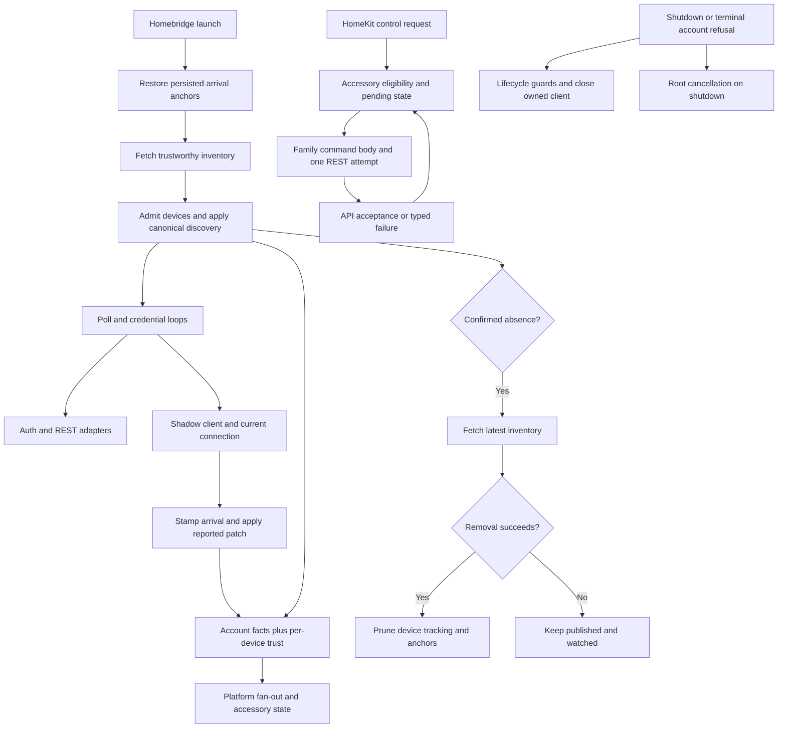

# Phase 4: Runtime Conformance - Research

**Researched:** 2026-10-14
**Domain:** TypeScript ESM runtime conformance, asynchronous lifecycle, monitoring trust, and review evidence
**Confidence:** MEDIUM overall; direct repository and checker observations are identified separately from cited external guidance.

<user_constraints>
## User Constraints (from CONTEXT.md)

The following two blocks copy the current context verbatim. The implementation-discretion heading belongs to the original decisions section. [VERIFIED: .planning/phases/04-runtime-conformance/04-CONTEXT.md:20-104,200-207]

DATA_c84f19a2_START
## Implementation Decisions

### Carry-forward decisions

- **D-01:** Apply the approved header to every source/test/helper touched:
  SPDX first, separate copyright and overview JSDoc blocks, one blank line
  between sections. Original-work copyright is Copyright (c) 2026 Alessandro
  Colomba. Keep a brief purpose and essential context; preserve license and
  attribution, including existing template-derived boundaries.
- **D-02:** Use stable finding IDs, exact rules, revision-qualified locations,
  severity, disposition and actual test/commit evidence in a phase ledger.
  Full-file reviewers and cause fixers use the complete project rulebooks.
  Each cause fix is atomic and passes the required pre-step and normal hooks.
- **D-03:** Pause ALL work if an independent correction round with open findings
  does not reduce the open count, a previously fixed finding reopens, or round
  four is reached, even if clean. Report accurate IDs/counts before any further
  repair or dispatch. A new cause never resets an existing batch's counter.
  Tracer checks and initial clarifications are not correction rounds.
- **D-04:** For a genuine bug, observe an active intended regression failure
  against unchanged production. Commit planning-only complete patch/native
  output/command/exit/source-commit/version evidence BEFORE the minimum GREEN
  production and active-test commit. This is the maintainer-approved sweep
  policy. Preserve every earlier record and actual Git ancestry. No failing
  code commit, hidden/skipped regression or hook bypass. Assertion controls
  are separate and restore exact source bytes before rebuilt GREEN.
- **D-05:** Preserve the locked safety and identity contracts: opaque canonical
  telemetry, current reported-only patches, monotonic watermark behavior,
  immutable public snapshots, narrow invalid-scope trust, last valid values,
  deviceId physical identity, deviceTypeId adapter selection, and distinct
  local/device clocks. Keep persisted observations and invalid-record recovery
  semantics. No new family meaning, fallback normal state or persistence
  migration is inferred from a type/style change.
- **D-06:** Fix confirmed findings at their cause with minimum code. Trace exact
  consumers before changing shared/exported types, names or signatures. An
  owning plan includes narrowly required external consumer edits in its wave;
  those edits do not imply a completed later subsystem sweep. Re-verify
  undefined/optional and readonly warnings against actual public shape,
  exhaustiveness and mutation contracts before choosing a repair or rejection.
  Preserve privacy, opaque identity, existing features and ADR-locked behavior.
- **D-07:** Every modified source/test pair alone keeps 100% direct lines,
  functions and branches. Run the full combined gate after waves and at phase
  end; reuse only exact unchanged inputs under local-verification. Serialize
  build output, mutation experiments, shared helpers, Git and shared records.
  Use offline synthetic inputs; no live vendor or hardware runs or installs.


### Runtime preservation and implementation discretion

The carry-forward policies apply to runtime ownership, retry scheduling,
shutdown, clocks, monitoring trust, commands and persisted arrival anchors.
Preserve the existing distinction between monitoring-path failure and device
offline state, reported authority over controls, one potentially delivered
command attempt, shared-root cancellation and explicit current lifecycle
ownership. Do not infer a new retry, deadline, timestamp-domain or recovery
policy from a conformance repair.

Research and planning choose dependency order and tracer slices. AccountRuntime
owns one continuous batch even when execution spans sequential plans; every
independent correction round keeps its original IDs and counts. The full
1,283-line source and 3,365-line owner cannot be replaced by a short diff-only
review. Group the nine smaller pairs into disjoint review batches, respecting
shared type/seed ownership and serial build/Git critical sections.

Trace exact production/test consumers and private aliases before a shared
contract change or removal. A narrow external adaptation requires a declared
bounded task in its owning wave, including report/evidence/helper paths within
the five-file cause budget. It does not complete the consumer's later sweep.
Actual test helpers join full review, header inspection and broad staged checks.
Declaration-only contracts retain meaningful strict compiler positives/negatives
without artificial runtime wrappers or fabricated coverage percentages.

Recheck runtime source narrative against canonical decisions and actual shipped
history. In particular, initial absence/restart language and identifier privacy
claims are review candidates, not new product permissions or automatic findings.
The scoped deviceId persistence/log treatment retains its opaque-key assumption;
public and committed planning artifacts remain sanitized. No new migration,
opaque-ID guarantee or universal transport teardown claim is authorized.

No new product preference was identified. The original all-remaining-phases
request authorizes routine continuation. Phase 3's three actual maintainer
judgments are bounded to Phase 3 and do not preapprove Phase 4 taxonomy or
prohibition judgments. WINDOWS 46/47 remain OPEN/unwaived historical process
exceptions. Three early hook streams lack separately retained JSON; historical
Gemini 247/247 remains independently unconfirmed. Current successful checks
cannot reconstruct those missing historical proofs.
DATA_c84f19a2_END

### Deferred Ideas (OUT OF SCOPE)

DATA_59b7e1d3_START
## Deferred Ideas

Accessory, root and Cucumber whole-subsystem sweeps remain in Phases 5–7,
except declared narrow consumers required by a runtime cause. Phase 8 performs
the final whole-repository re-review and milestone bug audit. Hardware/release
gates, live vendor runs, new product features and unrelated gate-test reviews
remain outside scope. Historical WINDOWS 46/47 remain visible for milestone
disposition; no automatic waiver follows from this context.
DATA_59b7e1d3_END
</user_constraints>

## Summary

Plan a full-file conformance sweep of ten mirrored runtime pairs. Keep three smaller batches and one continuous account-runtime batch. Complete each batch's initial independent review before its first repair. Account-runtime slices divide repairs, never review ownership or round counters. [VERIFIED: .planning/phases/04-runtime-conformance/04-CONTEXT.md:10-15,76-89]

Use the existing ports, native runner, strict compiler, direct-coverage selector, and repository hooks. Add no package or product feature. Research read all runtime sources, smaller owner contracts, the account harness and selected risk-bearing cases. This research did not independently review the full 3,365-line account owner, run tests, establish a new baseline gate, or accept findings. Execution must do those reviews. [VERIFIED: src/runtime/accountRuntime.ts:1-1283; test/runtime/accountRuntime.test.ts:1-625,2975-3083; .planning/phases/04-runtime-conformance/04-CONTEXT.md:59-63,76-89]

**Primary recommendation:** Stabilize shared ports first, then retry/logging/command contracts, then persisted monitoring trust, then account composition. Reserve explicit same-wave consumer tasks for confirmed contract changes. Preserve one account-runtime ledger and counter across sequential plans. [VERIFIED: src/runtime/accountRuntime.ts:13-37,330-335,1232-1282; .planning/phases/04-runtime-conformance/04-CONTEXT.md:76-89]

## Architectural Responsibility Map

These are planning assignments derived from the current composition, not a new product architecture. [VERIFIED: src/runtime/accountRuntime.ts:330-335,1232-1282]

| Capability | Primary tier | Secondary tier | Rationale and source |
| --- | --- | --- | --- |
| Lifecycle, polling, rotation, shutdown | Plugin process / runtime | Cloud adapters | Runtime coordinates injected cloud work and root cancellation. [VERIFIED: src/runtime/accountRuntime.ts:330-385,932-1079,1118-1175] |
| Wall and elapsed time | Injected process ports | Runtime trust projection | Separate clocks keep incompatible time bases explicit. [VERIFIED: src/runtime/clock.ts:8-16; src/runtime/monotonicClock.ts:14-22,46-48] |
| Silence and REST trust | Runtime projection | Persisted anchor store | Health records observations; runtime chooses reporting and I/O cadence. [VERIFIED: src/runtime/monitoringHealth.ts:108-165,245-321; src/runtime/accountRuntime.ts:634-668] |
| Anchor storage | Local storage adapter | Runtime | Store owns map/read/write; runtime restores before admission. [VERIFIED: src/runtime/arrivalAnchors.ts:167-210; src/runtime/accountRuntime.ts:1125-1132] |
| Command delivery | Runtime command port | Family adapter, REST adapter | Runtime resolves family body and sends one attempt; accessory binder owns pending presentation. [VERIFIED: src/runtime/accountRuntime.ts:252-262,1082-1103; src/accessories/controls.ts:552-570] |
| Accessory observation persistence | Accessory-scoped port | Platform / Homebridge | Platform supplies the cache-write closure; runtime declarations do not implement a second cache. [VERIFIED: src/runtime/accessoryStore.ts:24-27; src/platform.ts:126-158] |
| Review, provenance, seal | Execution coordinator | Independent reviewer/fixer | Shared records and stop decisions have one owner. [VERIFIED: .planning/phases/03-device-and-persistence-conformance/03-REVIEW-PROTOCOL.md:1-42] |

## Project Constraints (from AGENTS.md)

Apply every directive that reaches this phase. These are constraints, not discretionary recommendations. [VERIFIED: AGENTS.md:9-63,75-84]

- Read each file before editing. Trace callers before changing a function. Research before repair. [VERIFIED: AGENTS.md:11]
- Consult applicable official Homebridge/Cucumber pages only when a repair depends on their behavior. Compare installed definitions and pinned versions. [VERIFIED: AGENTS.md:15-20]
- Stay on the authorized feature checkout. Never commit to main, rebase, rewrite history, amend a failed commit, or bypass hooks. [VERIFIED: AGENTS.md:24-31; .planning/phases/04-runtime-conformance/04-CONTEXT.md:175-182]
- Use Conventional Commits. Titles contain 5–72 characters; body lines contain at most 80. Omit milestone/phase prose. [VERIFIED: AGENTS.md:27]
- Before each commit, run the exact-file pre-step with the approved npm-check skip. Repeat clean after formatter changes, then stage and use foreground normal hooks. [VERIFIED: AGENTS.md:28-31; .planning/phases/04-runtime-conformance/04-CONTEXT.md:181-182]
- Read complete style/comments rules for TypeScript and complete writer/reviewer rules for owners/helpers. Preserve relative .js imports and compiled layout. [VERIFIED: AGENTS.md:49-55]
- Use the local-verification schedule. Full combined gates remain mandatory after code waves and at phase end. [VERIFIED: AGENTS.md:57-59]
- Include the literal Threat Flags heading in every SUMMARY. Use the exact None text when applicable. [VERIFIED: AGENTS.md:38-45]
- Use the owning WINDOWS CLI with a milestone-prefixed description. Workers never edit shared state, roadmap, requirements, or WINDOWS directly. [VERIFIED: AGENTS.md:38; .planning/phases/03-device-and-persistence-conformance/03-REVIEW-PROTOCOL.md:35-42]
- Before edits, run Fallow guard. Before shared-symbol changes, obtain exact type-aware impact. Before deletion, obtain the exact symbol trace. Before commit, audit against the recorded base. [VERIFIED: AGENTS.md:155-169; .agents/skills/fallow/SKILL.md:19-35]
- Preserve safety, identity, privacy, explicit persistence, and release boundaries. No live vendor/hardware runs or installs belong to this phase. [VERIFIED: AGENTS.md:77-84; .planning/phases/04-runtime-conformance/04-CONTEXT.md:45-63]
- PR-only instructions remain conditional: use the named prose skills, offer the version bump, record changelog changes, squash merges, and close a shipping milestone before merge. This phase creates no PR. [VERIFIED: AGENTS.md:32-34,61-63; assigned research scope]

The repository's recorded Node ranges differ across documents. Preserve current package behavior: the manifest declares `"node": "^22.10.0 || ^24.0.0 || ^26.0.0"`; AGENTS' embedded older constraint declares `^22.10.0 || ^24.0.0`. STATE documents the later approved widening. This sweep does not resolve that documentation drift by narrowing runtime support. [VERIFIED: package.json:29-32; AGENTS.md:77; .planning/STATE.md:720-732]

<phase_requirements>
## Phase Requirements

| ID | Description | Research support |
| --- | --- | --- |
| RUN-01 | `src/runtime/**` and `test/runtime/**` conform. | Exact ten-pair inventory, complete rulebook reviews, batch plan, contracts, tracers and isolated checks. [VERIFIED: .planning/REQUIREMENTS.md:28-36] |
| PROC-01 | Each phase records rule, location, severity and outcome for every finding. | Revision-qualified ledger and independent round arithmetic. [VERIFIED: .planning/REQUIREMENTS.md:15,79-84] |
| PROC-02 | Each phase converges or stops with an accurate report. | Continuous counters and global D-03 stop before further work. [VERIFIED: .planning/REQUIREMENTS.md:16,79-84; .planning/phases/04-runtime-conformance/04-CONTEXT.md:33-37] |
| PROC-03 | Apply the approved file-header form. | Inspect every source, owner, actual helper and external adaptation. [VERIFIED: .planning/REQUIREMENTS.md:17,82-84] |
| BUG-01 | Every discovered bug has a failing regression before its fix and a ledger entry. | D-04 planning evidence commit precedes production GREEN. [VERIFIED: .planning/REQUIREMENTS.md:40,79-81; .planning/phases/04-runtime-conformance/04-CONTEXT.md:38-44] |
| GATE-01 | Every pair retains direct coverage; full check passes at milestone end. | Pair commands plus mandatory combined wave/phase gates. Phase 8 retains milestone closure. [VERIFIED: .planning/REQUIREMENTS.md:41,75-77] |
</phase_requirements>

## Initial Scope Inventory

The following are current repository inputs, not completed execution reviews. Counts came from scoped reads and `wc -l src/runtime/*.ts test/runtime/*.ts` at `35cc47fc600e51f528e15ef792d00e07f087e577`. All ten sources were read. The full account owner still requires its independent execution review. [VERIFIED: scoped source reads; .planning/phases/04-runtime-conformance/04-CONTEXT.md:10-15,154-160]

| Source | Mirrored owner | Source / owner lines | Proposed batch |
| --- | --- | ---: | --- |
| src/runtime/accessoryStore.ts | test/runtime/accessoryStore.test.ts | 27 / 42 | PORTS |
| src/runtime/clock.ts | test/runtime/clock.test.ts | 16 / 30 | PORTS |
| src/runtime/monotonicClock.ts | test/runtime/monotonicClock.test.ts | 48 / 45 | PORTS |
| src/runtime/timers.ts | test/runtime/timers.test.ts | 44 / 98 | PORTS |
| src/runtime/commandPort.ts | test/runtime/commandPort.test.ts | 32 / 24 | POLICIES |
| src/runtime/failureLog.ts | test/runtime/failureLog.test.ts | 86 / 282 | POLICIES |
| src/runtime/retryPolicy.ts | test/runtime/retryPolicy.test.ts | 92 / 178 | POLICIES |
| src/runtime/arrivalAnchors.ts | test/runtime/arrivalAnchors.test.ts | 210 / 164 | TRUST |
| src/runtime/monitoringHealth.ts | test/runtime/monitoringHealth.test.ts | 321 / 542 | TRUST |
| src/runtime/accountRuntime.ts | test/runtime/accountRuntime.test.ts | 1,283 / 3,365 | ACCOUNT |

The total is 20 core files and 6,929 lines. No separate runtime helper exists in this initial inventory. New helpers are conditional on confirmed writer-rule findings. Add actual helpers to full review, header inspection, task paths and broad staged selection. [VERIFIED: initial scoped file inventory; .planning/phases/04-runtime-conformance/04-CONTEXT.md:83-89,154-156]

## Standard Stack

Keep existing packages and tooling. No package installation, upgrade, replacement runner, assertion library, or mocking library is proposed. The table records declared project versions; it does not claim registry currency or new package approval. [VERIFIED: package.json:33-86; skills/typescript-unit-testing/SKILL.md:12-23; .planning/phases/04-runtime-conformance/04-CONTEXT.md:59-63]

| Tool | Current declaration or observation | Use |
| --- | --- | --- |
| Node / node:test / node:assert/strict | Native probe: v26.11.1; manifest range quoted in Project Constraints | Compiled owners, native TAP, direct V8 coverage. [VERIFIED: session native version probe; package.json:29-36,49-59] |
| TypeScript | Manifest `"typescript": "^6.0.3"`; installed compiler reports 6.0.3 | Strict ESM and positive/negative type contracts. [VERIFIED: package.json:80; session compiler version probe] |
| strong-mock | Manifest `"strong-mock": "^9.2.2"` | Exact prescribed interactions where interaction is the promise. [VERIFIED: package.json:79; skills/typescript-unit-testing/SKILL.md:125-160] |
| Fallow | Manifest `"fallow": "3.27.0"`; installed native and companion both 3.27.0 | Guard, trace, exact impact and recorded-base audit. [VERIFIED: package.json:73; session native/status probes] |
| Homebridge | Manifest `"homebridge": "^2.4.0"`; engines `"homebridge": "^1.8.0 || ^2.0.0"` | Existing Logging types and platform integration. [VERIFIED: package.json:31,75] |
| Cucumber | Manifest `"@cucumber/cucumber": "^13.2.1"` | Existing offline full gate; no feature sweep. [VERIFIED: package.json:36,63] |

Compiler settings include `"module": "nodenext"`, `"strict": true`, `"exactOptionalPropertyTypes": true`, and `"noUncheckedIndexedAccess": true`. The test project includes `["src", "test", "features"]`. Preserve these contracts when assessing optional versus required-undefined members. [VERIFIED: tsconfig.json:6-15; tsconfig.test.json:1-8]

**Installation:** None. Package legitimacy audit and registry/publish-date lookups are inapplicable because this phase adds no external package. Existing declarations are evidence about the checked tree, not a recommendation to install arbitrary current releases. [VERIFIED: .planning/phases/04-runtime-conformance/04-CONTEXT.md:143-145; assigned no-install scope]

## Architecture Patterns

### Data flow

The diagram follows actual composition and callbacks. It abstracts filenames into responsibilities. [VERIFIED: src/runtime/accountRuntime.ts:330-335,393-525,813-903,932-1015,1088-1103,1118-1175; src/platform.ts:581-613]



Do not expand the last branch into a universal teardown guarantee. Terminal auth halt and explicit shutdown are different paths; the current cloud layer's bounded cancellation evidence remains authoritative. [VERIFIED: src/runtime/accountRuntime.ts:710-735,1149-1175; .planning/phases/02-cloud-conformance/02-VERIFICATION.md:75-78]

### Recommended batch and wave structure

These batch names are planning choices within the approved discretion. Use separate plans when cause count or budgets require them. [VERIFIED: .planning/phases/04-runtime-conformance/04-CONTEXT.md:76-89]

| Batch | Full initial review | Repair order and boundary | Completion review |
| --- | --- | --- | --- |
| PORTS | Eight files: accessoryStore, clock, monotonicClock, timers and owners | Start with declaration-only persistence contract and deterministic clock/timer tracers. Preserve external structural clients. | All eight files plus actual helpers/adaptations |
| POLICIES | Six files: commandPort, failureLog, retryPolicy and owners | Command union/type contracts; exact warning/recovery output; capped retry/pending/abort semantics | All six files plus actual helpers/adaptations |
| TRUST | Four files: arrivalAnchors, monitoringHealth and owners | Real temporary storage and restart anchor tracer, then independent two-device/time-domain trust expectations | All four files plus actual helpers/adaptations |
| ACCOUNT | Both full files before first repair | Sequential lifecycle, command/reconciliation, and composition/assertion slices as required; one shared batch ledger/counter | Both complete files and every actual helper/external adaptation after all slices |
| Coordinator | All reports and current inventory | Ledger/provenance tracer; scope/header audit; final combined gate | Current inputs match final review revisions |

Prefer serial waves in the existing checkout. Independent read-only review can overlap where ownership is disjoint. Only one fixer writes; builds, mutations, helpers, Git and shared records stay exclusive. Full gates occur after code waves. Do not schedule a concurrent account rewrite beside a changed shared seed or contract. [VERIFIED: .planning/phases/04-runtime-conformance/04-CONTEXT.md:59-63,76-89; .planning/phases/03-device-and-persistence-conformance/03-REVIEW-PROTOCOL.md:18-42]

Execution must dispatch the typed gsd-code-reviewer and gsd-code-fixer roles with fresh independent context. Both roles read the complete style, comments, unit writer, unit reviewer and local-verification rulebooks. Do not reduce the required books to a prompt summary or the configured injection subset. Omit the model field and resolve effort through the active Codex workflow. Keep GSD_RUNTIME=codex for this task despite the recorded legacy runtime field. [VERIFIED: .planning/ROADMAP.md:139; .planning/config.json:67-99,143-144; assigned orchestration constraints]

Before each executor dispatch, force isolation:none for the live phase and read the persisted sentinel directly. Do not replace that read with a bare query or fork from the remote default. The coordinator owns the sentinel, gates, Git, ledger and shared records. Research did not run a dispatch or modify the sentinel. [VERIFIED: .planning/phases/04-runtime-conformance/04-CONTEXT.md:177-182; .planning/phases/03-device-and-persistence-conformance/03-REVIEW-PROTOCOL.md:18-42]

### Exact consumers and public contract graph

Research ran nine symbol-impact targets independently in each compiler project. Every one of the 18 runs returned exit 0, `"status":"complete"`, `"completeness":"complete"`, and the expected `selected_project`. Native command/result records are retained at `/private/tmp/guardian-runtime-research-fallow.json`. Earlier repeated-project probes selected the source project while including the combined consumer set; they are not separate test-project proof. [VERIFIED: 18 session Fallow native results at source commit 35cc47fc600e51f528e15ef792d00e07f087e577]

| Exact target | Source-project named consumers | Test-project named consumers | Relevant adaptation boundary |
| --- | ---: | ---: | --- |
| CommandOutcome | 1 | 3 | Runtime send implementation; controls owner; command-port owner |
| CommandFailure | 2 | 3 | Runtime classification; control status mapping; type owner |
| CommandPort | 4 | 9 | Runtime, platform, accessory binder, controls, synthetic World and owners |
| MonitoringTrust | 3 | 8 | Runtime, platform fan-out, accessory binder, fake/real Worlds and owners |
| ArrivalAnchors | 2 | 5 | Runtime and health; their owners and anchor owner |
| Clock | 7 | 14 | Runtime/health/log plus auth, shadow, state and reconciliation |
| Timers | 4 | 9 | Platform, controls, stale marking, accessory binder, fake timers and owners |
| RetryPolicy | 2 | 4 | Runtime and cloud shadow; both relevant owners |
| AccountRuntimeOptions | 0 | 0 | Exported factory parameter and local callers still carry this public contract |

Counts are named-import/re-export evidence, not an exhaustive structural call graph. For example, the controls implementation consumes the command outcome through `commands.send`, without importing its result alias. It narrows `outcome.accepted` and reads `outcome.failure`. Read that caller despite its absence from the outcome's named-import list. [VERIFIED: src/accessories/controls.ts:563-566; session Fallow output]

The actual public discriminants are quoted verbatim here. No optional-property or readonly conversion may silently widen or weaken them. [VERIFIED: src/runtime/commandPort.ts:16-31]

DATA_1a7d08c4_START
```typescript
export type CommandFailure = 'vendor-error' | 'timed-out';
export type CommandOutcome = { accepted: true } | { accepted: false; failure: CommandFailure };
```
DATA_1a7d08c4_END

If the independent reviewer confirms the inline object-union style finding, use bounded, documented public named variants while retaining this discriminant and required refusal cause. The current registry provides that pattern with `ImplementedFamilyOutcome<T> | UnsupportedFamilyOutcome | UnknownFamilyOutcome`. Do not hide exported union constituents as private types or add a Fallow suppression. [VERIFIED: src/device/registry.ts:23-47; .fallowrc.json:17-19; skills/typescript-google-style-review/SKILL.md:98-112]

A zero named-consumer answer does not justify removing an exported options interface. It remains a constituent of exported function signatures, including `createAccountRuntime(options: AccountRuntimeOptions): AccountRuntime`. Trace signatures, local references, aliases and structural construction before changing visibility. [VERIFIED: src/runtime/accountRuntime.ts:128-214,252-262,306-313,330,1232-1282; session exact AccountRuntimeOptions trace]

Run each command separately per project at the actual pre-edit revision. Retain stdout, stderr, exit, source HEAD, query target, selected project, completeness and omitted evidence. [VERIFIED: node_modules/fallow/skills/fallow/SKILL.md:44-67,288-305; installed dead-code help]

```bash
node_modules/.bin/fallow dead-code --type-aware --symbol-impact src/runtime/commandPort.ts:CommandOutcome --type-aware-project tsconfig.json --type-aware-require complete --format json --quiet --explain
node_modules/.bin/fallow dead-code --type-aware --symbol-impact src/runtime/commandPort.ts:CommandOutcome --type-aware-project tsconfig.test.json --type-aware-require complete --format json --quiet --explain
```

Before deleting any export or private alias, obtain its own exact-target trace in both projects. Do not substitute a related public-type query. Check live help for private-target support, preserve an unsupported/partial result, and read every lexical use and public-signature edge. If Fallow cannot establish the private target, retain the unresolved trace requirement; do not infer permission to delete it. WINDOWS 47 is the historical example of the missing exact pre-edit trace. [VERIFIED: .planning/phases/04-runtime-conformance/04-CONTEXT.md:83-89; .planning/WINDOWS.md:622-632; node_modules/fallow/skills/fallow/SKILL.md:55-67]

### Cause budgets and records

Propose stable batch IDs with an increasing cause number. Each finding needs the exact rule, initial/current revision-qualified location, severity, triage, disposition, independent observation and real commit/check evidence. Initial clarification is not a correction round. [VERIFIED: .planning/phases/04-runtime-conformance/04-CONTEXT.md:29-37; .planning/phases/03-device-and-persistence-conformance/03-REVIEW-PROTOCOL.md:44-77]

Keep every atomic cause within five changed paths, including report, evidence, helper and task-amendment paths. Before external adaptation, amend the owning wave's concrete task map, file inventory, threats and validation. Separate record-only work where needed. A common occupied budget is owner source/test, consumer source/test, and genuine RED evidence. Do not hide a sixth path or postpone required compatibility work to the consumer's later sweep. [VERIFIED: .planning/phases/04-runtime-conformance/04-CONTEXT.md:83-89; .planning/phases/03-device-and-persistence-conformance/03-REVIEW-PROTOCOL.md:94-122]

After each complete repair pass, independently re-review the entire original batch and actual additions. Record opening, fixed, rejected, new, reopened and closing IDs/counts. Check `closing = opening - fixed - rejected + new + reopened`. A nonreducing open count, reopened fix, or fourth correction round pauses ALL work before further edits, records, builds, commits or dispatch. New causes and account plan slices do not reset counters. [VERIFIED: .planning/phases/04-runtime-conformance/04-CONTEXT.md:33-37,76-81; .planning/phases/03-device-and-persistence-conformance/03-REVIEW-PROTOCOL.md:137-153]

### Tracer slices

| Slice | Existing public path | Required discriminator |
| --- | --- | --- |
| Declaration port | accessoryStore and commandPort compiler contracts | Valid port assignment; meaningful missing-member and wrong-outcome negatives; no fabricated runtime percentage |
| Scheduling | retryPolicy schedule/reset and injected timer adapters | Exact delayed execution, pending guard, abort outcome, independent whole observation |
| Restart trust | anchors restore before account admission; health admission/message | Restored anchor remains unchanged; a real arrival advances it; two clocks remain distinct |
| Per-device trust | runtime callback → platform fan-out | One quiet device and one reporting device yield complete different verdicts |
| Commands | runtime command port → family body → REST | Whole outcome and exact single request; no optimistic canonical change |
| Removal | trustworthy inventory → final check → callback → pruning | Failed removal retains tracking; confirmed success prunes exact device only |
| Ledger | one accepted cause → actual report → Git history | Source/evidence/fix ancestry, real paths, complete output, round reconciliation |

These are implementation targets based on existing paths, not newly accepted defects. [VERIFIED: src/runtime/accountRuntime.ts:393-525,585-668,813-903,1088-1103,1118-1175; test/runtime/accountRuntime.test.ts:2975-3083; test/runtime/monitoringHealth.test.ts:452-522]

## Don't Hand-Roll

| Problem | Do not build | Use instead | Grounding |
| --- | --- | --- | --- |
| Test execution | Alternate runner or custom assertion DSL | Native node:test/assert/strict and existing scripts | [VERIFIED: skills/typescript-unit-testing/SKILL.md:12-23; package.json:49-59] |
| Runtime cancellation | Second independent cancellation tree | Existing root ownership and cloud cancellation ports | [VERIFIED: src/runtime/accountRuntime.ts:330-385,1088-1103,1172-1174] |
| Testable time | Real sleeps or production reset hooks | Injected clock ports; context timer mocks for scheduling | [VERIFIED: skills/typescript-unit-testing/SKILL.md:204-241] |
| Persistence | New cache format or migration inferred from comments | Existing anchor store and typed accessory persistence | [VERIFIED: .planning/phases/04-runtime-conformance/04-CONTEXT.md:45-51,91-96] |
| Consumer discovery | Grep-only deletion approval | Exact Fallow trace/impact plus actual caller bodies | [VERIFIED: AGENTS.md:11,155-169] |
| Coverage reporting | Aggregate percentage as pair proof | Existing one-source selector and honest type-only acceptance | [VERIFIED: scripts/test-coverage-direct.mjs:137-190,238-276] |

## Runtime State Inventory

This conformance phase can rename symbols or reshape declarations. Inventory runtime state before such a change; do not infer a migration from a source rename. No private home/account storage or live service was inspected. [VERIFIED: .planning/phases/04-runtime-conformance/04-CONTEXT.md:45-63,91-96]

| Category | Items found or inspection boundary | Action required |
| --- | --- | --- |
| Stored data | Anchor creation uses `writeFile(temporary, contents, { flag: 'wx' })`, then `rename(temporary, target)`; target is joined from Homebridge storage and the constant below. Accessory records remain platform-owned. [VERIFIED: src/runtime/arrivalAnchors.ts:77-79,149-157,197-201; src/platform.ts:148-155] | Keep format/key semantics. Inspect code paths without reading private records. Declare a migration only after a confirmed requirement and authorization. |
| Live service configuration | No live vendor configuration was queried. Current runtime composes existing vendor clients; no new service is proposed. [VERIFIED: src/runtime/accountRuntime.ts:1240-1282; .planning/phases/04-runtime-conformance/04-CONTEXT.md:143-145] | None in the authorized scope. Do not claim that external state was audited. |
| OS-registered state | Homebridge supplies launch/shutdown callbacks. No OS registration operation exists in the read runtime sources. This is repository evidence, not a machine-wide OS audit. [VERIFIED: src/platform.ts:603-613; src/runtime/accountRuntime.ts:1-1283] | No registration migration planned. Recheck if a confirmed repair introduces one. |
| Secrets/env variables | Runtime receives credentials through injected configuration and registers rotated secrets by role. Names remain unchanged. No private environment file was read. [VERIFIED: src/runtime/accountRuntime.ts:932-954,1232-1252] | Preserve redaction registration order and current storage ownership. |
| Build artifacts / installed packages | Test compilation targets `"outDir": "dist-test"`; build script runs `"rimraf ./dist-test && tsc -p tsconfig.test.json"`. [VERIFIED: tsconfig.test.json:3-6; package.json:35] | Rebuild serially after edits and exact restoration. No reinstall is needed. |

Exact anchor filename, quoted verbatim: `export const ARRIVAL_ANCHOR_FILENAME = '.basement-guardian-arrivals.json';`. Preserve it. The write sites are the filesystem-path authority, not an expected location inferred from a name. [VERIFIED: src/runtime/arrivalAnchors.ts:39-40,77-79,149-157,197-201]

## Common Pitfalls

### Optional and readonly changes can change contracts

Required-present absence is explicit in upstream patches:
`data: Readonly<Record<string, unknown>> | undefined;`,
`state: Readonly<Record<string, unknown>> | undefined;`,
`version: number | undefined;`.
Do not replace these with optional members merely because a scan found undefined. Review exhaustive keys and real mutation contracts first. The same caution applies to mutable persisted observation records and interface readonly suggestions. [VERIFIED: src/device/state.ts:62-72; .planning/phases/04-runtime-conformance/04-CONTEXT.md:45-58]

### Declaration-only tests can accidentally test their own doubles

The accessoryStore owner currently imports the empty runtime namespace and invokes a literal recorder. The command-port owner already uses compiler contracts. Independently review whether each promise belongs to compiler/static gates, then retain meaningful positive/negative shapes. Do not add runtime wrappers to produce coverage numbers. This is a review candidate, not an accepted finding. [VERIFIED: test/runtime/accessoryStore.test.ts:13-42; test/runtime/commandPort.test.ts:1-24; skills/typescript-unit-testing/SKILL.md:204-225]

### Count-only assertions can miss identity, order and causes

The account owner has count-based assertions and a command cancellation title whose setup stops the runtime before sending. Read the complete cases and identify the actual promise before changing them. Require independent whole observations when the promise includes request identity/body, order, canonical state, or exact trust. A count remains useful when multiplicity alone is the public promise. [VERIFIED: test/runtime/accountRuntime.test.ts:1006,1451-1459,2100-2101,3001-3040,3072-3082; skills/typescript-unit-testing/SKILL.md:101-121]

### Current comments must not invent a new policy

The anchor narrative still says `"installation from before this release carries no anchor at all"` and `"the seeding path is the only one that has ever"` existed. Git blame attributes those lines to initial-release commit b19ea5890a3fe6b2168a5965271d564cfa0fd8d9. Account privacy narrative was introduced at b868f4e9435f75706e70c0b489b08ed115dc6d3b. Compare canonical decisions and actual shipped history before a comment repair. Preserve current absence/admission/restart behavior and the scoped opaque-key assumption. Do not infer a migration or identifier guarantee. [VERIFIED: src/runtime/arrivalAnchors.ts:57-64; src/runtime/accountRuntime.ts:64-76; session git blame/log; .planning/phases/04-runtime-conformance/04-CONTEXT.md:91-104]

### Default timer imports carry a testability constraint

Existing retry/runtime code calls the timers object. Current official Node documentation warns that destructured timer imports are not supported by timer mocks. Keep that constraint during import/style repairs. Current documentation is v26.12.0; local runtime is v26.11.1. Use installed behavior and declarations as the execution authority. [VERIFIED: src/runtime/retryPolicy.ts:2-5,60-63; src/runtime/accountRuntime.ts:2,364-366; node_modules/@types/node/test.d.ts:2176-2241] [CITED: https://nodejs.org/api/test.html#working-with-nodejs-timers-modules]

### Successful selected checks do not refresh whole-tree evidence

The selector writes the merged artifact only when all pairs and the LCOV option are selected. Native compiled LCOV denominators and merged source-mapped denominators differ. Keep both representations explicit. The full-gate script produces `coverage/direct.lcov`; the writing authority is `writeFileSync(target, reports.join(''))`. [VERIFIED: scripts/test-coverage-direct.mjs:194-235,323-325,359-364; package.json:36]

### Current green cannot repair historical process gaps

WINDOWS records explicitly retain `"status": "open"` for 46 and 47. Clean current checks cannot reconstruct the missing pre-step ordering, private-alias trace, three early separate JSON captures, or historical Gemini count. Phase 3's actual pass judgments remain bounded to Phase 3. [VERIFIED: .planning/WINDOWS.md:608-632; .planning/phases/04-runtime-conformance/04-CONTEXT.md:98-104]

## Code Examples

### Existing type-only compiler contract

Retain the exact vocabulary quoted under Architecture Patterns. This is an existing positive/negative pattern, not a proposed new API. [VERIFIED: test/runtime/commandPort.test.ts:9-22; src/runtime/commandPort.ts:16-20]

DATA_7f13bc80_START
```typescript
void ({ accepted: true } satisfies CommandOutcome);
void ({ accepted: false, failure: 'vendor-error' } satisfies CommandOutcome);
// @ts-expect-error a refusal names the cause the HomeKit tier maps to a status
void ({ accepted: false } satisfies CommandOutcome);
```
DATA_7f13bc80_END

### Existing persistence-before-admission ordering

This existing ordering is a preservation target. Its owner must discriminate an awaited restore from a late restore. [VERIFIED: src/runtime/accountRuntime.ts:1125-1132; test/runtime/accountRuntime.test.ts:407-442]

DATA_b60a2ce9_START
```typescript
await options.anchors.restore();

const retryInMs = await launch();
```
DATA_b60a2ce9_END

### Focused and full commands

These are execution commands, not research results. The selector accepts source/owner path pairs. Its compiled-file authority is ``return `dist-test/${file.slice(0, -3)}.js`;``. [VERIFIED: scripts/test-coverage-direct.mjs:35-36,64-85,343-355; package.json:35-59]

```bash
npm run build:test
node --test --test-reporter=tap dist-test/test/runtime/accountRuntime.test.js
npm run test:coverage:direct -- src/runtime/accountRuntime.ts test/runtime/accountRuntime.test.ts
npm run check
```

For native RED capture, use the full owner or an exact named target with explicit TAP. Capture the child process's true exit and complete output. A missing, filtered, skipped, cancelled, setup-failing or permission-failing target is not intended RED. Current Node documentation supports explicit TAP and LCOV; exact reporter text can vary between versions. [VERIFIED: .planning/phases/03-device-and-persistence-conformance/03-REVIEW-PROTOCOL.md:155-182] [CITED: https://nodejs.org/api/test.html#test-reporters]

## Genuine Bug Evidence and Assertion Controls

For each confirmed behavior defect, add an active intended regression while production remains unchanged. Capture complete native TAP, exact command/exit, target, expected/actual, semantic assessment, Node/npm versions, start/end times, source commit, source/test blob identities and the complete test patch. Commit planning-only evidence before GREEN production edits. Preserve recursively nested priorEvidence and independently classify every historical record with the existing RED checker. [VERIFIED: .planning/phases/04-runtime-conformance/04-CONTEXT.md:38-44; .planning/phases/03-device-and-persistence-conformance/03-REVIEW-PROTOCOL.md:155-182]

Then make the minimum production fix, retain the active regression, prove GREEN and isolated coverage, and commit source plus active tests with normal hooks. Audit source → evidence → fix ancestry and unchanged production blobs through evidence. Compare the saved patch with the active GREEN test and record formatter/lint differences. Commit titles and TDD markers are not ancestry proof. [VERIFIED: .planning/phases/03-device-and-persistence-conformance/03-REVIEW-PROTOCOL.md:173-190]

Assertion maintenance has a separate negative-control record. Observe the intended named assertion, restore exact pre-control bytes, rebuild, and prove GREEN. An unrelated TypeError or pre-existing gate failure is an unsuccessful control. Do not call a control an actual runtime bug. Research accepted zero runtime bugs and created no RED record. [VERIFIED: .planning/phases/04-runtime-conformance/04-CONTEXT.md:38-44; assigned research scope]

## State of the Art

| Existing constraint | Use in this phase | Source |
| --- | --- | --- |
| Current connection owns delivered shadow callbacks | Preserve completed cloud corrections, not older ownership assumptions | [VERIFIED: .planning/phases/02-cloud-conformance/02-VERIFICATION.md:74-78] |
| Public named discriminated variants | Use the registry's bounded pattern if the command union needs conformance repair | [VERIFIED: src/device/registry.ts:23-47] |
| Exact semantic consumers | Separate source and test project probes; read structural callers as well | [VERIFIED: session 18 native Fallow results; src/accessories/controls.ts:563-566] |
| Evidence-first GREEN history | Planning RED evidence before production fix; no failing-code commit | [VERIFIED: .planning/phases/04-runtime-conformance/04-CONTEXT.md:38-44] |

This phase does not research replacement libraries or upgrade the stack. [VERIFIED: .planning/phases/04-runtime-conformance/04-CONTEXT.md:143-145]

## Assumptions Log

| ID | Claim | Status / consequence |
| --- | --- | --- |
| A1 | Vendor deviceId's account-key segment is opaque and non-sensitive in the permitted runtime context. | [ASSUMED] Inherited, explicitly unconfirmed boundary; preserve scoped log/persistence permission and sanitize public artifacts. No broader privacy guarantee follows. [VERIFIED: .planning/STATE.md:231-233; .planning/phases/04-runtime-conformance/04-CONTEXT.md:91-96] |

All other proposed batching and tracer choices are planning recommendations within the approved discretion. They are not claimed external facts or new locked product decisions. [VERIFIED: .planning/phases/04-runtime-conformance/04-CONTEXT.md:76-89]

## Resolved Planning Procedures and Pending Execution Observations

1. **RESOLVED FOR PLANNING — accepted causes and helper inventory:** use complete independent initial reviews before repairs and full correction reviews after all batch slices, with stable finding IDs and continuous D-02/D-03 counters. Create a helper only for a confirmed writer-rule cause under D-06. Actual findings, helpers, bug counts and clean verdicts remain pending execution; none is preassigned. [VERIFIED: .planning/phases/04-runtime-conformance/04-CONTEXT.md:10-15,29-37,76-89]
2. **RESOLVED FOR PLANNING — private target support:** per D-06, run the exact alias/member query separately in both compiler projects at the actual pre-edit revision and inspect lexical/public-signature uses before removal. Retain an unsupported or incomplete result as an unmet trace obligation and use a contract-preserving repair; do not infer deletion permission from a neighboring public-symbol scan. Actual target support and native results remain pending execution. [VERIFIED: .planning/phases/04-runtime-conformance/04-CONTEXT.md:52-58,83-89; .planning/WINDOWS.md:622-632]
3. **RESOLVED FOR PLANNING — Phase 4 end judgments:** carry the actual phase-specific taxonomy/prohibition flags into the seal under D-02/D-07, then have the parent present any remaining judgments with current evidence and limits. Preserve unresolved flags until actual answers; Phase 3 acceptance supplies no Phase 4 answer or check descriptor. Those answers remain pending execution and seal. [VERIFIED: .planning/phases/04-runtime-conformance/04-CONTEXT.md:98-104]
4. **RESOLVED FOR PLANNING — timing and native outcomes:** per D-04/D-07, execution captures actual commands, exits, versions and start/end times for owner, regression and full-gate evidence. Planning estimates do not substitute for measurements. No Phase 4 owner duration or new full-gate result has been measured or claimed. [VERIFIED: .planning/phases/04-runtime-conformance/04-CONTEXT.md:38-44,59-63; research command inventory]

No unresolved product or research choice prevents planning. These procedures are settled under existing policy; their listed observations remain pending execution. This planning resolution starts or resets no D-03 execution counter. [VERIFIED: .planning/phases/04-runtime-conformance/04-CONTEXT.md:98-99,191-195]

## Environment Availability

| Dependency | Available evidence | Fallback / limit |
| --- | --- | --- |
| Node | Native version probe: v26.11.1 | Record actual version in every result; no new cross-version suite claim |
| npm | Native version probe: 11.20.0 | No installs authorized |
| TypeScript | Installed compiler probe: 6.0.3 | Existing strict build commands |
| pre-commit | Native version probe: 4.5.1 | Run approved clean pre-step and ordinary hooks |
| Fallow | 3.27.0 native; semantic companion 3.27.0 available | Exact private-target queries remain individually required |
| Context7 | No exposed MCP tool; ctx7 command not found | Used official Node/OWASP sources with web tools |
| Graphify | GSD status reports disabled | Used repository source and exact checker evidence |

The version/availability observations are native session results. None installs or runs a vendor dependency. No missing local dependency currently blocks planning. [VERIFIED: session version, command-availability, Fallow status and graphify probes]

## Validation Architecture

Nyquist and security enforcement are enabled: `"nyquist_validation": true`, `"security_enforcement": true`, `"security_asvs_level": 1`. The new validation strategy remains draft with no executed PASS entries. [VERIFIED: .planning/config.json:25,50-52; .codex/gsd-core/templates/validation.md:1-9]

### Test framework

| Property | Value |
| --- | --- |
| Framework | Native node:test and assert/strict on observed Node v26.11.1 |
| Compiler configuration | Existing source/test projects with strict ESM settings |
| Quick feedback | Fresh build, then the exact compiled owner or named tracer |
| Direct pair | Existing test:coverage:direct selector |
| Full suite | npm run check |

These commands and mechanisms are existing project policy. No checks in this table ran during research. [VERIFIED: package.json:35-59; skills/local-verification/SKILL.md:7-34]

### Requirement → automated map

| Requirement | Behavior / evidence | Command | Existing input? | Failure condition |
| --- | --- | --- | --- | --- |
| RUN-01 | Strict shared/public shapes | npm run typecheck | Yes | Compiler error, missing required shape, unused negative |
| RUN-01 | Every runtime public owner | Fresh build then node --test --test-reporter=tap on exact owner | Yes, ten owners | Target missing, failure, cancellation, unintended skip or title/promise mismatch |
| RUN-01 / GATE-01 | Each modified pair alone | npm run test:coverage:direct -- source owner | Yes | Nonzero exit or incomplete line/function/branch metrics |
| PROC-03 | Shipped license plus complete source/test/helper headers | Existing compiled license owner plus independent inventory/header read | Yes / new inventory pending | Wrong classification, missing section or unreviewed addition |
| PROC-01 / PROC-02 | Ledger and rounds match actual reports/Git | Planner must embed one concrete ledger tracer in its record task | Not authored yet | Unmatched ID/path/revision, wrong count or unreported D-03 trigger |
| BUG-01 | Intended RED before GREEN | Existing check tdd-red-evidence command on each real record | Conditional on actual bug | Invalid native target, missing patch/history, checker failure or semantic mismatch |
| GATE-01 | Combined input | npm run check | Yes | Nonzero exit, timeout, omitted stage or stale input evidence |

The mapping follows existing requirements and selectors. The ledger tracer is a required Wave 0 planning gap, not an invented executed command or passing test. [VERIFIED: .planning/REQUIREMENTS.md:15-17,32,40-41; scripts/test-coverage-direct.mjs:137-190,238-278; .planning/phases/03-device-and-persistence-conformance/03-REVIEW-PROTOCOL.md:127-190]

### Sampling and Wave 0

Before each cause commit, run its precise focused checks and hooks. After each combined code wave, run full check. Before phase verification, require a current full result. Reuse only same-session unchanged inputs with exact diff/untracked comparison. [VERIFIED: skills/local-verification/SKILL.md:7-34; .planning/phases/04-runtime-conformance/04-CONTEXT.md:59-63]

Wave 0 must create the review protocol, central ledger inventory, batch reports and concrete ledger/provenance tracer. Populate plan/task/threat IDs in the draft map before execution. No runner install or speculative test helper is required. Every later edited production consumer adds its real owner and direct-coverage obligation. [VERIFIED: .planning/phases/04-runtime-conformance/04-CONTEXT.md:29-32,83-89; .planning/phases/03-device-and-persistence-conformance/03-REVIEW-PROTOCOL.md:94-133]

The prior final gate belongs to Phase 3: cf04e71b85ce45bcdd73fb861d77d88e22d3ebe5, Node v26.11.1, 104 scenarios, 1,156 steps and 43 isolated pairs. Its report records exit 0. Research did not rerun it or establish same-session reuse itself. Preserve it as prior evidence until the coordinator checks exact inputs. [VERIFIED: .planning/phases/03-device-and-persistence-conformance/03-VERIFICATION.md:205-209]

## Security Domain

Use stack-applicable categories from ASVS 5.0.0. Do not copy older V2-auth/V5-validation labels into a current security table. The official categories used here are `V2 Validation and Business Logic`, `V14 Data Protection`, and `V16 Security Logging and Error Handling`. Applicability is a planning assessment, not ASVS certification. [CITED: https://raw.githubusercontent.com/OWASP/ASVS/v5.0.0/5.0/en/0x11-V2-Validation-and-Business-Logic.md] [CITED: https://raw.githubusercontent.com/OWASP/ASVS/v5.0.0/5.0/en/0x23-V14-Data-Protection.md] [CITED: https://raw.githubusercontent.com/OWASP/ASVS/v5.0.0/5.0/en/0x25-V16-Security-Logging-and-Error-Handling.md]

| ASVS category | Applies here | Existing control / preservation task |
| --- | --- | --- |
| Validation and business logic | Yes | Narrow runtime trust, current report authority, order and single-attempt command semantics |
| Data protection | Yes | Register secrets before downstream use; keep artifact inputs sanitized; preserve scoped identifier policy |
| Security logging/error handling | Yes | Fixed sanitized reasons, per-device rate limits and safe lifecycle outcomes |
| Authentication/session implementation | Adjacent existing cloud layer | Preserve terminal/refusal/throttle ownership; add no new login/session implementation |
| Cryptographic implementation | No new cryptography in scope | Preserve existing cloud/signing boundary and temporary-name randomness; do not invent crypto |

The applicability rows derive from actual runtime paths and locked scope. [VERIFIED: src/runtime/accountRuntime.ts:271-278,710-735,932-963,1082-1103; src/runtime/arrivalAnchors.ts:133-157; .planning/phases/04-runtime-conformance/04-CONTEXT.md:45-74]

### Proposed threat architecture

These threat references are proposed plan anchors. Each plan must attach concrete mitigations and automated evidence. [VERIFIED: .planning/config.json:50-52; AGENTS.md:38-45]

| Proposed threat | STRIDE | Preservation / verification |
| --- | --- | --- |
| T-04-STATE: false normal from partial/stale data | Tampering | Complete canonical readback and narrow trust; preserve reported-only upstream contract |
| T-04-TIME: wall/device/elapsed bases collapse | Tampering / denial of service | Independent clock domains, restart anchor and backward-jump boundary observations |
| T-04-COMMAND: duplicate delivery or optimistic state | Tampering | Exact one request and whole outcome; no requested value enters canonical safety state |
| T-04-LIFECYCLE: old work after stop or terminal halt | Denial of service | Current-client ownership, root signal, late-start and shutdown cases at the owning layer |
| T-04-PRIVACY: raw secrets in logs or records | Information disclosure | Role registration, fixed messages, sanitized examples and exact bounded privacy assertions |
| T-04-REMOVAL: failed removal loses distrust tracking | Tampering | Callback-before-prune ordering, final current inventory and exact-device cleanup |
| T-04-EVIDENCE: incomplete output reported as proof | Repudiation | Real commands/exits/blobs, unchanged-source RED, restored controls and accurate stop accounting |

Never report universal external teardown, live protocol validity, opaque-ID certainty, hardware gates, perfect historical procedure or later subsystem conformance from these bounded checks. [VERIFIED: .planning/phases/04-runtime-conformance/04-CONTEXT.md:91-104,199-207]

## Sources

### Direct repository / installed-tool observations

- Current context, requirements, roadmap, state and project decision record, read in this session. [VERIFIED: .planning/phases/04-runtime-conformance/04-CONTEXT.md:1-209; .planning/REQUIREMENTS.md:1-93; .planning/ROADMAP.md:136-150]
- All ten runtime source files; selected owner/caller bodies cited in the sections that use them. Full independent execution review remains pending. [VERIFIED: research scoped reads]
- Complete TypeScript style/comments, unit writer/reviewer and local-verification rulebooks; pointer and installed Fallow skill. [VERIFIED: session complete skill reads]
- Existing review protocol, prior final verification/UAT, WINDOWS 46/47 and source-header gate. [VERIFIED: cited phase/protocol/header sources]
- Eighteen independent one-project Fallow impact results, two additional combined-project traces, native tool versions, source Git history and exact inventory. Temporary native capture: /private/tmp/guardian-runtime-research-fallow.json. [VERIFIED: session commands]

### Official external documentation — MEDIUM

- Node test runner, TAP/LCOV and module timer mocks: https://nodejs.org/api/test.html. Current page identifies v26.12.0; installed runtime is v26.11.1. [CITED: https://nodejs.org/api/test.html]
- OWASP ASVS 5.0.0 official validation, data-protection and logging chapters, linked in Security Domain. [CITED: https://owasp.org/projects/asvs]

### Lookup and confidence provenance

The research-plan seam chose context7 for Node docs and websearch for security. No Context7 MCP or ctx7 command was available. Official web sources supplied the fallback. `classify-confidence --provider websearch --verified` returned `MEDIUM`; unknown provider labels returned LOW and were not promoted. Digests were cached under /private/tmp's research store to preserve the assigned repository write scope. [VERIFIED: session research-plan, command-availability, classify-confidence and research-store results]

## Metadata

- Standard stack: directly observed installed/project declarations; no registry currency or package-install recommendation. [VERIFIED: package.json:29-86; session probes]
- Architecture: direct source/caller observations plus complete exact-symbol evidence for the nine queried exports; structural/private targets retain stated limits. [VERIFIED: session Fallow results; cited source bodies]
- Pitfalls: evidence-backed review candidates, not accepted findings or executed negative controls. [VERIFIED: cited owners and context]
- Research date: 2026-10-14. Refresh source/caller/tracer evidence after changes. Recheck external docs if a real repair depends on new behavior. [VERIFIED: research session date; AGENTS.md:15-20]
- No source/test/helper repair, new runtime bug evidence, baseline gate, independent full-account review, Git commit, shared-record mutation, live request, install, or hardware result was produced by this research. [VERIFIED: research command/write inventory]
