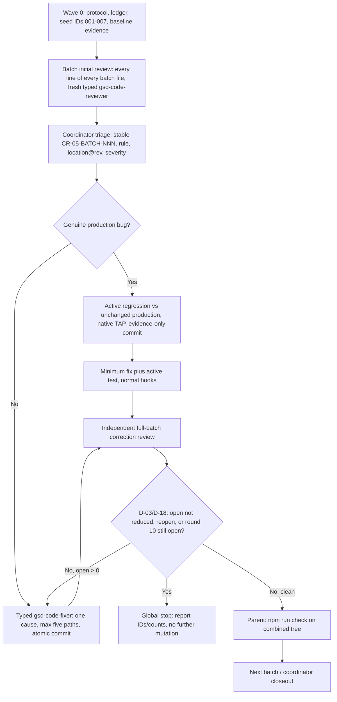
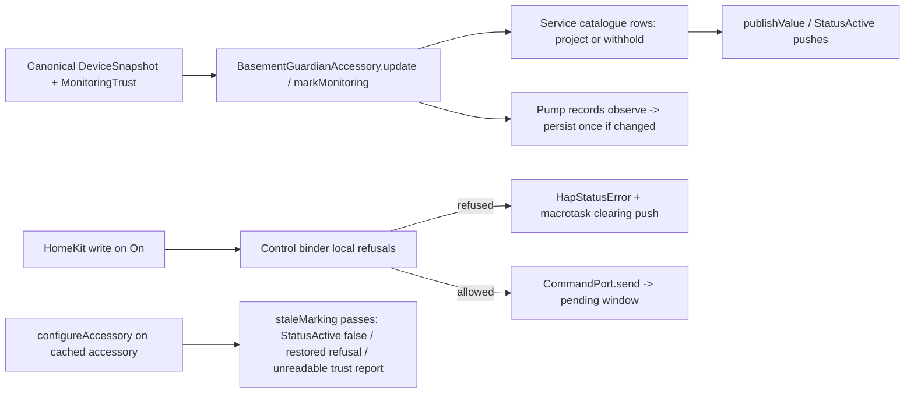

# Phase 5: Accessories Conformance - Research

**Researched:** 2026-10-16
**Domain:** TypeScript ESM conformance sweep of the HomeKit accessory tier (HAP projection, control writes, restart passes, pump records) and its unit and static-gate tests
**Confidence:** HIGH for the repository inventory, tooling and commands, which were observed in this session. MEDIUM for batching and wave order, which are planning recommendations. Review candidates are leads, not accepted findings.

<user_constraints>
## User Constraints (from CONTEXT.md)

Copied verbatim from `.planning/phases/05-accessories-conformance/05-CONTEXT.md:20-117` (decisions and discretion) and `:184-189` (deferred). [VERIFIED: 05-CONTEXT.md read this session]

### Locked Decisions

### Carry-forward decisions (Phase 4 D-01..D-07, unchanged)

- **D-01:** Approved header on every source/test/helper touched: SPDX first,
  separate copyright and overview JSDoc blocks, one blank line between
  sections, Copyright (c) 2026 Alessandro Colomba for original work; keep
  license and attribution boundaries.
- **D-02:** Stable finding IDs, exact rules, revision-qualified locations,
  severity, disposition and actual test/commit evidence in a phase ledger.
  Full-file reviewers and cause fixers use the complete rulebooks. Each cause
  fix is atomic and passes the pre-step and normal hooks.
- **D-03:** Stop ALL work if an independent correction round with open
  findings does not reduce the open count, a fixed finding reopens, or round
  four is reached, even if clean. Report accurate IDs/counts first. A new
  cause never resets an existing batch counter. Tracer checks and initial
  clarifications are not correction rounds.
- **D-04:** Genuine bug: observe an active regression failure against
  unchanged production; commit planning-only RED evidence before the minimum
  GREEN commit. No failing code commit, hidden/skipped regression or hook
  bypass. Assertion controls restore exact source bytes before rebuilt GREEN.
- **D-05:** Preserve locked safety and identity contracts (opaque canonical
  telemetry, narrow invalid-scope trust, last valid values, deviceId identity,
  deviceTypeId adapter selection, distinct local/device clocks, persisted
  observations). No new meaning or fallback inferred from a style change.
- **D-06:** Fix at the cause with minimum code. Trace exact consumers before
  changing shared/exported types, names or signatures. Narrow external
  consumer edits are bounded tasks in the owning wave and do not complete
  that consumer's later sweep.
- **D-07:** Every modified pair alone keeps 100% direct lines, functions and
  branches. Full combined gate after waves and at phase end; reuse only exact
  unchanged inputs. Serialize build output, mutation experiments, shared
  helpers, Git and shared records. Offline synthetic inputs only.

### Earlier reviews and fixes

- **D-08:** `test/accessories/controls.test.ts` (Phase 1 SC-02 fix) and the
  `reconciliation` pair (Phase 4 ACCOUNT consumer edits `e914a62`, `020498a`,
  `9b33167`) get a full fresh full-file review like every other file.
  Earlier fixes are regression anchors; earlier edits do not count as a
  completed sweep.
- **D-09:** The Phase 1 deferred seed warnings get stable Phase 5 IDs before
  the first review round, each re-verified against current lines and then
  fixed or rejected with a reason: (a) whole-value check at original
  `controls.test.ts:831`; (b) no `describe()` per exported entrypoint;
  (c) case at original 217-238 tests the fake HAP; (d) hand-rolled `.bind`
  spy at original 316-335 instead of `t.mock.method`; (e) `// act & assert`
  over two statements at original 928-933; (f) undocumented
  `as unknown as Service` casts; (g) `LOCAL_REFUSALS` ordering comment on
  `NO_COMMAND_TRANSPORT_CAUSE` at `controls.ts:304-328`. Line numbers are
  pre-Phase-1; relocate them by content.
- **D-10:** A Phase 5 finding on lines a Phase 1/4 fix touched is a new
  Phase 5 ID that cites the earlier ID. It triggers the D-03 stop only if
  the same fixed defect returns. A new cause is not a reopen. Phase 4
  counters (PORTS 3 / POLICIES 2 / TRUST 2 / ACCOUNT 3) do not carry into
  Phase 5 batches.

### HAP test doubles and casts

- **D-11:** Each test file widens the HAP stand-in in one named, commented
  place (pattern: `controls.test.ts:44-46` `HAP_NAMESPACE`; add e.g.
  `asService`/`asAccessory` helpers as needed). Inline `as unknown as` casts
  are replaced by those helpers. No production type changes to remove casts.
- **D-12:** `features/lib/hap.ts` (722 lines, 15 consumers) stays
  outside Phase 5's sweep. Edit it only when a confirmed accessory finding
  requires it, as a declared bounded consumer task (D-06). Its full review
  belongs to the phase that owns `features/**`.
- **D-13:** A case that proves only stand-in behavior moves to
  `hapWriteFidelity.test.ts` (where it runs against real HAP too) or is
  removed with a ledger reason if it adds nothing there.

### Static and fidelity tests

- **D-14:** Keep the documented `>=` enumeration floors in the three static
  gates. Fix a floor only if it is wrong for the current tree. Record the
  whole-value rule as N/A for the floor with the stated design reason.
- **D-15:** Do not extract a shared static-gate helper up front. Extract one
  test-support helper, in its own bounded task, only if a reviewer or
  `fallow dupes` confirms a duplication finding.
- **D-16:** For `hapWriteFidelity.test.ts`, fix confirmed rule findings and
  confirmed gaps where stand-in and real HAP could disagree undetected. Add
  no parity cases beyond those.
- **D-17:** A unit-testing rule that cannot apply to a gate with no source
  module (e.g. one `describe()` per exported entrypoint) is recorded N/A in
  the ledger with a one-line reason. All other rules apply in full.

### Claude's Discretion

- Batch grouping and wave order, within the roadmap batching note
  (`basementGuardian` and `serviceCatalogue` alone; `controls` with the seed
  warnings; the four gates together; no two plans in one wave edit the same
  file).
- Names of the per-file widening helpers.
- Applying the D-01 header to the nine unheadered test files and the
  `reconciliation.ts` header gap as ordinary findings.

### Deferred Ideas (OUT OF SCOPE)

- Full conformance review of `features/lib/hap.ts`: belongs to the
  phase that owns `features/**`.
</user_constraints>

## Summary

Phase 5 is a full-file conformance sweep of 24 files: ten accessory source modules, their ten mirrored owners, and four unpaired repository-gate tests. Per-file `wc -l` gives 3,879 source lines and 9,853 test lines, 13,732 in total. The repository tooling already supports the work: native `node:test`, the isolated direct-coverage selector, the unpaired-gate runner, Fallow guard and audit, the RED-evidence checker, and the pre-commit hooks. No package needs to be installed. [VERIFIED: `wc -l src/accessories/*.ts test/accessories/*.ts` this session]

The baseline at `1bcaddd8d20d73316f6298d6ce5eb53aa6b2ee46` on Node v26.12.0 is green. `npm run build:test` exited 0. All 14 accessory owners ran in one `node --test` call with 609 tests, 22 suites, 0 failures. Isolated direct coverage for all ten pairs exited 0 with no output, which is the selector's success mode. `npm run test:unpaired:compiled` exited 0. This is research-time evidence. It is not a phase gate and does not replace the full `npm run check`. [VERIFIED: native runs 2026-10-16T19:32:44Z–19:32:58Z]

Three facts in CONTEXT need correction before planning. (1) The header gap is the opposite of what the discretion bullet says. `src/accessories/reconciliation.ts` is the only source that already has the full D-01 header. The other nine sources have `// SPDX-License-Identifier: MIT` followed directly by the `@fileoverview` block, with no blank line and no copyright block. Twelve of the fourteen tests also need the header, not nine. (2) There are 24 `as unknown as` casts, not 25. (3) `features/lib/hap.ts` is imported by 14 files, not 15. The discussion premises were recorded this way, so the planner should use the verified values. [VERIFIED: head reads of all 24 files; `grep -o "as unknown as" test/accessories/*.ts | wc -l` = 24; `grep -rln "hap.js" src test features` = 14 files]

**Primary recommendation:** Reuse the Phase 4 protocol shape, with fewer process artifacts. Create a Wave 0 protocol and ledger. Pre-allocate CR-05-CONTROLS-001…007 for seeds (a)–(g). Run six serial batches in leaf-first order: DECLARATIONS → CATALOGUE → CONTROLS → RECORDS → ACCESSORY → GATES. End with a coordinator closeout that audits the 24-path inventory and headers and runs `npm run check`. Use one writer in the existing checkout.

## Architectural Responsibility Map

| Capability | Primary tier | Secondary tier | Rationale |
| --- | --- | --- | --- |
| Decoded state → HAP value projection | Accessory tier (`serviceCatalogue.ts`) | Device tier (decoded snapshot) | The catalogue is the only place a decoded fact becomes a HomeKit value. [VERIFIED: src/accessories/serviceCatalogue.ts:6-12] |
| One accessory's lifecycle and fan-out | Accessory tier (`basementGuardian.ts`) | Platform (`src/platform.ts`) wires it | The single runtime export is `createBasementGuardianAccessory`. Consumers are `src/platform.ts`, `test/platform.test.ts` and `features/support/world.ts`. [VERIFIED: grep of import sites] |
| HomeKit write → vendor command | Accessory tier (`controls.ts`) | Runtime command port | This is the only reverse-direction path. The command body is built behind the injected port. [VERIFIED: src/accessories/controls.ts:3-11] |
| Restart and credential passes on cached accessories | Accessory tier (`staleMarking.ts`) | Platform `configureAccessory`, Cucumber harness | These passes are exported so the harness runs the real code. [VERIFIED: src/accessories/staleMarking.ts:47-50] |
| Plugin-observed pump records and persistence | Accessory tier (`pumpRecords.ts`) | `AccessoryStore` port | One `persist()` per observation that changed something. [VERIFIED: src/accessories/pumpRecords.ts:26-28,346-350] |
| Absence confirmation | Accessory tier (`reconciliation.ts`) | Runtime (`accountRuntime.ts:346`) | The runtime is its only production consumer. [VERIFIED: src/runtime/accountRuntime.ts:346] |
| Vendor-defined HAP types | Accessory tier (`customCharacteristics.ts`, `customServices.ts`) | Injected `api.hap` | These are subclasses built over the injected namespace. HAP is never imported directly. [VERIFIED: customCharacteristics.ts:23-25] |
| Review, ledger, stop arithmetic, full gate | Coordinator (parent) | Typed reviewer and fixer subagents | Phase 4 protocol: the parent owns shared records, Git and the full gates. [VERIFIED: 04-REVIEW-PROTOCOL.md:31-43] |

## Project Constraints (from CLAUDE.md / AGENTS.md)

CLAUDE.md contains only `@AGENTS.md`. These are the directives that apply to this phase. [VERIFIED: CLAUDE.md, AGENTS.md read this session]

- Read each file before editing it. Trace callers before you modify a function.
- Never commit to `main`. Do not rebase or rewrite history. Never use `--no-verify`. Do not `--amend` after a failed hook.
- Commit messages follow Conventional Commits. The title is 5–72 characters, each body line is at most 80, and no GSD milestone or phase text appears. Each commit ends with the attribution line given in the session.
- Before each commit, run `SKIP=npm-check pre-commit run --files <changed files>`. Restage until it is clean, then run `git commit` in the foreground. The hook runs `npm run check:commit`.
- TypeScript rules are under `.agents/skills/`. Read `typescript-style` for every `.ts` file. Read `typescript-unit-tests` (write and check) for `test/**/*.ts`. Preserve `.js` imports and the compiled test layout.
- Build verification follows `.agents/skills/local-verification/SKILL.md`. Run the full `npm run check` at wave, phase and merge gates. A passing commit hook does not replace a full gate.
- Every plan `SUMMARY.md` includes `## Threat Flags`, with the exact None text when it applies.
- Each `gsd-tools windows append --description` starts with `[code-review-sweep]`. Do not hand-edit `.planning/WINDOWS.md`.
- Use Fallow per the task map: run `fallow guard <files>` before edits, `fallow dead-code --type-aware --symbol-impact` before you change an exported symbol, `fallow dead-code --trace` before a deletion, and `fallow audit --base <ref>` before a commit.
- Runtime constraints: use HAP only through `api.hap`, keep `deviceId` as the UUID seed, keep privacy rules for logs and artifacts, and keep persistence in typed `accessory.context`.
- The manifest engines field `"node": "^22.10.0 || ^24.0.0 || ^26.0.0"` is newer than AGENTS' stated `^22.10.0 || ^24.0.0`. Phase 4 recorded this as known documentation drift. Do not change either one in this phase. [VERIFIED: package.json:29-32; AGENTS.md]

<phase_requirements>
## Phase Requirements

| ID | Description | Research support |
| --- | --- | --- |
| ACC-01 | `src/accessories/**` and `test/accessories/**` conform. | 24-path inventory with header status, seed relocation, review-candidate list, batch plan and per-pair commands below. [VERIFIED: .planning/REQUIREMENTS.md:33] |
| PROC-01 (applied) | Every finding records rule, location, severity and outcome. | Ledger shape reused from Phase 4. [VERIFIED: .planning/REQUIREMENTS.md:15; 04-REVIEW-PROTOCOL.md:75-89] |
| PROC-02 (applied) | Converge or stop with a report. | D-03 arithmetic `closing = opening - fixed - rejected + new + reopened`. [VERIFIED: 04-REVIEW-PROTOCOL.md:146-163] |
| BUG-01 (applied) | A failing regression before each fix, listed in the ledger. | D-04 evidence-first commit and the RED checker command below. [VERIFIED: .planning/REQUIREMENTS.md:40] |
</phase_requirements>

## Initial Scope Inventory

Revision `1bcaddd8d20d73316f6298d6ce5eb53aa6b2ee46`. "Header" means the D-01 form: SPDX line, blank line, copyright JSDoc, blank line, `@fileoverview` JSDoc, blank line, imports. [VERIFIED: head reads of each file; approved form quoted from src/runtime/clock.ts:1-9 below]

| # | Path | Lines | D-01 header now | `describe` shape | Proposed batch |
| --- | --- | ---: | --- | --- | --- |
| 1 | src/accessories/alarmMute.ts | 32 | SPDX + overview, no copyright, no blank | — | DECLARATIONS |
| 2 | test/accessories/alarmMute.test.ts | 64 | None (starts with imports) | top-level, 3 tests | DECLARATIONS |
| 3 | src/accessories/services.ts | 104 | SPDX + overview, no copyright | — | DECLARATIONS |
| 4 | test/accessories/services.test.ts | 69 | None | top-level, 3 tests | DECLARATIONS |
| 5 | src/accessories/customCharacteristics.ts | 225 | SPDX + overview, no copyright | — | DECLARATIONS |
| 6 | test/accessories/customCharacteristics.test.ts | 354 | None | **one `describe('createCustomCharacteristics')` for a single-entrypoint module** | DECLARATIONS |
| 7 | src/accessories/customServices.ts | 164 | SPDX + overview, no copyright | — | DECLARATIONS |
| 8 | test/accessories/customServices.test.ts | 260 | None | **one `describe('createCustomServices')`, single entrypoint** | DECLARATIONS |
| 9 | src/accessories/serviceCatalogue.ts | 1,044 | SPDX + overview, no copyright | — | CATALOGUE |
| 10 | test/accessories/serviceCatalogue.test.ts | 2,291 | None | 13 `describe` for 13 runtime exports | CATALOGUE |
| 11 | src/accessories/controls.ts | 595 | SPDX + overview, no copyright | — | CONTROLS |
| 12 | test/accessories/controls.test.ts | 1,001 | **Conforms** (Phase 1 `2b08571`) | **top-level only, two runtime exports** (seed b) | CONTROLS |
| 13 | src/accessories/pumpRecords.ts | 361 | SPDX + overview, no copyright | — | RECORDS |
| 14 | test/accessories/pumpRecords.test.ts | 535 | None | top-level, single entrypoint | RECORDS |
| 15 | src/accessories/reconciliation.ts | 114 | **Conforms** (Phase 4 `e914a62`) | — | RECORDS |
| 16 | test/accessories/reconciliation.test.ts | 256 | **Conforms** (`e914a62`) | three `describe` named for interface **methods** `observe`/`present`/`forget`; the module's one runtime export is `createReconciliation` | RECORDS |
| 17 | src/accessories/staleMarking.ts | 174 | SPDX + overview, no copyright | — | RECORDS |
| 18 | test/accessories/staleMarking.test.ts | 452 | None | 3 `describe` for 3 exports | RECORDS |
| 19 | src/accessories/basementGuardian.ts | 1,066 | SPDX + overview, no copyright | — | ACCESSORY |
| 20 | test/accessories/basementGuardian.test.ts | 3,456 | None | **one `describe('createBasementGuardianAccessory')` wrapping 125 tests, single entrypoint** | ACCESSORY |
| 21 | test/accessories/timerFreedom.test.ts | 136 | `@fileoverview` only | top-level, 3 tests | GATES |
| 22 | test/accessories/hapImportScope.test.ts | 190 | `@fileoverview` only | top-level, 4 tests | GATES |
| 23 | test/accessories/accessoryReadPathScope.test.ts | 236 | `@fileoverview` only | top-level, 5 tests | GATES |
| 24 | test/accessories/hapWriteFidelity.test.ts | 553 | `@fileoverview` only | top-level, 18 tests | GATES |

Totals: header findings are expected on 21 of 24 files (9 sources and 12 tests). All ten sources are MIT. Every `src/**` file other than `src/index.ts` and `src/settings.ts` must carry MIT, so no accessory file has an Apache attribution boundary. [VERIFIED: test/packaging/licenseHeaders.test.ts:49 `const APACHE_DERIVED_FILES: readonly string[] = ['src/index.ts', 'src/settings.ts'];`]

The source-only license gate checks only that an SPDX MIT token is present (`assert.match(content, /SPDX-License-Identifier:\s*MIT/, ...)`). It does not check the copyright block or the blank-line layout. Reviewers must inspect every header by eye. [VERIFIED: test/packaging/licenseHeaders.test.ts:93-101]

The approved form to copy, quoted verbatim [VERIFIED: src/runtime/clock.ts:1-9]:

```typescript
// SPDX-License-Identifier: MIT

/**
 * Copyright (c) 2026 Alessandro Colomba
 */

/**
 * @fileoverview Supplies current wall time in epoch milliseconds.
 */
```

For the nine sources, keep the existing long `@fileoverview` text. Insert the blank line and the copyright block above it. The overview body does not need to be cut down. Phase 4 kept each file's purpose text. [VERIFIED: 04-PATTERNS.md:337-351]

`test/accessories/` contains only the fourteen `.test.ts` files. No accessory test-support helper exists yet. Any helper added must join full review, header inspection and the broad staged selector (a non-`.test.ts` file under `test/` selects all pairs). [VERIFIED: `ls test/accessories`; scripts/test-coverage-direct.mjs:105-118]

### D-09 seed relocation at the current revision

All seven seeds are still present. Pre-allocate CR-05-CONTROLS-001…007 in this order before the first review round. [VERIFIED: full reads of src/accessories/controls.ts:1-595 and test/accessories/controls.test.ts:1-1001]

| Proposed ID | Seed | Original location | Current location and content | Rule to cite |
| --- | --- | --- | --- | --- |
| CR-05-CONTROLS-001 | (a) whole value | controls.test.ts:831 | `test/accessories/controls.test.ts:817-830`, `'ignores a confirming report that lands after the window already closed'`; line 829 asserts `{ warnings: warnings.length, ... }` against `{ warnings: 1, ... }` | unit writer/reviewer, Assertions (whole values) |
| CR-05-CONTROLS-002 | (b) `describe` per entrypoint | whole file | The file has two runtime exports, `bindRestoredControlRefusal` (controls.ts:421) and `createControlBinder` (controls.ts:445). The test has no `describe` and imports only `test` (controls.test.ts:12). | unit, Case structure |
| CR-05-CONTROLS-003 | (c) case tests the fake | 217-238 | `controls.test.ts:216-243`, `'leaves a sticky status when the clearing push is queued as a microtask instead'`. It drives only `switchService()` from the stand-in and never calls a controls export. | unit, "a case must discriminate the module"; D-13 |
| CR-05-CONTROLS-004 | (d) `.bind` spy | 316-335 | `controls.test.ts:321-340`, `'registers one handler however many times a service is bound'`; line 327 `const declared = characteristic.onSet.bind(characteristic);` and lines 328-332 reassign `characteristic.onSet` | unit, Test doubles (spies via `t.mock.method`); style quick-scan `.bind(` |
| CR-05-CONTROLS-005 | (e) `// act & assert` over two statements | 928-933 | `controls.test.ts:921-932`. The marker covers `await assertRefused(...)` and then a separate `assert.deepStrictEqual(...)`. A second instance of the same rule is at 975-982: the marker covers a plain `assert.deepStrictEqual(readOfSwitch(service), ...)`. | unit writer, Case structure |
| CR-05-CONTROLS-006 | (f) undocumented `as unknown as Service` | 158, 330, 853, 874, 905 | `controls.test.ts:163, 335, 336, 851, 872, 903` (six inline casts). The seventh at line 46 is the documented `HAP_NAMESPACE` widening that D-11 names as the pattern. | style, Types (`as` with a reason); unit, Types and isolation; D-11 |
| CR-05-CONTROLS-007 | (g) misplaced ordering comment | controls.ts:304-328 | `src/accessories/controls.ts:304-322`. The `LOCAL_REFUSALS` ordering comment is followed with no blank line by the `NO_COMMAND_TRANSPORT_CAUSE` comment (323-327), the constant (328), `QUIET_LIVE_CONNECTION_CAUSE` (330-334) and then `const LOCAL_REFUSALS` (336). | style/comments, documentation placement |

Verbatim anchors [VERIFIED: src/accessories/controls.ts:304-305,328,336]:

```typescript
// The rules in the order they are evaluated, cheapest and most local first. The
// first that applies answers the write; the rest are never consulted.
const NO_COMMAND_TRANSPORT_CAUSE = 'the plugin has no way to reach the vendor right now';
const LOCAL_REFUSALS: readonly LocalRefusal[] = [
```

Disposition evidence for seed (c) under D-13: `hapWriteFidelity.test.ts` already contains the same ordering experiment against real HAP and the stand-in. It is `'survives a push queued as a microtask inside the handler, on both implementations'` at lines 375-396. Removing the controls case with a ledger reason ("duplicated against both implementations at hapWriteFidelity.test.ts:375-396") loses nothing. Moving it would add a duplicate parity case, which D-16 forbids. [VERIFIED: test/accessories/hapWriteFidelity.test.ts:370-396]

Fix technique for seed (d), verified natively: `t.mock.method(instance, 'onSet')` with no replacement spies an inherited prototype method, runs the real behavior and exposes `mock.callCount()`. The stand-in's `onSet` is a prototype method of `StandInCharacteristic`. [VERIFIED: node v26.12.0 probe in the scratchpad; features/lib/hap.ts:286,303-307]

### Unaccepted review candidates (leads for reviewers, S-05-NN)

These are observations from reading the files this session. They are not findings. Reviewers must confirm or reject each one against the full rulebooks, the same way Phase 4 handled its S-04 candidates. [VERIFIED: 04-FINDINGS.md:70-85 pattern]

| ID | Location | Observation | Likely rule |
| --- | --- | --- | --- |
| S-05-01 | 36 `// act & assert` markers in 10 test files are not followed by `assert.rejects`/`assert.throws`. Counts per file: serviceCatalogue 19, accessoryReadPathScope 3, hapImportScope 3, services 3, timerFreedom 2, controls 2, alarmMute 1, customCharacteristics 1, customServices 1, hapWriteFidelity 1. | Phases 2–4 fixed this as a WARNING every time (CR-02-SHADOW-006, CR-02-AUTH-012, CR-04-PORTS-004, CR-04-POLICIES-006, CR-04-TRUST-013, CR-04-ACCOUNT-041). | unit writer, Case structure [VERIFIED: next-line heuristic grep; 04-REVIEW-DISPOSITION.md:218,225,238,262] |
| S-05-02 | customCharacteristics.test.ts:94, customServices.test.ts:113, basementGuardian.test.ts:789 | A single runtime entrypoint wrapped in one `describe`. The rule says "A single-entrypoint module keeps cases at the top level." | unit, Case structure |
| S-05-03 | reconciliation.test.ts:52,144,227 | The `describe` blocks name methods of the returned object, not exported entrypoints. | unit, Case structure (reviewer judgment) |
| S-05-04 | controls.test.ts:547-557 | `'answers each of the eight refusal causes ...'` loops all rows inside one `test()` and has no `// arrange`. | unit, Data-driven cases |
| S-05-05 | src/accessories/controls.ts:145-147 | JSDoc says HAP "keeps only the last handler registered while warning about the ones before it". Pinned HAP 2.2.2 `onSet` assigns one slot and gives no replacement warning. It warns only for a non-function and for ignored `on('set')` listeners. | comments accuracy [VERIFIED: node_modules/@homebridge/hap-nodejs/dist/lib/Characteristic.js:1346-1352,1801-1803] |
| S-05-06 | controls.ts:97-103; controls.ts:323-324 ("two refusals now answer it"); controls.test.ts:690,693,713 ("the new rule"); basementGuardian.test.ts:2947 ("reconciliation used to read the value") | Narration of code history. | comments, "Narration of code that no longer exists" |
| S-05-07 | src/accessories/reconciliation.ts:51-54 | `ReconciliationOptions.clock: Clock` is required, but nothing in the module reads `options.clock`. Its only production consumer passes it at `src/runtime/accountRuntime.ts:346`. Removing it is a D-06 contract change with a bounded consumer edit in a Phase 4 file. | style, unused dependency; unit, Design for tests [VERIFIED: reconciliation.ts:52,99; accountRuntime.ts:346] |
| S-05-08 | customCharacteristics.ts:148 | The comment says "so twelve near-identical class bodies never exist". The factory defines 16 characteristics. | comments accuracy [VERIFIED: customCharacteristics.ts:161-223] |
| S-05-09 | hapImportScope.test.ts:60-63; accessoryReadPathScope.test.ts:72-76 | Floor comments state exact counts that are stale: "a hundred and four TypeScript files" when the tree now has 132, and "the production tree forty" when `src` now has 43. D-14 keeps the `>=` floors. A stale stated count is a candidate for "wrong for the current tree". | D-14; comments accuracy [VERIFIED: `find src test features -name '*.ts' \| wc -l` = 132; `find src -name '*.ts' \| wc -l` = 43] |
| S-05-10 | timerFreedom.test.ts:13 | "Three modules in this repository already import that form". This is true for `src/` (accountRuntime, retryPolicy, mqttTransport). Repository-wide, 13 files import it, excluding the gate's own fixture. | comments accuracy [VERIFIED: grep of `node:timers/promises` imports] |
| S-05-11 | hapWriteFidelity.test.ts:394-395 | `assert.notStrictEqual(real.statusCode, 0)` is a standalone negative that the next `strictEqual` makes redundant. The case does not compare the whole record, while every sibling does. | unit, Assertions |
| S-05-12 | hapWriteFidelity.test.ts:51,112,94 | `require_` uses a trailing-underscore name. `catch {` has no `(error: unknown)`. `manifest as InstalledManifest` has no stated reason. | style, Naming / Errors / Types |
| S-05-13 | hapWriteFidelity.test.ts:258-268 | A conditionally registered test. Under Homebridge 1.x it does not exist, which works like a skip. | unit, no conditional in registration / no skip (reviewer judgment) |
| S-05-14 | hapWriteFidelity.test.ts:481-494 | `'leaves the stand-in published flag ...'` exercises the stand-in only. | unit, "test support needs no meta-tests"; D-13/D-16 |
| S-05-15 | D-16 parity gaps, not diffed today: (1) a write with **no** handler stores the value and reports success, which `staleMarking.ts:29-34` and `controls.ts:36-41` rely on; (2) a second `onSet` replaces the first, which `bindRestoredControlRefusal` handoff relies on (controls.ts:42-45,424-428); (3) real HAP resets `statusCode` to 0 at **entry** to `handleSetRequest`, while the stand-in clears it only on success, so a read during an in-flight write can differ. | D-16, confirmed gaps only | [VERIFIED: Characteristic.js:1786-1787,1838-1841; features/lib/hap.ts:309-334] |
| S-05-16 | alarmMute.test.ts:19-29,52-64 | A source-text gate inside a paired test with no enumeration floor and no planted positive. An empty read would pass. | unit, "would a wrong implementation pass?" (BLOCKER class) |
| S-05-17 | basementGuardian.test.ts:3400-3455; serviceCatalogue.test.ts:1485-1491 | Source-text cases inside paired tests. The `onGet` and get-event checks repeat `accessoryReadPathScope.test.ts`, with a weaker pattern. | unit, "Do not test what a gate already enforces" |
| S-05-18 | controls.test.ts:104-118 (and similar recorders) | A hand-built `CommandPort` recorder asserts sends. The rules give command issuing to `strong-mock`. | unit, Test doubles (reviewer judgment; large refactor) |
| S-05-19 | controls.test.ts:30 and its reuse at 433-488 | The module-level `ACCEPTED: CommandOutcome` object is shared across rows. | unit, Test data (seeds return fresh values) |
| S-05-20 | src/accessories/basementGuardian.ts:177-180 | `DEFAULT_OFFLINE_CONFIRMATION_POLL_COUNT = 2` repeats `src/config.ts`'s default (the comment says so). | design (reviewer judgment; `src/config.ts` belongs to Phase 6) |
| S-05-21 | customCharacteristics.ts:111-114 | `type CharacteristicDomain = Pick<...>`. Style prefers interface extension over `Pick`. | style, Types |

Rulebook note for S-05-01: two rule texts disagree. `.agents/skills/typescript-unit-tests/rules/cases.md:15` says: "Use `// act & assert` only when one `assert.rejects()` or `assert.throws()` expression performs both the action and assertion. Data rows still use separate phases." The tracked `.claude/rules/typescript-unit-testing.md` (last changed in `04ab77d`; deleted in `f68df73`) says: "When act and assertion are one expression (`assert.rejects()`, `assert.throws()`, a data row), use `// act & assert`." AGENTS.md and `.planning/config.json` `agent_skills` name the `.agents/skills/` copies, and Phases 2–4 applied them. Claude Code also loads `.claude/rules/*.md` into every agent automatically. Dispatch prompts must say that `.agents/skills/` is authoritative. [VERIFIED: diff of the two files this session; `git ls-files --error-unmatch .claude/rules/typescript-unit-testing.md` exits 0 (corrected by the orchestrator; the first research pass recorded this file as untracked)]

## Standard Stack

No library is added, upgraded or replaced. [VERIFIED: package.json:56-86; 05-CONTEXT D-07 "Offline synthetic inputs only"]

| Tool | Observed version | Use |
| --- | --- | --- |
| Node / `node:test` / `node:assert/strict` | v26.12.0 at `/opt/homebrew/opt/node/bin/node`, npm 11.20.0 | Compiled owners, context mocks, V8 coverage |
| TypeScript | 6.0.3 | Strict ESM build (`tsconfig.test.json` → `dist-test`) |
| strong-mock | manifest `^9.2.2` | Strict interaction mocks, where a reviewer requires one |
| `@homebridge/hap-nodejs` | `2.2.2` (devDependency, exact pin) | Only `hapWriteFidelity.test.ts` imports it |
| Fallow | 3.27.0 | `guard`, `dead-code --type-aware --symbol-impact`, `audit --base`, `dupes` |
| pre-commit | 4.5.1 | `SKIP=npm-check pre-commit run --files ...` pre-step and the commit hook |
| Cucumber | manifest `^13.2.1` | Inside `npm run check`; scenarios use `staleMarking`, `basementGuardian` and `serviceCatalogue` through `features/support/world.ts` |

[VERIFIED: native version probes this session; package.json devDependencies]

**Installation:** none.

## Package Legitimacy Audit

Not applicable. This phase installs no external package. [VERIFIED: phase scope; no install in any decision]

**Packages removed due to [SLOP] verdict:** none
**Packages flagged as suspicious [SUS]:** none

## Architecture Patterns

### Review loop and data flow



The product data flow the reviewers protect, as tier responsibilities [VERIFIED: fileoverviews of basementGuardian.ts, serviceCatalogue.ts, controls.ts, staleMarking.ts]:



### Recommended batches and wave order

Single checkout (`workflow.use_worktrees` is `false` for this run) with one writer. "Waves" are serial. Read-only initial reviews may overlap only with batches whose files no one is changing. [VERIFIED: .planning/config.json `"use_worktrees": false`; 04-REVIEW-PROTOCOL.md:40-43]

| Wave | Batch / plan | Files (full review scope) | Why this position |
| --- | --- | --- | --- |
| 0 | Coordinator protocol | `05-REVIEW-PROTOCOL.md`, `05-FINDINGS.md` (24-path inventory and the seven pre-allocated seed IDs), baseline evidence | D-09 requires IDs before round 1. |
| 1 | DECLARATIONS | alarmMute, services, customCharacteristics, customServices pairs (8 files, 525 src / 747 test lines) | Leaf modules. Catalogue, controls and the accessory import them. |
| 2 | CATALOGUE | serviceCatalogue pair (1,044 / 2,291) | Imported by controls, staleMarking, basementGuardian, platform and features. Settle its contracts before consumers are reviewed. |
| 3 | CONTROLS | controls pair (595 / 1,001) plus seeds 001–007 | Consumed by staleMarking and basementGuardian. Seed (c) is settled before the GATES batch touches `hapWriteFidelity`. |
| 4 | RECORDS | pumpRecords, reconciliation, staleMarking pairs (649 / 1,243) | `staleMarking.test.ts` imports `createControlBinder`. Reconciliation's possible contract change (S-05-07) needs a bounded `accountRuntime` consumer task. |
| 5 | ACCESSORY | basementGuardian pair (1,066 / 3,456) | Top consumer of every other module. It may span two sequential plans with **one** batch ledger and counter, as Phase 4 did with ACCOUNT. |
| 6 | GATES | the four unpaired gates (1,115 lines) | Floors and stated counts read the final `src/` tree. D-16 gaps are judged after controls settles. D-17 records N/A rules. |
| 7 | Coordinator closeout | Ledger audit, header audit of all 24 plus any additions, full gate | Phase-end `npm run check` on the final inputs. |

No two plans in a wave edit the same file because each wave holds one plan. If the planner splits a batch into sequential plans, the counter stays continuous (D-03).

### Ledger and IDs

- IDs: `CR-05-DECLARATIONS-NNN`, `CR-05-CATALOGUE-NNN`, `CR-05-CONTROLS-NNN` (001–007 are the seeds), `CR-05-RECORDS-NNN`, `CR-05-ACCESSORY-NNN`, `CR-05-GATES-NNN`. One ID per cause. IDs never change on recurrence. [VERIFIED: 04-REVIEW-PROTOCOL.md:77-83 analog]
- Fields per finding: ACC-01, the exact rule and section, the initial and current `revision:path:line`, BLOCKER/WARNING, the first observer, the disposition with its reason, native commands with raw exits, and the source/evidence/fix commit hashes.
- D-10: a finding on lines that a Phase 1 or Phase 4 fix touched gets a new Phase 5 ID that cites `SC-02` or `CR-04-ACCOUNT-0xx`.
- D-17: for each gate, record N/A with one line for rules that need a source module: mirrored pairing, `describe` per exported entrypoint, and isolated direct coverage. The gates are unpaired by design (see Validation Architecture).
- Cause budget: at most five paths per atomic cause commit, including report, RED evidence and helper. Header-only fixes go in their own commits, separate from functional causes. [VERIFIED: 04-REVIEW-PROTOCOL.md:125-137,249-250]

### Exact consumers for D-06 contract changes

Import sites for each accessory module outside its own pair [VERIFIED: grep of `accessories/<m>.js` and `./<m>.js` across src, test, features, scripts]:

| Module | External importers |
| --- | --- |
| alarmMute | src/accessories/controls.ts |
| services | src/platform.ts, src/config.ts, src/accessories/basementGuardian.ts, src/accessories/serviceCatalogue.ts, test/platform.test.ts, test/config.test.ts, test/accessories/serviceCatalogue.test.ts, test/accessories/basementGuardian.test.ts, features/support/world.ts, features/step_definitions/configuration.steps.ts |
| customCharacteristics | src/accessories/customServices.ts, serviceCatalogue.ts, staleMarking.ts; tests: serviceCatalogue, customServices, basementGuardian |
| customServices | src/accessories/serviceCatalogue.ts; test/accessories/serviceCatalogue.test.ts |
| serviceCatalogue | src/accessories/basementGuardian.ts, staleMarking.ts, controls.ts; test/platform.test.ts, test/configSchema.test.ts, test/accessories/basementGuardian.test.ts; features/lib/publishedServices.ts, features/step_definitions/homekit.steps.ts |
| controls | src/accessories/basementGuardian.ts, staleMarking.ts; test/accessories/staleMarking.test.ts |
| pumpRecords | src/accessories/basementGuardian.ts |
| reconciliation | src/runtime/accountRuntime.ts |
| staleMarking | src/platform.ts, test/platform.test.ts, test/accessories/basementGuardian.test.ts, features/support/world.ts |
| basementGuardian | src/platform.ts, test/platform.test.ts, features/support/world.ts |

Edits to `src/platform.ts` and its test touch Phase 6's subsystem. Edits under `features/**` touch Phase 7's. Each must be a declared bounded task in the owning wave (D-06). Before any exported-symbol change, run both compiler projects separately [VERIFIED: 04-RESEARCH.md:288-291 command form; fallow 3.27.0 present]:

```bash
node_modules/.bin/fallow dead-code --type-aware --symbol-impact src/accessories/reconciliation.ts:ReconciliationOptions --type-aware-project tsconfig.json --type-aware-require complete --format json --quiet --explain
node_modules/.bin/fallow dead-code --type-aware --symbol-impact src/accessories/reconciliation.ts:ReconciliationOptions --type-aware-project tsconfig.test.json --type-aware-require complete --format json --quiet --explain
```

### D-11 widening helpers

Current inline casts by file: controls 7 (1 documented `HAP_NAMESPACE`), basementGuardian 8, staleMarking 5, serviceCatalogue 2, customCharacteristics 1, customServices 1. Total 24. [VERIFIED: `grep -o "as unknown as" test/accessories/*.ts | sort | uniq -c`]

- Already in one named place: `HAP_NAMESPACE` (controls.test.ts:46, basementGuardian.test.ts:178, staleMarking.test.ts:29); `hapNamespace()` (customCharacteristics.test.ts:74, customServices.test.ts:98, serviceCatalogue.test.ts:163); `accessoryStandIn()` (serviceCatalogue.test.ts:167). Reviewers decide whether each one has the required comment.
- Inline casts that need a helper: controls.test.ts 163, 335, 336, 851, 872, 903 (Service); basementGuardian.test.ts 480, 746 (PlatformAccessory), 646, 676, 1278, 1279 (`row.serviceClass as unknown as FakeServiceClass`), 813 (`{ context: null } as unknown as PlatformAccessory`, a deliberately invalid accessory); staleMarking.test.ts 111, 115, 119 (PlatformAccessory), 431 (Service).

### Anti-Patterns to Avoid

- **Reviewing a diff or excerpt in place of whole files.** D-08 needs a fresh full-file review of `controls.test.ts` and the `reconciliation` pair even though earlier phases edited them.
- **Rewording user-visible strings during a style fix.** Log lines, refusal causes, characteristic display names, subtypes and UUID literals are pinned behavior. Tests compare exact refusal lines (controls.test.ts:424-516).
- **Adding a coverage wrapper or a `describe` reshuffle mixed with a functional change.** Style-only edits go in their own commits.
- **Treating the commit hook as the gate.** `check:commit` runs only staged pairs. The phase needs the parent's `npm run check` after each wave.

## Don't Hand-Roll

| Problem | Don't build | Use instead | Why |
| --- | --- | --- | --- |
| Call-count spy on the stand-in | `.bind` plus method reassignment | `t.mock.method(characteristic, 'onSet')` | Restores itself after the case. Verified on inherited methods. |
| Pair coverage proof | Aggregate `--experimental-test-coverage` | `npm run test:coverage:direct -- <src> <test>` | Runs each pair alone and rejects any line, function or branch under 100%. [VERIFIED: scripts/test-coverage-direct.mjs:158-194,238-283] |
| Gate-test execution | Adding a gate to the pair selector | `npm run test:unpaired` / exact `node --test` | `pairForPath` throws `Not a source-test pair member` for the gates. |
| RED evidence validation | A new parser | `node .claude/gsd-core/bin/gsd-tools.cjs check tdd-red-evidence <record> --raw` (the `.codex` copy is byte-identical) | Phase 4's classifier. Both copies returned `"passed": true` on the Phase 4 platform record this session. |
| Duplicate detection for gate tests | Trusting `fallow dupes` | Reviewer judgment (D-15) | `fallow dupes` skips `**/*.test.*` by default: "skipped 59 files matching default duplicates ignores". The D-15 Fallow route cannot fire for test files under the current config. [VERIFIED: `fallow dupes --explain-skipped`] |
| Real-HAP semantics | Arguing from memory | Read `node_modules/@homebridge/hap-nodejs/dist/lib/Characteristic.js` (pinned 2.2.2) | This session found a JSDoc claim (S-05-05) that the pinned source contradicts. |

## Runtime State Inventory

Conformance repairs can rename symbols or reshape types. A source rename does not migrate these stores. [VERIFIED: sources cited per row]

| Category | Items found | Action required |
| --- | --- | --- |
| Stored data | Homebridge accessory cache holds `accessory.context` members `primaryPump`, `backupPump`, `watermarks` (`PumpRecordsContext`, pumpRecords.ts:63-67). It also holds each published service by **UUID + subtype** and each characteristic by **UUID**: 16 characteristic UUID literals (customCharacteristics.ts:85-100) and 4 service UUID literals (customServices.ts:78-81). | Never rename context keys or change a UUID or subtype literal. A rename here is a persistence migration, which is out of scope (D-05). |
| Live service config | None. The accessory tier talks to no external service directly; `accessoryReadPathScope` enforces this. | None. |
| OS-registered state | None in the accessory tier. | None. |
| Secrets/env vars | None read in `src/accessories/**`. Log lines carry `deviceId`, which controls.ts:512-518 documents as non-sensitive and admitted to logs. | Keep log content. No raw responses or tokens. |
| Build artifacts | `dist-test/` is rebuilt by `rimraf ./dist-test && tsc -p tsconfig.test.json` (package.json `build:test`). | Rebuild serially after every edit and after any control mutation is restored. |

## Common Pitfalls

### Wrong header premise from CONTEXT
**What goes wrong:** A planner reads "the `reconciliation.ts` header gap" and edits the one source that already conforms, or misses the other nine.
**How to avoid:** Use the inventory table. 21 files need D-01. `reconciliation.ts`, `reconciliation.test.ts` and `controls.test.ts` already conform.

### Two disagreeing `// act & assert` rules
**What goes wrong:** A Claude-run reviewer applies `.claude/rules/typescript-unit-testing.md` (deleted in `f68df73`; "a data row" may use the combined marker) and rejects S-05-01, unlike Phases 2–4.
**How to avoid:** Every dispatch names `.agents/skills/*/SKILL.md` as authoritative per AGENTS.md. Record the conflict once in the protocol.

### Stale floors that still pass
**What goes wrong:** `SOURCE_FILE_FLOOR = 104` passes against 132 files, so a gate that read only 104 would still pass. D-14 keeps `>=` floors but allows a fix "if it is wrong for the current tree".
**How to avoid:** Reviewers decide whether a floor or its stated count is wrong now. They record the whole-value rule as N/A for floors, with the D-14 reason. A source file added or removed by a fix in any earlier wave changes these counts, which is why GATES runs last.

### Literal values a style fix must not touch
**What goes wrong:** A normalization changes a UUID, subtype, display name, HAP status number or exact log line. Tests may still pass if the test literal changes in the same commit.
**How to avoid:** Treat those literals as identity and behavior (D-05). A change needs a finding that names the behavior, not a style rule.

### Phase 4 process failures
**What goes wrong:** Releasing a foreground lease on an interim message. Treating a failed impact/check command as evidence. Staging after a fixer failed. A host Node update during the session. (Handoff anti-patterns.)
**How to avoid:** Wait for each subagent's terminal result. Keep raw exits. Run the pre-step clean before staging. Prefix `PATH="/opt/homebrew/opt/node/bin:$PATH"` and record `node --version` with every result. [VERIFIED: .continue-here.md:56-64]

### Runtime path mismatch in plan context blocks
**What goes wrong:** Phase 4 plans reference `.codex/gsd-core/...` and `GSD_RUNTIME=codex`. This planning session runs under Claude Code with `.claude/gsd-core/...`. Both trees exist and the RED checker lib is byte-identical.
**How to avoid:** Write `execution_context` and checker commands for the runtime that will execute (see Open Questions).

### Large mechanical reindent hides real changes
**What goes wrong:** If S-05-02 is accepted, removing the wrapping `describe` in the 3,456-line `basementGuardian.test.ts` reindents almost every line. Any functional fix mixed into that commit becomes impossible to review.
**How to avoid:** Make the reindent its own style-only cause commit. Run `git diff -w` to show that no content changed.

## Code Examples

### Spy on the stand-in's handler registration (seed d)

```typescript
// Pattern: unit rulebook "Spies" (t.mock.method with no replacement); verified on Node v26.12.0
test('registers one handler however many times a service is bound', (t) => {
  // arrange
  const binder = createControlBinder(binderOptions());
  const service = switchService();
  const onSetSpy = t.mock.method(onCharacteristic(service), 'onSet');

  // act
  binder.bind(asService(service), 'self-test', () => false);
  binder.bind(asService(service), 'self-test', () => false);

  // assert
  assert.strictEqual(onSetSpy.mock.callCount(), 1);
});
```

`asService` is an example name (helper names are Claude's discretion). Only `createControlBinder`, `binderOptions`, `switchService` and `onCharacteristic` exist today. [VERIFIED: controls.test.ts:120-166]

### One named widening per file (D-11)

```typescript
// The stand-in answers the members the plugin reads and nothing else, which no structural type
// can express; this is the one place a stand-in service stands where the plugin takes a Service.
function asService(service: FakeHapService): Service {
  return service as unknown as Service;
}
```

The pattern comes from controls.test.ts:44-46. [VERIFIED]

### Data-driven rows, one sibling test each (S-05-04)

```typescript
// Pattern: .agents/skills/typescript-unit-tests/rules/cases.md "Data-driven cases"
for (const refusalCase of REFUSALS) {
  test(`answers ${String(refusalCase.status)} for ${refusalCase.cause}`, async () => {
    // act
    const { thrown } = await refuse(refusalCase);

    // assert
    assert.strictEqual(thrown, refusalCase.status);
  });
}
```

`REFUSALS` and `refuse` exist at controls.test.ts:518-545. [VERIFIED]

## State of the Art

| Old approach | Current approach | Source |
| --- | --- | --- |
| `// act & assert` on any one-line check | Combined marker only for one `assert.rejects`/`assert.throws` | Applied as WARNING fixes in Phases 2–4 [VERIFIED: 04-REVIEW-DISPOSITION.md:218,225,238,262] |
| Header with SPDX plus overview only | SPDX, copyright JSDoc, overview JSDoc, each separated by a blank line | PROC-03; Phase 1 decision; runtime files [VERIFIED: src/runtime/clock.ts:1-9] |
| Seeds as hints | Seeds pre-allocated as IDs, then re-verified (D-09) | 05-CONTEXT |

## Assumptions Log

| # | Claim | Section | Risk if wrong |
| --- | --- | --- | --- |
| A1 | Batching and wave order (leaf-first, GATES last) is the best order. | Architecture Patterns | Low. Any order that keeps one writer and continuous counters is valid. [ASSUMED] |
| A2 | Removing seed (c) under D-13, rather than moving it, is the correct disposition. | Seed relocation | Low. Reviewers may decide otherwise. [ASSUMED from the verified duplication] |
| A3 | Finding volume will be on the order of Phase 4 (87 findings over 6.9K lines), so ~100–200 here, given the 21 header files and 36 AAA sites. | Summary / planning | Medium. Affects plan count and context budget. [ASSUMED] |
| A4 | Phase 4's ASVS 5.0.0 category names (V2 Validation and Business Logic, V14 Data Protection, V16 Security Logging and Error Handling) still apply. | Security Domain | Low. They were not re-fetched this session. [CITED: 04-RESEARCH.md:506 → OWASP ASVS v5.0.0] |

## Open Questions (RESOLVED)

All four were resolved by the plan-phase orchestrator within CONTEXT's discretion, and the plans adopt each resolution.

1. **Which GSD runtime executes Phase 5?** — RESOLVED: Claude Code. Plans use `.claude/gsd-core/...` paths only, and the Wave 0 protocol (05-01) records the choice. Because `gsd-executor` has no Agent tool under Claude Code, batch plans run inline through `/gsd-execute-phase 5 --interactive`.
   - What we know: Phase 4 ran with `GSD_RUNTIME=codex` and `.codex/gsd-core` paths. This session is Claude Code, and `.claude/gsd-core/workflows/execute-plan.md` exists. Both RED checkers are identical and both work.
2. **Is a generated seal JSON required?** — RESOLVED: no. 05-09 runs a smaller coordinator closeout (inventory, header audit, round arithmetic, ledger tracer, full gate).
   - What we know: Phase 4 produced `04-SEAL-AUDIT.json` (14 MB) and a three-part tracer. CONTEXT D-02 requires only a ledger with evidence.
3. **Does S-05-07 (unused `clock`) justify a cross-subsystem contract edit?** — RESOLVED: only if a reviewer accepts it. 05-05 carries a conditional, bounded consumer task for `src/runtime/accountRuntime.ts:346` and its owner, gated on both TypeScript-project impact commands. This does not affect Phase 4's closed ACCOUNT counter (D-10).
4. **`.planning/HANDOFF.json` was deleted after the last full gate (ae88de8).** — RESOLVED: 05-01 runs a fresh `npm run check` as Wave 0 baseline evidence; no earlier gate result is reused.

## Environment Availability

| Dependency | Required by | Available | Version | Fallback |
| --- | --- | --- | --- | --- |
| Node at `/opt/homebrew/opt/node/bin` | Build, tests, coverage | ✓ | v26.12.0 | — |
| npm | Scripts | ✓ | 11.20.0 | — |
| TypeScript | Build | ✓ | 6.0.3 | — |
| Fallow | Guard, impact, audit | ✓ | 3.27.0 (`guard` and `audit --base` probed) | — |
| pre-commit | Pre-step, hooks | ✓ | 4.5.1 | — |
| `@homebridge/hap-nodejs` | hapWriteFidelity | ✓ | 2.2.2 installed | — |
| Context7 MCP | Docs lookup | ✗ | — | Pinned installed source plus native probes (used) |
| Graphify | Graph context | ✗ (disabled) | — | Direct grep and reads (used) |
| GNU `timeout` | — | ✗ (macOS) | — | Use the tool's own timeout setting; do not wrap commands in `timeout` |

**Missing dependencies with no fallback:** none.

## Validation Architecture

Nyquist validation is enabled (`"nyquist_validation": true`), and `workflow.test_command` is `npm run check`. [VERIFIED: .planning/config.json]

### Test Framework

| Property | Value |
| --- | --- |
| Framework | Native `node:test` + `node:assert/strict`, strict TypeScript ESM, compiled to `dist-test/` |
| Config file | `tsconfig.test.json`; `scripts/test-coverage-direct.mjs`; `scripts/check-corresponding-tests.mjs` |
| Quick run command | `npm run build:test && node --test dist-test/test/accessories/<name>.test.js` |
| Pair coverage command | `npm run test:coverage:direct -- src/accessories/<name>.ts test/accessories/<name>.test.ts` (builds first) |
| Gate command | `npm run test:unpaired` (build + all unpaired gates) or `npm run build:test && node --test dist-test/test/accessories/<gate>.test.js` |
| Full suite command | `npm run check` |

Script definitions, verbatim [VERIFIED: package.json:35-59]:

- `"test:coverage:direct": "npm run --silent build:test && node scripts/test-coverage-direct.mjs"`
- `"test:unpaired": "npm run --silent build:test && npm run --silent test:unpaired:compiled"`
- `"check": "npm run --silent check:static && npm run --silent build:test && npm run --silent test:unpaired:compiled && cucumber-js && npm run --silent test:coverage:direct:compiled -- --all --lcov coverage/direct.lcov"`

The selector treats the four gates as repository tests that are not pairs, quoted verbatim [VERIFIED: scripts/test-coverage-direct.mjs:17-21]:

```javascript
const repositoryTests = new Set([
  'test/accessories/accessoryReadPathScope.test.ts',
  'test/accessories/hapImportScope.test.ts',
  'test/accessories/hapWriteFidelity.test.ts',
  'test/accessories/timerFreedom.test.ts',
```

The same four paths are listed in `scripts/check-corresponding-tests.mjs:22-26`. Passing a gate path to `test:coverage:direct` fails by design. D-17 records isolated direct coverage as N/A for the gates.

### Per-pair isolated direct-coverage commands (Phase 4 command form)

| Pair key | Command |
| --- | --- |
| PAIR:accessories/alarmMute | `npm run test:coverage:direct -- src/accessories/alarmMute.ts test/accessories/alarmMute.test.ts` |
| PAIR:accessories/services | `npm run test:coverage:direct -- src/accessories/services.ts test/accessories/services.test.ts` |
| PAIR:accessories/customCharacteristics | `npm run test:coverage:direct -- src/accessories/customCharacteristics.ts test/accessories/customCharacteristics.test.ts` |
| PAIR:accessories/customServices | `npm run test:coverage:direct -- src/accessories/customServices.ts test/accessories/customServices.test.ts` |
| PAIR:accessories/serviceCatalogue | `npm run test:coverage:direct -- src/accessories/serviceCatalogue.ts test/accessories/serviceCatalogue.test.ts` |
| PAIR:accessories/controls | `npm run test:coverage:direct -- src/accessories/controls.ts test/accessories/controls.test.ts` |
| PAIR:accessories/pumpRecords | `npm run test:coverage:direct -- src/accessories/pumpRecords.ts test/accessories/pumpRecords.test.ts` |
| PAIR:accessories/reconciliation | `npm run test:coverage:direct -- src/accessories/reconciliation.ts test/accessories/reconciliation.test.ts` |
| PAIR:accessories/staleMarking | `npm run test:coverage:direct -- src/accessories/staleMarking.ts test/accessories/staleMarking.test.ts` |
| PAIR:accessories/basementGuardian | `npm run test:coverage:direct -- src/accessories/basementGuardian.ts test/accessories/basementGuardian.test.ts` |

Phase 4 used exactly this form, for example `PAIR:accessories/reconciliation`. [VERIFIED: 04-VALIDATION.md:69] The selector prints nothing on success and returns exit 0. Record the raw exit, not the output text. All ten passed together at the research baseline (exit 0). [VERIFIED: native run]

### Phase Requirements → Test Map

| Req ID | Behavior / evidence | Test type | Automated command | Exists? |
| --- | --- | --- | --- | --- |
| ACC-01 | Each owner passes after its batch | unit | `npm run build:test && node --test dist-test/test/accessories/<name>.test.js` | ✅ 14 owners |
| ACC-01 | Each touched pair alone is 100/100/100 | coverage | the PAIR commands above | ✅ |
| ACC-01 | Gates still pass and read the final tree | static gate | `npm run test:unpaired` | ✅ |
| ACC-01 / PROC-03 | MIT SPDX token on every `src` file | static gate | `npm run build:test && node --test dist-test/test/packaging/licenseHeaders.test.js` | ✅ (token only; full header is a manual review) |
| ACC-01 | Strict types and lint | static | `npm run typecheck`; `node_modules/.bin/eslint . --max-warnings=0 --no-cache` | ✅ |
| PROC-01 / PROC-02 | Ledger IDs, rounds and arithmetic match reports and Git | ledger tracer | Wave 0 must author a concrete tracer (Phase 4 used an inline `node -e` predicate) | ❌ Wave 0 |
| BUG-01 | RED before GREEN for each real bug | evidence check | `node .claude/gsd-core/bin/gsd-tools.cjs check tdd-red-evidence .planning/phases/05-accessories-conformance/05-<PAIR>-RED-EVIDENCE.json --raw` (Codex runtime: `GSD_RUNTIME=codex node .codex/gsd-core/bin/gsd-tools.cjs ...`) | Conditional |
| All | Combined tree, including 104 Cucumber scenarios | full | `npm run check` | ✅ |

Pre-commit and audit steps for every cause commit:

```bash
node_modules/.bin/fallow guard <exact paths>
node_modules/.bin/fallow audit --base <recorded batch base> --format json --quiet --explain
SKIP=npm-check pre-commit run --files <changed paths>   # repeat until clean, then stage
git commit                                             # foreground; hook runs npm run check:commit
```

### Sampling Rate

- **Per cause commit:** the owner command and the PAIR command for each touched pair (each consumer pair too). Gates: `npm run test:unpaired`. Shared support or `features/**` edits: the commit hook selects all pairs.
- **Per wave:** the parent runs `npm run check`. The 2,400-second limit is a timeout, not a pass. Phase 4's last full gate took about 56–68 s. [VERIFIED: 04-VALIDATION.md:38; .continue-here.md:23]
- **Phase gate:** a current full `npm run check` on the final inputs before `/gsd-verify-work`. Reuse is allowed only for exactly unchanged inputs in the same session.

### Wave 0 Gaps

- [ ] `05-REVIEW-PROTOCOL.md`: batches, roles, rulebook authority (.agents/skills/ over .claude/rules), D-03 arithmetic, five-path budget, runtime paths.
- [ ] `05-FINDINGS.md`: the 24-path inventory, CR-05-CONTROLS-001…007 with current locations, S-05 candidates as unaccepted leads.
- [ ] Ledger tracer predicate (concrete command, written in the coordinator plan).
- [ ] A fresh baseline `npm run check` result (see Open Question 4).
- No framework install is needed.

## Security Domain

`security_enforcement: true`, ASVS level 1, block on `high`. [VERIFIED: .planning/config.json]

### Applicable ASVS Categories

| ASVS 5.0.0 category | Applies | Control to preserve |
| --- | --- | --- |
| V2 Validation and Business Logic | yes | Local refusal table and order (controls.ts:336-343). Only the accepted `true` is sent. One attempt and no retry. Rows withhold doubtful values instead of publishing defaults. |
| V14 Data Protection | yes | Log lines carry `deviceId`, capability and cause only, never URLs, tokens or bodies (controls.ts:512-518). Persisted context keys are unchanged. |
| V16 Security Logging and Error Handling | yes | Only `HapStatusError` is thrown (controls.ts:355-360). Fixed cause strings. The clearing push stops a sticky "No Response". |
| Authentication / Session | no (adjacent cloud layer) | — |
| Cryptography | no | — |

[CITED: 04-RESEARCH.md:506 → OWASP ASVS v5.0.0 chapters V2, V14, V16]

### Threat patterns for this tier

| Pattern | STRIDE | Mitigation to verify |
| --- | --- | --- |
| A refactor changes refusal order or status and operates a pump on a guess | Tampering | Exact per-row refusal and status cases. The order cases at controls.test.ts:657-725 stay. |
| False normal from projection or stale marking | Tampering | Row withholding, `StatusActive` withdrawal. No default projection. |
| Published identity change (UUID, subtype, context key) | Tampering / DoS (orphaned automations) | Literals treated as identity. No migration (D-05). |
| A second direct HAP importer | Tampering | `hapImportScope` passes with exactly `[PERMITTED_IMPORTER]`. |
| A read handler that reaches the network | DoS | `accessoryReadPathScope` passes. |
| Incomplete evidence reported as proof | Repudiation | Raw exits, evidence commit before GREEN, D-03 arithmetic. |
| Package installation | Tampering (supply chain) | None authorized. A newly required package returns to research. |

## Sources

### Primary (HIGH confidence, observed this session)
- 05-CONTEXT.md, 05-DISCUSSION-LOG.md, .continue-here.md, REQUIREMENTS.md, ROADMAP.md §Phase 5, config.json.
- Phase 4: 04-RESEARCH.md, 04-REVIEW-PROTOCOL.md, 04-FINDINGS.md (first 200 lines), 04-VALIDATION.md, 04-PATTERNS.md, 04-01-PLAN.md. Phase 1: 01-CONTROLS-REVIEW.md. SPOT-CHECK-FINDINGS.md.
- All five rulebooks (now under `.agents/skills/`). `.claude/rules/typescript-unit-testing.md` (for the divergence; deleted in `f68df73`).
- Full reads: all ten sources except basementGuardian.ts and serviceCatalogue.ts (headers, public types and selected regions read), controls.test.ts, timerFreedom, hapImportScope, accessoryReadPathScope, hapWriteFidelity. Selected regions of the other tests.
- `scripts/test-coverage-direct.mjs`, `scripts/check-corresponding-tests.mjs`, `test/packaging/licenseHeaders.test.ts`, package.json, `.fallowrc.json`, `.pre-commit-config.yaml`, `features/lib/hap.ts` (selected regions).
- Pinned `node_modules/@homebridge/hap-nodejs/dist/lib/Characteristic.js` 2.2.2 (lines 1340-1362, 1786-1880).
- Native runs: build, 14 owners (609/609), ten-pair direct coverage (exit 0), unpaired gates (exit 0), `fallow dupes` (2 clone groups, none in accessories, tests skipped by default), `fallow guard`, the RED checker on both runtimes, and a `t.mock.method` probe.

### Secondary (MEDIUM)
- Research-plan seam routed both questions to Context7, which is not available here. Pinned source and native probes replaced it. Digests are cached in the research store.

### Tertiary (LOW)
- None used for any recommendation.

## Metadata

**Confidence breakdown:**
- Inventory, tooling, commands: HIGH. Observed natively at `1bcaddd`.
- Batching and order: MEDIUM. A planning recommendation within the stated discretion.
- Review candidates: MEDIUM. Evidence-backed leads. Acceptance belongs to the independent reviewers.
- Pitfalls: HIGH for header, rule-divergence, floor and dupes facts. MEDIUM for volume estimates.

**Research date:** 2026-10-16
**Valid until:** the first source or test edit in this phase. Re-derive line numbers by content after any change.
