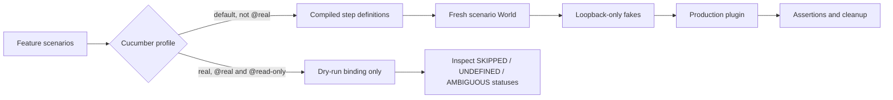

# Phase 7: Cucumber Feature Conformance - Research

**Researched:** 2026-10-19
**Domain:** Gherkin and TypeScript behavioral-test conformance
**Confidence:** HIGH for local inventory and commands; MEDIUM for documented Cucumber behavior

<user_constraints>
## User Constraints (from CONTEXT.md)

### Locked Decisions

### Scope and rulebook

- **D-01:** Review the actual complete `features/**` inventory: fifteen
  `.feature` files and twenty-two TypeScript files at phase start, including
  `features/lib/hap.ts`. The roadmap's count of twenty-one TypeScript files and
  its `features/support/steps/harness.ts` example are stale; file existence and
  the phase goal determine the inventory.
- **D-02:** `.agents/skills/cucumber/SKILL.md` and its four rule files are the
  current behavioral-testing rulebook. The former `features/CLAUDE.md` and
  `skills/cucumber-behavioral-testing` references in milestone prose refer to
  rules that were migrated into that skill; do not recreate obsolete files.
  `.agents/skills/typescript-style/SKILL.md` governs TypeScript style.
- **D-03:** Keep the default profile's scenario count at its measured phase-start
  baseline unless the ledger explains every count change. Compile first. Run
  the real profile only with `--dry-run`; never execute its steps or contact
  vendor services, hardware, or a real account.

### Review and repair policy

- **D-04:** Apply the approved Phase 1 header form to reviewed TypeScript
  files: SPDX, separate copyright and `@fileoverview` blocks, with the
  established spacing and attribution. Record stable finding IDs, exact rule,
  revision-qualified location, severity, disposition, and test/commit evidence
  in the phase ledger. Review complete files, not only changed lines.
- **D-05:** Each batch uses review, triage, cause repair, and independent
  re-review. Stop all batch work if an open count does not fall, a fixed finding
  reopens, or correction round four is reached, even if clean. Report open IDs
  accurately at STOP. Phase 5's exceptional round extensions do not carry
  forward.
- **D-06:** For a genuine behavior bug, observe the active intended regression
  fail against unchanged production and commit planning-only RED evidence
  before the minimum GREEN code/test fix. Keep source bytes and Git history
  intact; do not bypass hooks. Trace callers before changing shared helpers.
- **D-07:** Preserve product safety, identity, telemetry trust, privacy, and
  Homebridge contracts. Use offline stand-ins. Every modified source/test pair
  retains 100% isolated direct coverage; run the full `npm run check` at wave
  and phase gates. Do not recreate the two tests that the maintainer explicitly
  deleted in Phase 6.

### The agent's Discretion

- Divide Gherkin and TypeScript review into disjoint batches and sequential
  waves for shared world or harness ownership. Choose the smallest repairs
  that satisfy confirmed findings and the existing contracts.
- Apply the current Cucumber skill's layout conventions to the real-pump
  support modules without running their live steps.

### Deferred Ideas (OUT OF SCOPE)

- The real Homebridge degraded-status check remains unverified because the
  maintainer could not run it during Phase 6. It is a later release gate, not
  evidence that Phase 7 Cucumber conformance passed.
</user_constraints>

<phase_requirements>
## Phase Requirements

| ID | Description | Research Support |
|----|-------------|------------------|
| FEAT-01 | All Gherkin under `features/**/*.feature` follows the current behavioral-testing rules. | Inventory, feature-rule review matrix, default and real-profile checks. |
| FEAT-02 | Step definitions and support code under `features/**` follow the behavioral-testing and TypeScript rules. | TypeScript inventory, registration boundaries, world/stand-in review, headers, isolated gates. |
| PROC-01 | Every finding has a rule, location, severity, and disposition. | Stable-ID ledger and revision-qualified evidence protocol. |
| PROC-02 | Re-review converges or stops at the four-round limit. | Per-batch open-count comparison and unconditional stop rule. |
| BUG-01 | Every confirmed bug has a failing regression before its fix. | Active RED on unchanged production, planning-only evidence commit, then GREEN. |
</phase_requirements>

## Project Constraints (from AGENTS.md)

- Read a file before editing it, trace a function's callers before modifying it, and research the affected behavior first. Use the applicable official Homebridge or Cucumber documentation and compare it with the installed version and types. [VERIFIED: `AGENTS.md:9-20`]
- Preserve TypeScript ESM `.js` relative imports, Homebridge compatibility and `api.hap` ownership, cloud-only production behavior, device identity, narrow telemetry trust, private credentials, and the stated persistence boundaries. Keep release `1.0.0` behind the declared hardware, automated, package, secret-scan and compatibility gates. The project document quotes the Node runtime as `"^22.10.0 || ^24.0.0"`; the manifest separately quotes `"^22.10.0 || ^24.0.0 || ^26.0.0"`. Record this discrepancy instead of silently treating a Node 26 check as a Node 22/24 compatibility check. [VERIFIED: `AGENTS.md:63-72`; `package.json:29-31`]
- Work on a `features/*` branch, prefer a worktree for new feature work, use the committing skill and normal hooks, and never bypass hooks, rebase, or rewrite history. Before a PR, offer the package/lock/Sonar version bump and write a concise changelog entry. Use the `simple-english` Plain and `humanizer` skills on PR descriptions. Merge PRs with `--squash`; audit and close a shipping milestone on the PR branch before merge. [VERIFIED: `AGENTS.md:22-32,49-51`]
- Prefix GSD window descriptions with the milestone and include `## Threat Flags` in every plan summary. Use the GSD workflow entry point before file edits. [VERIFIED: `AGENTS.md:34-43,113-123`]
- Use the local-verification schedule: commit hooks are incremental, while `npm run check` is the post-merge wave and phase gate. Reuse passing evidence only for unchanged inputs. Use `fallow dead-code` before deleting exports or dependencies, `fallow dead-code --type-aware --symbol-impact` before exact consumer claims, `fallow trace` for reachability, `fallow guard` before edits, `fallow review` for diff orientation, and `fallow audit` before commit or PR. The task map also specifies `fallow health`, `fallow dupes`, `fallow flags`, `fallow security`, `fallow explain`, and monorepo `--workspace` filters when those questions arise. [VERIFIED: `AGENTS.md:45-47,139-157`; `.agents/skills/local-verification/rules/gates.md:1-10`]

## Summary

The current inventory contains 15 `.feature` files and 22 TypeScript files. The default profile selects 12 feature files; the real profile selects three. The actual installed Cucumber CLI is 13.2.1, and the checked default baseline passed 104 scenarios and 1,156 steps after test compilation. The real dry run selected seven scenarios and 41 steps, all skipped. [VERIFIED: `rg --files features` inventory; `cucumber.json:2-14`; `package.json:35-36,55,63`; local `cucumber-js --version` and baseline command output, 2026-10-19]

The official versioned dry-run documentation says support code loads while hooks and steps do not run. It also says undefined and ambiguous steps can be reported without a failing process status. Consequently, the real-profile gate must inspect the summary or message statuses and require exactly seven `SKIPPED` scenarios and 41 `SKIPPED` steps with zero `UNDEFINED` and `AMBIGUOUS`; exit code zero alone is insufficient. [CITED: https://github.com/cucumber/cucumber-js/blob/v13.2.1/docs/dry_run.md] The local dry-run usage output had no `UNUSED` definition, but emitted a `MaxListenersExceededWarning` for `process.unhandledRejection`. This is a review candidate rather than a confirmed behavioral finding because ordinary execution passed; inspect the world constructor and cleanup semantics in its dedicated batch. [VERIFIED: local `cucumber-js --dry-run --format usage` output, 2026-10-19; `features/support/world.ts:228-235,781-785`]

**Primary recommendation:** Review each file in a bounded owner batch; repair only accepted findings; independently re-review each batch with the four-round stop, then run the full combined gate and a status-checked real dry run. [VERIFIED: `.planning/phases/07-cucumber-feature-conformance/07-CONTEXT.md:26-52`; `.agents/skills/local-verification/rules/gates.md:1-10`]

## Architectural Responsibility Map

| Capability | Primary Tier | Secondary Tier | Rationale |
|------------|--------------|----------------|-----------|
| Gherkin contract | Test specification | Runtime behavior | Scenarios describe externally visible behavior and assert whole outcomes. [VERIFIED: `.agents/skills/cucumber/rules/features.md:5-5,48-52`] |
| Step binding and assertions | Test adapter | Test world | Step modules register one match and use the world for scenario state. [VERIFIED: `.agents/skills/cucumber/rules/layout.md:45-49`; `.agents/skills/cucumber/rules/steps.md:50-66`] |
| Offline stand-ins | Test support | Loopback services | Library modules supply isolated fakes; the world releases scenario resources. [VERIFIED: `.agents/skills/cucumber/rules/layout.md:45-52`; `.agents/skills/cucumber/rules/world-and-stand-ins.md:7-19`] |
| Real-pump observation | Isolated test profile | Vendor services, only in a later live gate | This phase may parse and bind its steps, but may not execute them. [VERIFIED: `cucumber.json:9-13`; `.planning/phases/07-cucumber-feature-conformance/07-CONTEXT.md:10-14,25-28`] |

## Standard Stack

| Component | Installed/configured version | Purpose | Evidence |
|-----------|------------------------------|---------|----------|
| `@cucumber/cucumber` | Installed CLI `13.2.1`; manifest range `^13.2.1` | Runner, profiles, World, hooks, steps, formatters. | The quoted range is `"^13.2.1"`. [VERIFIED: `package.json:62-64`; local `cucumber-js --version`] |
| TypeScript | Manifest range `^6.0.3` | Compile ESM test support before Cucumber loads it. | The quoted range is `"^6.0.3"`; `build:test` compiles to `dist-test`. [VERIFIED: `package.json:35,79`; `cucumber.json:4,11`] |
| `node:assert/strict` | Node builtin | Whole-value assertion in `Then` steps. | [VERIFIED: `.agents/skills/cucumber/rules/steps.md:40-42,58-62`] |

No new external package is needed, so there is no installation or package-legitimacy gate for this phase. [VERIFIED: `package.json:33-60`; `.agents/skills/cucumber/rules/steps.md:40-42`]

## Exact Phase-Start Inventory

The following is a filesystem snapshot from `rg --files features`, grouped by ownership. It corrects the roadmap's stale count. [VERIFIED: `rg --files features` output, 2026-10-19; `.planning/phases/07-cucumber-feature-conformance/07-CONTEXT.md:24-37`]

| Family | Files | Count |
|--------|-------|------:|
| Default Gherkin | `accessory/discovery.feature`, `account/configuration.feature`, `account/sign-in.feature`, `harness/fakes.feature`, `homekit/official-controls.feature`, `homekit/safety-state.feature`, `monitoring/degradation.feature`, `plugin/lifecycle.feature`, `pump/records.feature`, `shadow/connection-lifecycle.feature`, `shadow/credential-rotation.feature`, `shadow/state-merging.feature` | 12 |
| Real Gherkin | `real-pump/discovery.feature`, `real-pump/heartbeats.feature`, `real-pump/lifecycle.feature` | 3 |
| Default steps | `step_definitions/accessory.steps.ts`, `account.steps.ts`, `configuration.steps.ts`, `controls.steps.ts`, `hap.steps.ts`, `harness.steps.ts`, `homekit.steps.ts`, `runtime.steps.ts`, `shadow.steps.ts` | 9 |
| Default world | `support/world.ts` | 1 |
| Default libraries | `lib/auth0.ts`, `hap.ts`, `homebridgeApi.ts`, `loopbackServer.ts`, `publishedServices.ts`, `shadowBroker.ts`, `timers.ts`, `vendorRestApi.ts` | 8 |
| Real support | `real-pump/support/heartbeatSteps.ts`, `lifecycleSteps.ts`, `realWorld.ts`, `steps.ts` | 4 |

All table paths are relative to `features/`; no new path is proposed by this inventory. `features/lib/hap.ts` is 729 lines and `features/support/world.ts` is 785 lines in this snapshot; each deserves separate complete-file review. [VERIFIED: local `wc -l` output, 2026-10-19]

## Architecture Patterns



The default profile imports compiled support and `.steps.js` modules, filters `not @real`, and retains random order. The real profile imports its own compiled support and filters `@real and @read-only`. Those literal selectors are `"not @real"` and `"@real and @read-only"`. [VERIFIED: `cucumber.json:2-14`] Cucumber's versioned configuration documentation supports profile, import, tag, format and ordering options; the local 13.2.1 CLI exposes the corresponding flags. [CITED: https://github.com/cucumber/cucumber-js/blob/v13.2.1/docs/configuration.md] [VERIFIED: local `cucumber-js --help` output, 2026-10-19]

The installed 13.2.1 type declaration quotes `dryRun: boolean` and describes a prepared run where nothing executes; it agrees with the versioned dry-run page and the local CLI. No relevant disagreement was observed for the flags and statuses this phase uses. [VERIFIED: `node_modules/@cucumber/cucumber/lib/api/types.d.ts:175-179`; local `cucumber-js --help` output, 2026-10-19] [CITED: https://github.com/cucumber/cucumber-js/blob/v13.2.1/docs/dry_run.md]

### Recommended executable batch order

1. **Wave 0: inventory and ledger.** Save exact paths, `git rev-parse HEAD`, Node/CLI versions, baseline command output and the verified counts. Define stable IDs and a separate correction counter for each batch. [VERIFIED: `.planning/phases/07-cucumber-feature-conformance/07-CONTEXT.md:24-52`; local baseline output]
2. **Wave 1: disjoint full-file reviews.** Batches: 12 default Gherkin; three real Gherkin; eight default step modules excluding `harness.steps.ts`; seven default libraries excluding `hap.ts`. Review the content, not only grep matches. Review scope and rules separately from repairs so coupled feature/step text edits can be assigned to one owner. [VERIFIED: inventory above; `.agents/skills/cucumber/SKILL.md:19-29`]
3. **Wave 2: shared default harness.** Give `features/step_definitions/harness.steps.ts` and `features/support/world.ts` one serial owner; inspect the dry-run listener warning here. Give `features/lib/hap.ts` its own complete-file batch and trace its consumers, including unit tests, before public-shape edits. [VERIFIED: `features/support/world.ts:228-235,781-785`; `.planning/phases/05-accessories-conformance/05-CONTEXT.md:78-90`; `.planning/phases/07-cucumber-feature-conformance/07-CONTEXT.md:65-72`]
4. **Wave 3: isolated real support.** Review all four TypeScript files statically against layout, headers, World and TypeScript rules. Three files, `heartbeatSteps.ts`, `lifecycleSteps.ts`, and `steps.ts`, register `When`/`Then` from `real-pump/support/` without the `.steps.ts` suffix; triage them as concrete layout candidates and keep any move within this profile's import boundary. Never execute real steps. [VERIFIED: `features/real-pump/support/heartbeatSteps.ts:20-36`; `features/real-pump/support/lifecycleSteps.ts:16-36`; `features/real-pump/support/steps.ts:44-63`; `.agents/skills/cucumber/rules/layout.md:45-49`; `cucumber.json:9-13`]
5. **Wave and phase gates.** After each combined wave, run `npm run check`; compile again before dry runs, inspect default `usage` for `UNUSED`, and inspect real summary/message statuses. End with ledger accounting for every file and ID. [VERIFIED: `.agents/skills/local-verification/rules/gates.md:1-10`; `.agents/skills/cucumber/SKILL.md:26-29`; `.planning/phases/07-cucumber-feature-conformance/07-CONTEXT.md:39-52`]

If a Gherkin repair changes step text, assign its matching definition to the same serial repair owner; run the combined default profile before committing. Do not let separately owned plans mutate the same file or issue concurrent builds/commits. [VERIFIED: `.planning/phases/07-cucumber-feature-conformance/07-CONTEXT.md:39-52`; `cucumber.json:2-7`]

## Don't Hand-Roll

| Problem | Do not build | Use instead | Why |
|---------|--------------|-------------|-----|
| Detect unused step definitions | Repository source scanner | Cucumber `--dry-run --format usage`; inspect `UNUSED`. | The built-in formatter records actual registered definitions and uses. [CITED: https://github.com/cucumber/cucumber-js/blob/v13.2.1/docs/formatters.md] |
| Detect broken step matching | Regex scan of source text | Default executable profile plus real-profile dry-run status inspection. | Dry-run exit can still be zero on `UNDEFINED` or `AMBIGUOUS`. [CITED: https://github.com/cucumber/cucumber-js/blob/v13.2.1/docs/dry_run.md] |
| Check table outcomes | Sample-row assertion or substring test | Whole-row `deepStrictEqual` against `table.raw()`. | Partial checks permit plausible wrong outputs. [VERIFIED: `.agents/skills/cucumber/rules/steps.md:58-62`] |
| Test cloud integration | Live vendor call in default suite | Existing loopback fake modules and per-scenario world. | Default tests must remain offline and releasable. [VERIFIED: `.agents/skills/cucumber/SKILL.md:6-8,26-29`; `.agents/skills/cucumber/rules/world-and-stand-ins.md:7-19`] |

## Common Pitfalls

| Pitfall | Detection and required action |
|---------|-------------------------------|
| Treating a real dry-run exit zero as proof of bound steps. | Require the exact 7/41 skipped counts and zero undefined/ambiguous in the formatter output. [CITED: https://github.com/cucumber/cucumber-js/blob/v13.2.1/docs/dry_run.md] |
| Warning from world construction during dry run. | `world.ts` adds `process.unhandledRejection` listener in its constructor and removes it through registered cleanup; the dry run emits `MaxListenersExceededWarning` while hooks are skipped. Independently review resource lifetime and decide whether this is an accepted issue; do not suppress it by raising the listener limit without a cause analysis. [VERIFIED: `features/support/world.ts:228-235,781-785`; local dry-run output, 2026-10-19] [CITED: https://github.com/cucumber/cucumber-js/blob/v13.2.1/docs/dry_run.md] |
| Moving real step modules without preserving loading. | The current real import is `"dist-test/features/real-pump/**/*.js"`; any layout repair must keep compiled modules reachable under the isolated real profile. [VERIFIED: `cucumber.json:9-13`; `.agents/skills/cucumber/rules/layout.md:45-49`] |
| Cosmetic assertion repair that leaves a lying scenario. | Re-run a plausible wrong implementation or assertion control and verify the named scenario fails; require whole results, not one field or sample row. [VERIFIED: `.agents/skills/cucumber/SKILL.md:6-8,19-29`; `.agents/skills/cucumber/rules/steps.md:58-62`] |
| Reusing Phase 5's exceptional correction cap. | Apply the Phase 7 four-round stop, including a clean fourth round, and report open IDs. [VERIFIED: `.planning/phases/07-cucumber-feature-conformance/07-CONTEXT.md:39-43`] |

The opening review has concrete seeds, not pre-adjudicated ledger findings: `features/homekit/official-controls.feature` has a `Given` after `When` at lines 211-216, conflicting with the feature rule; the three real step modules begin with `@fileoverview` but lack the approved SPDX/copyright blocks; and `real-pump/support/steps.ts` exports `until` from a step module while another step module imports it, so the layout rule's library-helper boundary needs review. Fixes must preserve the scenarios' intended behavior and the real-profile import. [VERIFIED: `features/homekit/official-controls.feature:211-216`; `features/real-pump/support/heartbeatSteps.ts:1-11`; `features/real-pump/support/lifecycleSteps.ts:1-12`; `features/real-pump/support/steps.ts:1-26`; `.agents/skills/cucumber/rules/features.md:36-46`; `.agents/skills/cucumber/rules/layout.md:45-49`; `.planning/phases/07-cucumber-feature-conformance/07-CONTEXT.md:40-44`]

## Code Examples

Use the repository's existing commands as the executable pattern. All paths and status words below are quoted from `package.json`, `cucumber.json`, the installed CLI help or the official v13.2.1 formatter docs. [VERIFIED: `package.json:35-36,55`; `cucumber.json:2-14`; local CLI help, 2026-10-19] [CITED: https://github.com/cucumber/cucumber-js/blob/v13.2.1/docs/formatters.md]

```bash
npm run build:test
./node_modules/.bin/cucumber-js --format summary
./node_modules/.bin/cucumber-js --dry-run --format usage
./node_modules/.bin/cucumber-js --profile real --dry-run --format summary
npm run check
```

The third command needs an explicit `UNUSED` check; the fourth needs `SKIPPED`, `UNDEFINED`, and `AMBIGUOUS` status inspection. Do not turn the fourth into a live run. [VERIFIED: `.agents/skills/cucumber/rules/steps.md:64-66`; `.planning/phases/07-cucumber-feature-conformance/07-CONTEXT.md:25-28`] [CITED: https://github.com/cucumber/cucumber-js/blob/v13.2.1/docs/dry_run.md]

## Validation Architecture

| Property | Value |
|----------|-------|
| Framework | Installed Cucumber.js CLI 13.2.1; existing Node test runner for any changed source/test pair. [VERIFIED: local CLI output; `package.json:55-56,63`] |
| Configuration | `cucumber.json` defines default and real profiles. [VERIFIED: `cucumber.json:1-15`] |
| Focused check | `npm run build:test`, then `./node_modules/.bin/cucumber-js --name '<exact scenario title>'` for default scenarios only. [VERIFIED: `package.json:35`; `.agents/skills/local-verification/rules/commands.md:11-12`] |
| Combined gate | `npm run check` after each wave and at phase end. [VERIFIED: `package.json:36`; `.agents/skills/local-verification/rules/gates.md:1-10`] |

| Requirement | Verification |
|-------------|--------------|
| FEAT-01 | Review all 15 feature files against the complete Gherkin rule file; default 104/1156 pass; real 7/41 dry-run statuses only. [VERIFIED: inventory and baseline output; `.agents/skills/cucumber/rules/features.md:25-56`] |
| FEAT-02 | Review 22 TypeScript files, headers, registration boundaries, World cleanup and whole assertions; default usage has no `UNUSED`. [VERIFIED: inventory and local usage output; `.agents/skills/cucumber/rules/layout.md:33-52`; `.agents/skills/cucumber/rules/steps.md:44-66`] |
| PROC-01 / PROC-02 | Ledger has path, source revision, rule, severity, disposition, evidence and per-batch open-count trajectory; stop on no progress, reopened finding or fourth correction. [VERIFIED: `.planning/phases/07-cucumber-feature-conformance/07-CONTEXT.md:34-43`] |
| BUG-01 | For a confirmed behavior bug, show a failing active regression on unchanged production, commit planning-only RED evidence, then make the minimum GREEN change and retain 100% direct pair coverage. [VERIFIED: `.planning/phases/07-cucumber-feature-conformance/07-CONTEXT.md:44-52`; `.agents/skills/local-verification/rules/commands.md:1-13`] |

No new test framework or Wave 0 test file is needed; Wave 0 needs baseline and ledger records. [VERIFIED: `package.json:35-59`; `.planning/phases/07-cucumber-feature-conformance/07-CONTEXT.md:34-52`]

## Security Domain

The phase's security-relevant boundary is test isolation and privacy: default scenarios use local stand-ins, and real-pump files remain dry-run only. [VERIFIED: `.agents/skills/cucumber/SKILL.md:6-8`; `.planning/phases/07-cucumber-feature-conformance/07-CONTEXT.md:10-14,25-28`]

| ASVS category | Applies to this review | Control |
|---------------|------------------------|---------|
| V2 Authentication | Yes, as behavior already covered by account scenarios | Review no-secret-log and refused-credential assertions without live accounts. [VERIFIED: `features/account/sign-in.feature:1-48`; `AGENTS.md:65-72`] |
| V3 Session Management | No new session mechanism | Preserve existing token-cache and cleanup tests; no design change authorized. [VERIFIED: `.planning/phases/07-cucumber-feature-conformance/07-CONTEXT.md:44-52`] |
| V4 Access Control | No new authorization endpoint | Preserve official-control refusal scenarios. [VERIFIED: `features/homekit/official-controls.feature:1-219`] |
| V5 Input Validation | Yes, as behavioral assertions | Verify invalid payloads fail or narrow trust instead of defaulting to healthy; use whole-value assertions. [VERIFIED: `AGENTS.md:64-71`; `.agents/skills/cucumber/rules/steps.md:58-62`] |
| V6 Cryptography | No new primitive | Do not hand-roll or change token/credential handling during conformance repairs. [VERIFIED: `.planning/phases/07-cucumber-feature-conformance/07-CONTEXT.md:44-52`] |

## Environment Availability

| Dependency | Required by | Available | Evidence / fallback |
|------------|-------------|-----------|---------------------|
| Node.js | Test compilation and runner | Yes, `v26.12.0`; permitted by manifest's quoted range `"^22.10.0 || ^24.0.0 || ^26.0.0"`. | [VERIFIED: `package.json:29-31`; local `node --version` output] |
| npm | Existing scripts | Yes, `11.20.0`. | [VERIFIED: local `npm --version` output] |
| Cucumber CLI | Default and real-profile checks | Yes, `13.2.1`. | [VERIFIED: local `cucumber-js --version` output] |
| Loopback binds | Offline default fakes | Yes when allowed for the check; sandbox-only run produced `listen EPERM: operation not permitted 127.0.0.1`, while the permitted run passed 104/1156. | [VERIFIED: local baseline outputs, 2026-10-19] |
| Vendor/hardware | Real-pump live scenarios | Intentionally unused. | Dry-run only. [VERIFIED: `.planning/phases/07-cucumber-feature-conformance/07-CONTEXT.md:10-14,25-28`] |

## Assumptions Log

| # | Claim | Section | Risk if wrong |
|---|-------|---------|---------------|
| A1 | [ASSUMED] A review may classify the dry-run listener warning as a cleanup defect; the evidence here establishes a warning and its likely path, not its severity or required fix. | Common Pitfalls | Premature workaround or missed leak. |

## Open Questions

1. **RESOLVED for planning — dry-run listener warning:** Plan 07-10 owns the full-file review of `world.ts` and must decide the warning's disposition from that review before any source change. The warning remains a candidate, not a preaccepted finding. [VERIFIED: `.planning/phases/07-cucumber-feature-conformance/07-10-PLAN.md:1-75`; local usage output; `features/support/world.ts:228-235,781-785`]
2. **RESOLVED for planning — real support layout and helper boundary:** Plan 07-13 owns the three real step-module moves and polling-helper extraction. It must preserve the real profile's seven scenarios and 41 skipped steps, with no undefined or ambiguous steps and no live execution. [VERIFIED: `.planning/phases/07-cucumber-feature-conformance/07-13-PLAN.md`; `cucumber.json:9-13`]
3. **RESOLVED for planning — Node baseline:** Accept the passing Node 26 baseline for this Phase 7 conformance review because `package.json` permits Node 26. Node 22/24 compatibility evidence remains a later release or Phase 8 concern; Phase 7 does not claim that evidence. [VERIFIED: `package.json:29-31`; `AGENTS.md:63-66`; local `node --version` output]

## Sources

### Primary repository and installed sources (HIGH for observations)

- `.planning/phases/07-cucumber-feature-conformance/07-CONTEXT.md`, `.planning/ROADMAP.md`, `.planning/REQUIREMENTS.md`, `AGENTS.md`: scope, policy and constraints. [VERIFIED: files opened in this session]
- `.agents/skills/cucumber/SKILL.md` plus four rules, `.agents/skills/typescript-style/SKILL.md`, `.agents/skills/local-verification/SKILL.md` plus commands/gates: current rulebooks. [VERIFIED: files opened in this session]
- `cucumber.json`, `package.json`, installed CLI help/types and actual `rg --files features` inventory: runner shape, paths and commands. [VERIFIED: files/CLI opened in this session]
- Local runs after `npm run --silent build:test`: default 104/1156 passed with loopback permission, real dry-run 7/41 skipped, default usage zero `UNUSED` with MaxListeners warning. [VERIFIED: command outputs, 2026-10-19]

### Official versioned documentation (MEDIUM for external behavior)

- [Cucumber.js v13.2.1 dry run](https://github.com/cucumber/cucumber-js/blob/v13.2.1/docs/dry_run.md): hooks and step bodies skipped; undefined/ambiguous status does not fail the process. [CITED: https://github.com/cucumber/cucumber-js/blob/v13.2.1/docs/dry_run.md]
- [Cucumber.js v13.2.1 configuration](https://github.com/cucumber/cucumber-js/blob/v13.2.1/docs/configuration.md): profile, import, tag, order and format options. [CITED: https://github.com/cucumber/cucumber-js/blob/v13.2.1/docs/configuration.md]
- [Cucumber.js v13.2.1 formatters](https://github.com/cucumber/cucumber-js/blob/v13.2.1/docs/formatters.md): summary, message and usage outputs. [CITED: https://github.com/cucumber/cucumber-js/blob/v13.2.1/docs/formatters.md]

## Metadata

- **Standard stack:** HIGH for installed version and manifest; MEDIUM for official documentation behavior. [VERIFIED: `package.json:62-64`; local CLI output] [CITED: https://github.com/cucumber/cucumber-js/blob/v13.2.1/docs/dry_run.md]
- **Architecture:** HIGH for actual profile imports and project rules. [VERIFIED: `cucumber.json:2-14`; `.agents/skills/cucumber/rules/layout.md:9-52`]
- **Pitfalls:** HIGH for observed listener warning and profile counts; MEDIUM for dry-run failure semantics. [VERIFIED: local run outputs] [CITED: https://github.com/cucumber/cucumber-js/blob/v13.2.1/docs/dry_run.md]
- **Valid until:** 2026-11-18 for this pinned 13.2.1 research; refresh if package/configuration or the feature tree changes. [ASSUMED]
