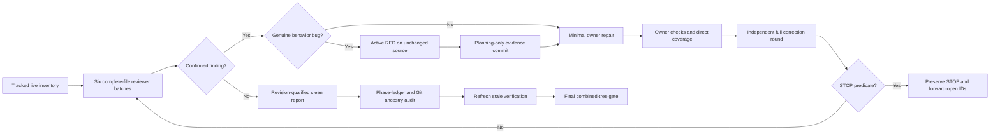

# Phase 8: Final Sweep and Gate — Research

**Researched:** 2026-10-22
**Domain:** Complete-file TypeScript and Cucumber review, evidence provenance, and combined-tree gates
**Confidence:** HIGH for repository facts; MEDIUM for ASVS mapping

<user_constraints>
## User Constraints (from CONTEXT.md)

### Locked Decisions

### Scope and rulebooks

- Use the live file inventory and the current `.agents/skills` rulebooks. The
  older `skills/*` and `features/CLAUDE.md` names in milestone prose refer to
  rules migrated into the current skills; do not recreate obsolete files.
- Apply the Phase 1 header form: SPDX first, then separate copyright and brief
  `@fileoverview` JSDoc blocks. Preserve existing license attribution.
- Keep `test/configSchema.test.ts` and `test/packageManifest.test.ts` deleted,
  as the maintainer requested in Phase 6.

### Review, repair, and evidence

- Review complete current files across subsystem boundaries, not only diffs.
  Divide the inventory into disjoint batches. Record stable IDs, exact rule,
  revision-qualified location, severity, disposition, and test/commit evidence.
- Fix confirmed findings at their cause. Stop the whole review when an open
  correction round makes no progress, a fixed finding returns, or round four
  is reached. Preserve historical STOP records and report any forward-open
  findings without silently waiving them.
- For a genuine behavior bug, observe an active regression failure against
  unchanged production and commit planning-only RED evidence before the
  minimum GREEN source/test fix. Use normal hooks and atomic commits.
- Audit the actual phase ledgers and Git ancestry for every bug. Do not infer
  a regression, fix commit, rejection reason, or closure from a passing check.

### Verification and closeout

- Preserve safety, identity, telemetry trust, privacy, persistence, and
  Homebridge contracts. Modified source/test pairs retain 100% isolated direct
  line, function, and branch coverage. Run the full `npm run check` on the final
  combined tree.
- Earlier Phase 1–6 verification reports currently read stale because later
  phases changed covered files. Reconcile their verification status before
  declaring the milestone complete; a prior pass is not a current pass.
- Keep the 18 open and 19 waived cross-milestone windows visible for audit.
  An open window is not automatically a current code finding, nor is it
  automatically closed by Phase 8's gate.

### the agent's Discretion

Choose disjoint review batches and the smallest verified repairs. Schedule
shared files serially and use the project's offline stand-ins. Use in-session
reviewers where independent review is required.

### Deferred Ideas (OUT OF SCOPE)

Real Homebridge confirmation of the monitoring trust publication repair and
hardware gates remain outside this milestone. They must not be counted as
Phase 8's static or offline test evidence.
</user_constraints>

<phase_requirements>
## Phase Requirements

| ID | Description | Research support |
| --- | --- | --- |
| BUG-01 | Each bug found gets a failing regression test before its fix and is listed in the phase ledger. | Audit every Phase 1–7 genuine-bug row against committed RED JSON, native target failure, source/evidence/fix ancestry, unchanged production blob, and live regression; use the same sequence for Phase 8 bugs. [VERIFIED: .planning/REQUIREMENTS.md:39-42; .planning/phases/01-known-findings-and-loop-proof/01-FINDINGS.md:52-82] |
| GATE-01 | Every source/test pair keeps 100% direct coverage, and the full `npm run check` passes at milestone end. | Run the final full gate on the combined tree; its script runs static, build, unpaired tests, default offline Cucumber and isolated direct coverage. [VERIFIED: .planning/REQUIREMENTS.md:40; package.json:35-38] |
| GATE-02 | A final full-repo re-review finds no open findings. | Review all 137 currently in-scope paths in complete-file batches, record current dispositions and any STOP. [VERIFIED: .planning/ROADMAP.md:346-358; git ls-files src test features at cd41313] |
</phase_requirements>

## Summary

Phase 8 is a review and evidence reconciliation phase. The tracked current inventory at `cd41313` has 43 TypeScript source modules, each with a mirrored owner test, nine TypeScript test helpers, one retained real-HAP fidelity test, two JSON source/test fixtures, 15 Gherkin files, and 24 feature TypeScript files: **137 in-scope paths**. Ten repository-level `.test.ts` files are outside the complete-file review set, although the full gate still runs them. The inventory was computed from `git ls-files src test features`, then checked against the pairing rule in `scripts/check-corresponding-tests.mjs`. Refresh it at execution start and after any additions, deletions, or moves. [VERIFIED: scripts/check-corresponding-tests.mjs:11-15,24-38,46-56,121-160; git ls-files src test features at cd41313]

Prior ledgers contain a useful review protocol, but their earlier file lists and pass judgments do not certify the final tree. In particular, the live `verification status` seam returns `stale` for Phases 1–6 and `passed` for Phase 7. The Phase 7 end gate reported 130 default offline scenarios, 1,400 steps, and 43 direct pairs on Node `v26.12.1`; those are historical baseline observations, not a Phase 8 result. [VERIFIED: query verification status for phases 01–07, 2026-10-22; .planning/phases/07-cucumber-feature-conformance/07-FINDINGS.md:634-692]

**Primary recommendation:** Freeze a live path/blob manifest, review complete files in six disjoint ownership batches, serialize all cross-batch repairs, audit historical bug provenance, refresh stale verifications, and run one final `TEST_CONCURRENCY=1 npm run check` on the sealed tree. [VERIFIED: .planning/phases/08-final-sweep-and-gate/08-CONTEXT.md:27-59; .agents/skills/local-verification/rules/gates.md:1-11]

## Architectural Responsibility Map

| Capability | Primary tier | Secondary tier | Rationale |
| --- | --- | --- | --- |
| Account grants, REST and shadow transport | Cloud adapter | Runtime | Review token, HTTP and message contracts alongside the runtime consumers. [VERIFIED: git ls-files src/cloud src/runtime at cd41313] |
| Device decoding and persisted observation | Device and persistence | Runtime | Review accepted telemetry, family adapters and stored state together, then trace their consumers. [VERIFIED: git ls-files src/device src/persistence src/runtime at cd41313] |
| Trust, commands, and HomeKit publication | Runtime and accessory | Platform root | `src/platform.ts` is the integration seam that connects these layers. [VERIFIED: .planning/phases/08-final-sweep-and-gate/08-CONTEXT.md:78-83] |
| Behavioral evidence | Feature harness | Source/test owners | Offline stand-ins drive public behavior; the real profile is limited to dry-run binding. [VERIFIED: .agents/skills/cucumber/SKILL.md:7-23; cucumber.json:2-13] |
| Findings and bug provenance | Planning records and Git | All tiers | A passing gate cannot establish the historical RED/green order or resolve a prior STOP. [VERIFIED: .planning/phases/08-final-sweep-and-gate/08-CONTEXT.md:35-48] |

## Project Constraints (from AGENTS.md)

- Read a file before editing it; trace callers before modifying a function; consult applicable Homebridge or Cucumber primary documentation and compare it with installed types before changing their behavior. [VERIFIED: AGENTS.md:8-17]
- Keep TypeScript ESM imports with `.js` extensions; support Homebridge via `api.hap`; preserve safety, stable `deviceId` identity, privacy and explicit persistence. [VERIFIED: AGENTS.md:42-50]
- Use feature branches; never commit on main, rebase, rewrite history, or skip hooks; follow the committing skill for atomic commits. [VERIFIED: AGENTS.md:19-31]
- Use current GSD workflow records; prefix broken-window descriptions with the milestone; every plan SUMMARY has `## Threat Flags`. [VERIFIED: AGENTS.md:33-40,91-103]
- Keep full `npm run check` for combined wave, phase, merge and final handoff gates; commit-hook evidence is incremental. [VERIFIED: AGENTS.md:42-44; .agents/skills/local-verification/rules/gates.md:1-11]
- Consult `fallow guard` before changing a path and `fallow audit --base <ref>` before a commit or PR. The guard run on this research path returned zone `none`, no configured rule pack. [VERIFIED: AGENTS.md:109-127; command `./node_modules/.bin/fallow guard .planning/phases/08-final-sweep-and-gate/08-RESEARCH.md`, 2026-10-22]

## Standard Stack

This phase installs **no external package**. Use the existing manifest and local binaries. The manifest currently declares `@cucumber/cucumber` `^13.2.1`, `fallow` `3.27.0`, TypeScript `^6.0.3`, and `strong-mock` `^9.2.2`; the local Cucumber and Fallow CLIs report `13.2.1` and `3.27.0`. The current Node process reports `v26.12.1`; `package.json` permits Node 22, 24 and 26, but the latest recorded full gate is Node 26 evidence only. [VERIFIED: package.json:31-34,66-88; local `node --version`, `./node_modules/.bin/cucumber-js --version`, `./node_modules/.bin/fallow --version` on 2026-10-22; .planning/phases/07-cucumber-feature-conformance/07-FINDINGS.md:684-692]

| Purpose | Existing tool | Required use |
| --- | --- | --- |
| Unit tests and direct coverage | `node:test`, `node:assert/strict`, repository direct-coverage script | Named regression, owner test and isolated 100% source pair. [VERIFIED: .agents/skills/typescript-unit-tests/SKILL.md:7-24; scripts/test-coverage-direct.mjs:9-74] |
| Behavioral tests | Existing Cucumber installation and `cucumber.json` | Default profile for full gate; real profile dry-run only; inspect undefined, ambiguous and unused markers. [VERIFIED: cucumber.json:2-13; .agents/skills/cucumber/SKILL.md:25-35] |
| Static and full gate | Existing npm scripts, Prettier, ESLint, Fallow | Preserve `check:commit` hook behavior and run `check` on combined tree. [VERIFIED: package.json:35-57] |
| Evidence | Git and existing phase ledgers, `gsd-tools check tdd-red-evidence` | Compare source/evidence/fix ancestry, blobs and native failure rather than inferring from commit subjects. [VERIFIED: .planning/phases/01-known-findings-and-loop-proof/01-FINDINGS.md:52-82; .planning/phases/02-cloud-conformance/02-FINDINGS.md:198-246] |

## Live Scope and Review Batches

The exact current count comes from tracked paths, rather than the old Phase 7 starting inventory of 37 paths. Phase 7's three real-step modules moved to `features/real-pump/step_definitions/`, and two new `features/lib` modules entered the tree. The current feature count is 39 paths, split into 15 `.feature` and 24 `.ts`. [VERIFIED: git ls-files features at cd41313; .planning/phases/07-cucumber-feature-conformance/07-FINDINGS.md:72-99]

| Batch | Exclusive complete-file ownership | Count | Cross-boundary read targets |
| --- | --- | ---: | --- |
| CLOUD | `src/cloud/**/*.ts`, matching `test/cloud/**/*.test.ts`, `test/cloud/alpnServer.ts`, `apiSeeds.ts`, `sigv4Seeds.ts` | 19 | Runtime grant and shadow consumers. [VERIFIED: git ls-files src/cloud test/cloud at cd41313] |
| DEVICE | `src/device/**/*.ts`, `src/persistence/**/*.ts`, matching owners, `test/device/geminiSeeds.ts`, `stateSeeds.ts` | 20 | Runtime store and accessory trust consumers. [VERIFIED: git ls-files src/device src/persistence test/device test/persistence at cd41313] |
| RUNTIME | `src/runtime/**/*.ts`, matching owners, `test/runtime/accountRuntimeSeeds.ts`, `accountShadowContract.ts`, `arrivalAnchorMemoryContract.ts` | 23 | Cloud, device, accessory and platform contracts. [VERIFIED: git ls-files src/runtime test/runtime at cd41313] |
| ACCESSORY | `src/accessories/**/*.ts`, matching owners, retained `test/accessories/hapWriteFidelity.test.ts` | 21 | Platform publication and feature HAP stand-in. [VERIFIED: git ls-files src/accessories test/accessories at cd41313] |
| ROOT | Six root `src/*.ts`, six matching owners, `test/platformSeeds.ts`, `src/protocol.json`, `test/hbConfig/config.example.json` | 15 | All subsystem interfaces, especially `src/platform.ts`; the JSON files are source/config fixture support. [VERIFIED: git ls-files src test at cd41313; .planning/phases/06-root-module-conformance/06-FINDINGS.md:3-22] |
| FEATURES | All 15 `features/**/*.feature` and 24 `features/**/*.ts` paths, including default and real profile modules | 39 | Public behavior and fake fidelity across subsystem boundaries. [VERIFIED: git ls-files features at cd41313] |

These six ownership sets sum to 137 and do not overlap. A reviewer reads the whole assigned file at the current revision and can cite a read-only cross-boundary file. Any proposed edit to another batch is routed to the owning batch or a serial integration task; `features/support/world.ts`, `features/lib/hap.ts`, and `src/platform.ts` are shared integration seams, so repair ownership must be assigned once. A changed file receives a fresh complete-file review at its new revision. [VERIFIED: .planning/phases/08-final-sweep-and-gate/08-CONTEXT.md:32-36,78-83; .planning/ROADMAP.md:357-358]

Exclude the following ten repository-level tests from the complete-file rulebook sweep, while allowing them to run in `npm run check`: `test/architecture/platformWiring.test.ts`, `test/architecture/versionSync.test.ts`, `test/documentation.test.ts`, `test/packaging/dependencyAllowlist.test.ts`, `test/packaging/dependencyLicenses.test.ts`, `test/packaging/dependencyTelemetry.test.ts`, `test/packaging/licenseHeaders.test.ts`, `test/packedArtifact.test.ts`, `test/realPumpCommandBlock.test.ts`, and `test/repositoryGovernance.test.ts`. The pair scripts expressly treat the architecture root and named repository tests as unpaired. The two JSON files stay with ROOT because `src/**` is fully in scope and the config fixture supports its paired test; review their data contracts without applying TypeScript style rules. [VERIFIED: .planning/REQUIREMENTS.md:44-55; scripts/check-corresponding-tests.mjs:24-38; scripts/test-coverage-direct.mjs:19-33; git ls-files src test at cd41313]

## Architecture Patterns



### Pattern 1: Stable finding and round ledger

Use `CR-08-<BATCH>-NNN` IDs, one cause per ID. Store requirement, exact current rule section, original and current `revision:path:line`, severity, first reviewer, disposition or explicit rejection reason, named test, commands and raw exits, RED evidence commit, GREEN commit and review result. The existing Phase 5 table includes the corresponding fields; Phase 6 shows a compact form and an equation for rounds. For every round record opening, fixed, rejected, new, reopened, closing, and exact open IDs; check `closing = opening - fixed - rejected + new + reopened`. The round-zero review is not a correction. [VERIFIED: .planning/phases/05-accessories-conformance/05-FINDINGS.md:53-55,112-114; .planning/phases/06-root-module-conformance/06-FINDINGS.md:88-107]

Apply the global stop predicate **before** further repair or review: any open round with `closing >= opening`, any reopened fixed cause, or reaching correction round four. Report a stopped but unresolved phase honestly; a gate pass or later focused fix does not rewrite a historical STOP as a clean round. Phase 5 retained retired scanner findings under a STOP, Phase 6 retained ENTRY round-four findings until a separately authorized debug and fresh validation, and Phase 7 retained historical STOPs after forward closure. [VERIFIED: .planning/phases/05-accessories-conformance/05-FINDINGS.md:2077-2283; .planning/phases/06-root-module-conformance/06-FINDINGS.md:88-142; .planning/phases/07-cucumber-feature-conformance/07-FINDINGS.md:72-99,634-692]

### Pattern 2: Bug provenance audit

Build the milestone bug ledger by reading, not counting only `BLOCKER` rows. Phase 1 has SC-05 RED and GREEN ancestry; Phase 2's `Genuine bug provenance` table names five bugs; Phase 3 expressly reports no genuine bug; Phase 4 has genuine-bug history across its review and RED records; Phase 5 has a separate genuine-bug table; Phase 6 has multiple RED JSON archives and post-debug evidence; Phase 7 confirms one fake-service defect, `CR-07-RECORDS-004`, with evidence commit `4a0d43b` before fix `9f993a3`. Preserve priorEvidence chains where a JSON archive contains earlier records. [VERIFIED: .planning/phases/01-known-findings-and-loop-proof/01-FINDINGS.md:52-82; .planning/phases/02-cloud-conformance/02-FINDINGS.md:198-246; .planning/phases/03-device-and-persistence-conformance/03-FINDINGS.md:108-120; .planning/phases/04-runtime-conformance/04-FINDINGS.md:124-135; .planning/phases/05-accessories-conformance/05-FINDINGS.md:421-448; .planning/phases/06-root-module-conformance/06-FINDINGS.md:24-87,109-142; .planning/phases/07-cucumber-feature-conformance/07-FINDINGS.md:670-677]

For each claimed bug, check the named regression is active, the native RED target actually failed its intended assertion, production blobs are unchanged between baseline and evidence commits, the evidence commit changed only planning material, and the fix commit is a descendant that changes the owner source/test. Run `gsd-tools check tdd-red-evidence` on each archive, then inspect actual JSON and Git. A classifier result alone cannot prove semantic relevance or commit ancestry. For a new Phase 8 bug, commit the RED record before the source/test fix and keep failed test code uncommitted until the GREEN commit. [VERIFIED: .planning/phases/01-known-findings-and-loop-proof/01-FINDINGS.md:52-82; .planning/phases/02-cloud-conformance/02-FINDINGS.md:198-246]

### Pattern 3: Verification freshness and windows

Run `node .codex/gsd-core/bin/gsd-tools.cjs query verification status <phase_dir>` for each phase. At research time, Phase 1–6 returned `stale`, with moved-file counts **10, 21, 20, 41, 9, 3** respectively; Phase 7 returned `passed`. The status output instructs rerunning `/gsd-execute-phase <N>` to resume at verification gates and regenerate `VERIFICATION.md` and its digest; `verify-work` alone cannot refresh a stale report. Recheck after all Phase 8 code edits because new changes may stale Phase 7 too. Preserve original report history and regenerate current fingerprints only through the verifier; do not edit `status: passed` by hand. [VERIFIED: `query verification status` for phase directories 01–07, 2026-10-22]

`.planning/WINDOWS.md` currently declares `open_count: 18`, `waived_count: 19`, `fixed_count: 21`, `total_count: 58`; the individual table rows independently count to those totals. Audit each open item against current code and evidence, but change status only for an actually resolved item through the `gsd-tools windows` command. Preserve waived reasons and old open process-evidence limits. This register includes historical and cross-milestone concerns, so do not equate it with Phase 8's new review ledger. [VERIFIED: .planning/WINDOWS.md:1-11 and all 58 status rows; AGENTS.md:33-36]

## Don't Hand-Roll

| Problem | Use instead | Why |
| --- | --- | --- |
| Pair mapping and coverage accounting | Existing `test:corresponding` and `test:coverage:direct` scripts | They already define mirrored paths, unpaired exceptions, and isolated direct coverage. [VERIFIED: scripts/check-corresponding-tests.mjs:11-56,121-160; scripts/test-coverage-direct.mjs:19-105] |
| New test runner, assertions, mocks | `node:test`, `node:assert/strict`, existing `strong-mock` | Project rules forbid another runner or mocking library. [VERIFIED: .agents/skills/typescript-unit-tests/SKILL.md:13-20] |
| New Cucumber harness or live vendor check | Existing `features/lib`, support, default profile and real dry run | The current behavioral tests use offline stand-ins; live real profile is out of scope. [VERIFIED: .agents/skills/cucumber/SKILL.md:7-23; cucumber.json:2-13; .planning/phases/08-final-sweep-and-gate/08-CONTEXT.md:8-15] |
| Gate success marker or inferred historical closure | Native command evidence, Git ancestry and `verification status` | A prior pass can be stale, and a full gate cannot reconstruct a historical RED failure. [VERIFIED: .agents/skills/local-verification/rules/gates.md:1-11; .planning/phases/08-final-sweep-and-gate/08-CONTEXT.md:39-57] |

## Common Pitfalls

| Pitfall | Detection and prevention |
| --- | --- |
| Reusing Phase 1–7 inventory as the final scope | Refresh `git ls-files` and map each of the 137 current paths exactly once; retain old paths only as historical entries. Phase 7 moved three files and added two. [VERIFIED: git ls-files at cd41313; .planning/phases/07-cucumber-feature-conformance/07-FINDINGS.md:72-99] |
| Treating all test `.ts` files as mirrored owners | Distinguish 43 pairs, nine helpers, one HAP fidelity test, and ten excluded repository gate tests. The gate still runs the excluded unpaired suite. [VERIFIED: scripts/check-corresponding-tests.mjs:11-38; package.json:35-38] |
| Calling a round clean after STOP or treating a forward fix as retroactive success | Preserve old counter and STOP; record forward closure in a later review without inventing a fifth round. [VERIFIED: .planning/phases/06-root-module-conformance/06-FINDINGS.md:109-142; .planning/phases/07-cucumber-feature-conformance/07-FINDINGS.md:72-99] |
| Counting assertion-strength mutation controls as production bugs | Separate wrong-result controls from active failure against unchanged production; only genuine bugs enter the BUG-01 ledger. [VERIFIED: .planning/phases/01-known-findings-and-loop-proof/01-FINDINGS.md:84-105; .planning/phases/03-device-and-persistence-conformance/03-FINDINGS.md:108-132] |
| Treating a dry-run exit 0 as proof that all real steps bind | Inspect the actual summary for undefined/ambiguous statuses and usage output for `UNUSED`; do not run the real profile live. [VERIFIED: .planning/phases/07-cucumber-feature-conformance/07-FINDINGS.md:616-632,684-692] |
| Reusing a passing gate after shared-input edits | Record command, exit, commit, Node version and exact input scope; rerun after source, support, dependency, config, runtime or tool changes. [VERIFIED: .agents/skills/local-verification/rules/gates.md:1-11] |
| Losing the privacy and trust contract in a style repair | Review safety, identity, stored state, secret logging and HAP status at cross-boundary call sites, then run focused owners and final gate. [VERIFIED: AGENTS.md:42-50; .planning/phases/08-final-sweep-and-gate/08-CONTEXT.md:50-55] |

## Code Examples and Commands

```sh
# Inventory and exact ownership; record the output and current Git revision.
git rev-parse HEAD
git ls-files src test features
npm run --silent test:corresponding

# A focused source/test owner after the test build.
npm run build:test
node --test dist-test/test/cloud/auth.test.js
npm run test:coverage:direct -- src/cloud/auth.ts

# Default suite and read-only real-profile binding checks.
npm run test:cucumber
./node_modules/.bin/cucumber-js --dry-run --format usage
./node_modules/.bin/cucumber-js --profile real --dry-run --format summary

# Final combined tree after all repairs and verification refreshes.
TEST_CONCURRENCY=1 npm run check
```

The commands above are present in the manifest or the local verification/Cucumber rulebooks. For RED evidence, use the actual target-specific command and native output in the JSON archive; do not substitute the final `npm run check` for a pre-fix target failure. Before each commit, follow the committing skill's fixer step and normal hook, and run `fallow audit --base <recorded-base>` as required by AGENTS. [VERIFIED: package.json:35-57; .agents/skills/local-verification/rules/commands.md:1-22; .agents/skills/cucumber/SKILL.md:25-35; .agents/skills/committing/SKILL.md:14-28; AGENTS.md:109-127]

## Validation Architecture

| Property | Value |
| --- | --- |
| Framework | Existing Node test runner and Cucumber.js `13.2.1`. [VERIFIED: .agents/skills/typescript-unit-tests/SKILL.md:13-20; local Cucumber CLI 2026-10-22] |
| Config | `tsconfig.test.json`, `cucumber.json`, `package.json` scripts. [VERIFIED: package.json:35-57; cucumber.json:1-14] |
| Quick owner command | `npm run build:test` then `node --test dist-test/test/<pair>.test.js`; direct coverage with `npm run test:coverage:direct -- src/<pair>.ts`. [VERIFIED: .agents/skills/local-verification/rules/commands.md:16-22] |
| Full command | `TEST_CONCURRENCY=1 npm run check`. [VERIFIED: package.json:35; .planning/phases/07-cucumber-feature-conformance/07-FINDINGS.md:684-692] |

| Requirement | Evidence gate | Automated command or audit |
| --- | --- | --- |
| BUG-01 | One row per genuine bug, active failing target before fix, evidence-only commit, unchanged source blob, ancestry, current GREEN | `gsd-tools check tdd-red-evidence <json> --raw`, named owner test, `git show --name-only`, `git merge-base --is-ancestor`, blob comparison. [VERIFIED: .planning/phases/01-known-findings-and-loop-proof/01-FINDINGS.md:52-82] |
| GATE-01 | All 43 pairs meet direct 100%; static, unpaired, default Cucumber and coverage pass on final tree | `TEST_CONCURRENCY=1 npm run check`; record exit, commit, Node version and clean-input proof. [VERIFIED: package.json:35-38; .agents/skills/local-verification/rules/gates.md:1-11] |
| GATE-02 | Every assigned complete file receives revision-qualified review and all current IDs have dispositions; no forward-open finding for successful closure | Compare live manifest with six batch ledgers, inspect counter equations and STOP records. [VERIFIED: .planning/ROADMAP.md:346-358] |

**Sampling:** Run focused owner tests and direct coverage after each repair; the ordinary commit hook supplies incremental checks. Run the full gate after every combined wave and once more on the sealed final tree. A planning-only commit can reuse same-session gate evidence only with a verified unchanged executable-input diff and no new untracked executable input. [VERIFIED: .agents/skills/local-verification/rules/gates.md:1-11]

**Wave 0 gap:** No new framework or test infrastructure is needed. The missing artifact is a Phase 8 manifest, six batch reports/ledger rows and an audited milestone bug index. Create those as planning records at execution time; do not install a dependency. [VERIFIED: .planning/phases/08-final-sweep-and-gate/08-CONTEXT.md:17-83; package.json:35-88]

## Security Domain

ASVS 5.0.0 is the current stable OWASP edition and changes the chapter numbering from older V2/V3/V4/V5/V6 shorthand. For this code review, map the applicable topics by **name** rather than carrying old chapter numbers into a new finding. ASVS supplies review guidance; the project's AGENTS and existing tests remain the concrete acceptance contract. [CITED: https://asvs.owasp.org/; https://cornucopia.owasp.org/taxonomy/asvs-5.0]

| ASVS 5 topic | Applies to this phase | Concrete review boundary |
| --- | --- | --- |
| Authentication, session management, OAuth/OIDC | Yes | Auth0 grants, token cache, expiry, caller cancellation and refusal paths in cloud/runtime. [CITED: https://cornucopia.owasp.org/taxonomy/asvs-5.0; VERIFIED: AGENTS.md:42-50] |
| Authorization and API/web service | Yes | Official command refusal and single-send boundary; no inferred control state. [CITED: https://cornucopia.owasp.org/taxonomy/asvs-5.0; VERIFIED: AGENTS.md:42-50] |
| Validation and business logic | Yes | Unknown/stale/invalid telemetry stays untrustworthy; invalid configuration and vendor data do not become safe defaults. [CITED: https://cornucopia.owasp.org/taxonomy/asvs-5.0; VERIFIED: AGENTS.md:42-50] |
| Cryptography and secure communication | Yes | Review existing SigV4/transport behavior and credential boundaries; no new crypto implementation. [CITED: https://cornucopia.owasp.org/taxonomy/asvs-5.0; VERIFIED: git ls-files src/cloud at cd41313; AGENTS.md:42-50] |
| Data protection and security logging | Yes | No credentials, tokens, temporary AWS credentials, raw responses or account identifiers in public artifacts, context or logs. [CITED: https://cornucopia.owasp.org/taxonomy/asvs-5.0; VERIFIED: AGENTS.md:42-50] |

## Open Questions and Assumptions Log

| # | Claim or question | Treatment |
| --- | --- | --- |
| A1 | The six batches are the smallest useful ownership split for parallel complete-file review. [ASSUMED] | Planner may split an oversized batch further, but every live path must have exactly one owner and cross-batch edits stay serial. |
| A2 | The final gate can run with this machine's local cache and loopback permissions. [ASSUMED] | If environmental permission errors recur, preserve the failed output and rerun in an authorized local environment; do not report the failed attempt as a pass. Prior ledgers record cache/socket sandbox failures. [VERIFIED: .planning/phases/06-root-module-conformance/06-FINDINGS.md:142-171] |
| A3 | Current ASVS topic mapping is guidance, not a claim that this plugin has completed a formal ASVS assessment. [ASSUMED] | Use it to look for security regressions in code actually reviewed; do not expand Phase 8 into a certification effort. |

The planner should explicitly schedule Phase 1–6 verification refresh after the last source change and ask the verifier to judge any still-stale or human-only truth. An unresolved stale report or forward-open finding must remain visible rather than be marked complete by editorial change. [VERIFIED: `query verification status` for phases 01–07, 2026-10-22; .planning/phases/08-final-sweep-and-gate/08-CONTEXT.md:50-59]

## Environment Availability

| Dependency | Available | Observed version | Use |
| --- | --- | --- | --- |
| Node | Yes | `v26.12.1` | Current local tests; do not infer Node 22/24 compatibility. [VERIFIED: local `node --version`, 2026-10-22; package.json:31-34] |
| npm | Yes | `11.20.0` | Existing scripts and normal hook. [VERIFIED: local `npm --version`, 2026-10-22] |
| Cucumber CLI | Yes | `13.2.1` | Offline default and real dry-run. [VERIFIED: local `./node_modules/.bin/cucumber-js --version`, 2026-10-22] |
| Fallow CLI | Yes | `3.27.0` | Path guard and audit. [VERIFIED: local `./node_modules/.bin/fallow --version`, 2026-10-22] |
| Vendor account and physical pump | Not probed | — | No live use authorized for Phase 8. [VERIFIED: .planning/phases/08-final-sweep-and-gate/08-CONTEXT.md:8-15,91-95] |

## Sources

### Primary repository evidence (HIGH)

- `.planning/phases/08-final-sweep-and-gate/08-CONTEXT.md`, `.planning/REQUIREMENTS.md`, `.planning/ROADMAP.md`, `AGENTS.md` — scope and locked acceptance.
- `git ls-files src test features` at `cd41313`, pairing and direct-coverage scripts — exact current file set and gate behavior.
- Phase 1–7 `*-FINDINGS.md`, review reports, RED JSON and `*-VERIFICATION.md` — prior findings, STOPs, bug histories and verification claims.
- `query verification status` for Phase 1–7 — current freshness routing.
- `.agents/skills/typescript-style`, `typescript-unit-tests`, `cucumber`, `local-verification`, and `committing` — current rulebooks.

### External official guidance (MEDIUM)

- [OWASP ASVS official overview](https://asvs.owasp.org/) — current stable edition and purpose.
- [OWASP ASVS 5 taxonomy](https://cornucopia.owasp.org/taxonomy/asvs-5.0) — current security topic names.

## Metadata

**Confidence breakdown:** Standard stack HIGH (read from manifest and local tools); architecture HIGH (live inventory and code/ledger seams); review and bug pitfalls HIGH (historical protocol and Git records); ASVS mapping MEDIUM (official taxonomy, applied as guidance). `classify-confidence --provider websearch --verified` returned `MEDIUM`; repository findings were directly verified from files and commands.
**Research date:** 2026-10-22.
**Valid until:** Refresh the file inventory and verification status immediately before planning/execution; package and tool versions are valid only for this checkout.
