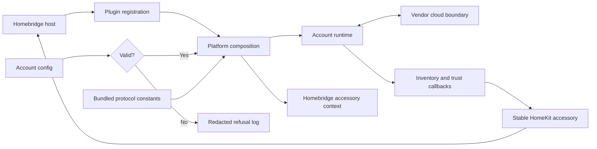

# Phase 6: Root Module Conformance - Research

**Researched:** 2026-10-19
**Domain:** Existing TypeScript ESM Homebridge composition root and paired Node tests
**Confidence:** HIGH for local scope and commands; MEDIUM for risks that require full-file review

<user_constraints>
## User Constraints (from CONTEXT.md)

### Locked Decisions

### Test inventory

- **D-01:** The maintainer explicitly requested deletion of
  `test/configSchema.test.ts` and `test/packageManifest.test.ts`. Commit
  `9605a63` removed both, together with their unpaired-test declarations.
  They are absent from Phase 6 review and must not be recreated as part of
  planning or execution.
- **D-02:** The six mirrored pairs are `platform`, `config`, `logging`,
  `index`, `settings`, and `protocol`. Other repo-level gates are only
  bounded consumers when a confirmed root finding requires a change; a
  bounded edit does not count as a full review of that gate.

### Carried-forward review policy

- **D-03:** Use the approved SPDX/copyright/overview header form on each
  reviewed file. Record stable finding IDs, exact rules, revision-qualified
  locations, severity, disposition, and actual test/commit evidence in a
  phase ledger. Review complete files, including the full platform owner.
- **D-04:** Stop a batch when an independent correction round with open
  findings makes no progress, a fixed finding reopens, or the Phase 6
  four-round cap is reached. Phase 5's GATES cap extension does not carry
  forward. Report open findings accurately at a stop.
- **D-05:** For a genuine behavior bug, observe the active regression fail
  against unchanged production and commit planning-only RED evidence before
  the minimum GREEN fix. Keep source bytes and Git history intact; do not
  bypass hooks. Fix at the cause with minimum code and trace callers before
  changing shared contracts.
- **D-06:** Preserve the project's identity, telemetry trust, privacy,
  command, persistence, and Homebridge compatibility constraints. Every
  modified pair keeps 100% direct line, function, and branch coverage when
  run alone. Run the full repository check at phase gates; use offline local
  stand-ins for external systems.

### the agent's Discretion

- Group the five smaller pairs into one or two nonoverlapping batches.
- Choose the order of review and narrow consumer fixes within the roadmap's
  wave and commit rules.

### Deferred Ideas (OUT OF SCOPE)

None.
</user_constraints>

<phase_requirements>
## Phase Requirements

| ID | Description | Research Support |
| --- | --- | --- |
| ROOT-01 | The root modules `src/*.ts` and their tests conform. | Six-pair inventory, complete-file review, batch ownership, and isolated coverage commands below. [VERIFIED: .planning/REQUIREMENTS.md:26-35; .planning/ROADMAP.md:258-271] |
| PROC-01 | Each phase writes a findings ledger with rule, location, severity, and outcome. | Stable-ID ledger and revision-qualified evidence protocol below. [VERIFIED: .planning/REQUIREMENTS.md:12-17; .planning/phases/01-known-findings-and-loop-proof/01-REVIEW-PROTOCOL.md:35-83] |
| PROC-02 | Re-review to zero open findings, or stop and report why. | Four-round, no-progress, and reopen stop rules below. [VERIFIED: .planning/ROADMAP.md:263-271; .planning/phases/06-root-module-conformance/06-CONTEXT.md:35-43] |
| BUG-01 | Each bug gets a failing regression before its fix and a ledger entry. | Active RED evidence, planning-only evidence commit, then GREEN fix. [VERIFIED: .planning/REQUIREMENTS.md:38-42; .planning/phases/01-known-findings-and-loop-proof/01-REVIEW-PROTOCOL.md:88-119] |
</phase_requirements>

## Summary

Review exactly the six current mirrored root pairs. The current `src/platform.ts` is 673 lines and `test/platform.test.ts` is 3,781 lines; the roadmap's 644/2,375 counts are stale. The complete platform test remains one review owner. `npm run --silent test:corresponding` passed on the current tree after the two requested deletions. [VERIFIED: .planning/phases/06-root-module-conformance/06-CONTEXT.md:15-30; .planning/ROADMAP.md:258-271; `wc -l src/*.ts test/*.test.ts` and `npm run --silent test:corresponding`, 2026-10-19]

The root files are a dependency chain: the entry point registers the platform; the platform consumes validation, redacting logging, protocol constants, and settings; it composes runtime and accessories. Review small pairs first, then platform on their combined tree. Earlier subsystem tests and the Cucumber harness are bounded consumers of any shared-contract change. [VERIFIED: src/index.ts:3-12; src/platform.ts:16-40,540-643; `rg` import scan, 2026-10-19]

**Primary recommendation:** Plan two disjoint small-pair batches (`config`+`protocol`; `logging`+`settings`+`index`), then a standalone complete `platform` batch, followed by a fresh combined `npm run check`. [VERIFIED: .planning/phases/06-root-module-conformance/06-CONTEXT.md:28-63; .planning/ROADMAP.md:263-271; .agents/skills/local-verification/rules/gates.md]

## Architectural Responsibility Map

| Capability | Primary Tier | Secondary Tier | Rationale |
| --- | --- | --- | --- |
| Plugin registration | Homebridge plugin entry | Homebridge host | `registerPlatform` passes the platform class to `api.registerPlatform`. [VERIFIED: src/index.ts:3-12] |
| Config validation and protocol data | Local plugin configuration | Vendor boundary | `validateConfig` resolves accepted input; `PROTOCOL` is imported from bundled JSON. [VERIFIED: src/config.ts:186-219; src/protocol.ts:1-36] |
| Credential-safe logging | Local plugin boundary | Homebridge delegate | `createRedactingLogger` wraps the delegate before platform diagnostics. [VERIFIED: src/logging.ts:112-180; src/platform.ts:552-572] |
| Discovery, trust, persistence, lifecycle | Platform composition | Runtime and accessory tiers | Platform callbacks wire runtime state to accessory registration and HomeKit reports. [VERIFIED: src/platform.ts:140-173,380-510,574-673] |

## Project Constraints (from AGENTS.md)

- Read each file before editing and trace callers before modifying a function; keep changes surgical and tied to the request. [VERIFIED: AGENTS.md, General; user-provided AGENTS.md instructions]
- Preserve TypeScript ESM `.js` relative imports, the declared Node/Homebridge ranges, and `api.hap` supplied HAP objects. The current manifest states `"node": "^22.10.0 || ^24.0.0 || ^26.0.0"` and `"homebridge": "^1.8.0 || ^2.0.0"`; verify against this manifest rather than copying the older embedded AGENTS runtime summary. [VERIFIED: package.json:29-32; AGENTS.md, Project Constraints]
- Preserve unknown/stale telemetry as untrusted, `deviceId` identity, secret-free logs/artifacts/context, token storage under Homebridge storage, and explicit accessory-context persistence. [VERIFIED: AGENTS.md, Project Constraints]
- Use the project's review rulebooks, verified check schedule, conventional commits, normal hooks, and no history rewrite. Never commit on `main` or use `--no-verify`. The executor owns commits; this research is uncommitted by assignment. [VERIFIED: AGENTS.md, Git and Build verification; .agents/skills/committing/SKILL.md]
- Full `npm run check` is required at combined wave and phase gates; commit-hook `check:commit` is incremental evidence only. Record `## Threat Flags` in every plan SUMMARY. [VERIFIED: AGENTS.md, GSD records and Build verification; .agents/skills/local-verification/rules/gates.md]
- Follow Fallow's task map for exact consumers, architecture guards, and pre-commit audit. Review `features/**` with its skill only if a confirmed bounded fix touches it. [VERIFIED: AGENTS.md, Fallow task map; .planning/phases/06-root-module-conformance/06-CONTEXT.md:68-78]

## Standard Stack

This phase adds no external package. Use the installed project toolchain and existing APIs; the version column is the local `npm ls --depth=0` result, not a proposal to upgrade. Package publication dates and legitimacy checks are inapplicable because no install is planned. [VERIFIED: package.json:29-87; `npm ls --depth=0 --json`, 2026-10-19]

| Tool/library | Installed version | Role |
| --- | --- | --- |
| Node.js `node:test`, `node:assert/strict` | Node v26.12.0 | Native ESM tests and assertions. [VERIFIED: `node --version`, 2026-10-19; .agents/skills/typescript-unit-tests/SKILL.md] |
| TypeScript | 6.0.3 | Strict compilation and test build. [VERIFIED: package.json:35,80; `npm ls --depth=0 --json`, 2026-10-19] |
| Homebridge | 2.4.0 | Installed API types and plugin lifecycle surface. [VERIFIED: package.json:29-32,75; `npm ls --depth=0 --json`, 2026-10-19] |
| `strong-mock` | 9.2.2 | Strict interaction mocks where calls are public behavior. [VERIFIED: package.json:79; `npm ls --depth=0 --json`, 2026-10-19; .agents/skills/typescript-unit-tests/rules/test-doubles.md] |
| ESLint, Prettier, Fallow | 10.11.0, 3.9.6, 3.27.0 | Existing static/style/dependency gates. [VERIFIED: package.json:69,73,77; `npm ls --depth=0 --json`, 2026-10-19] |

**Do not install a new runner, assertion, or mocking library.** [VERIFIED: .agents/skills/typescript-unit-tests/SKILL.md]

## Architecture Patterns

### System architecture diagram



The diagram follows the entry point, validation branch, runtime callbacks, discovery dispatch, and accessory persistence port. [VERIFIED: src/index.ts:3-12; src/platform.ts:140-173,296-361,552-673]

### Component responsibilities and batch ownership

| Batch | Full files to review | Primary seam and bounded consumers |
| --- | --- | --- |
| A | `src/config.ts`, `test/config.test.ts`, `src/protocol.ts`, `test/protocol.test.ts` | Validate the config result and bundled protocol contract. The accepted/refused union is quoted exactly: `export type ConfigResult = ConfigRefused | ConfigAccepted;`. Review config's protocol and accessory-kind imports; trace runtime/config consumers before contract edits. [VERIFIED: src/config.ts:2-6,47-60,194-219; src/protocol.ts:5-36; `rg` import scan, 2026-10-19] |
| B | `src/logging.ts`, `test/logging.test.ts`, `src/settings.ts`, `test/settings.test.ts`, `src/index.ts`, `test/index.test.ts` | Logging is a privacy boundary; settings supplies plugin identity; index registers the platform. Preserve template Apache attribution in index/settings. [VERIFIED: src/logging.ts:1-53,112-180; src/settings.ts:1-26; src/index.ts:1-12] |
| C | `src/platform.ts`, all of `test/platform.test.ts` | Standalone full-file platform review after A/B. Review discovery, monitoring, removal, lifecycle, persistence and local stand-ins. `test/platformSeeds.ts` is a support file read and edited only for a confirmed owner finding. [VERIFIED: src/platform.ts:73-105,140-173,380-510,540-673; test/platform.test.ts:20-60; test/platformSeeds.ts:1-35; `wc -l test/platform.test.ts`, 2026-10-19] |

A and B can have disjoint file ownership, but shared `dist-test`, Git index, mutation experiments, and full checks require a serialized critical section. No two concurrent plans edit the same bounded consumer. [VERIFIED: .planning/ROADMAP.md:270-271; .planning/phases/01-known-findings-and-loop-proof/01-REVIEW-PROTOCOL.md:22-33]

### Review and correction loop

1. Take an inventory and capture the reviewed revision. Read each complete pair and the relevant style, comments, cases, doubles, boundaries, and review rules. For the platform pair, include all 3,781 current test lines. [VERIFIED: .planning/phases/06-root-module-conformance/06-CONTEXT.md:31-43; .agents/skills/typescript-style/SKILL.md; .agents/skills/typescript-unit-tests/SKILL.md; `wc -l`, 2026-10-19]
2. Triage exact rule/location/severity under stable IDs. Record confirmed findings and concrete rejections in the phase ledger; distinguish new causes from reopened fixed findings. [VERIFIED: .planning/phases/01-known-findings-and-loop-proof/01-REVIEW-PROTOCOL.md:35-83]
3. Fix one cause per atomic hook-passing commit. For a genuine bug, run active RED against unchanged production, retain complete evidence, commit planning evidence first, then make the minimum GREEN production/test change. [VERIFIED: .planning/phases/06-root-module-conformance/06-CONTEXT.md:39-49; .planning/phases/01-known-findings-and-loop-proof/01-REVIEW-PROTOCOL.md:88-119]
4. Re-review full owned files plus introduced changes; reconcile opening, fixed, rejected, new, reopened, and closing counts. Stop on an open no-progress round, reopened fixed finding, or the four-round cap, and report unresolved IDs. The Phase 5 GATES extension is historical only. [VERIFIED: .planning/phases/06-root-module-conformance/06-CONTEXT.md:39-43; .planning/phases/01-known-findings-and-loop-proof/01-REVIEW-PROTOCOL.md:49-83]

### Header baseline

The approved form is SPDX line, blank line, separate copyright JSDoc, blank line, separate `@fileoverview` JSDoc, blank line, imports. `platform` source and test already show that form. The other five sources have SPDX lines but lack the complete form; their five owner tests start with imports. Record and fix these as ordinary header findings while preserving index/settings Apache attribution. [VERIFIED: .planning/phases/01-known-findings-and-loop-proof/01-REVIEW-PROTOCOL.md:121-131; src/platform.ts:1-11; test/platform.test.ts:1-11; src/config.ts:1-8; src/logging.ts:1-4; src/protocol.ts:1-7; src/settings.ts:1-8; src/index.ts:1-8; test/config.test.ts:1-4; test/logging.test.ts:1-7; test/protocol.test.ts:1-4; test/settings.test.ts:1-6; test/index.test.ts:1-5]

## Don't Hand-Roll

| Problem | Use instead | Why |
| --- | --- | --- |
| Pair discovery and isolated coverage | `scripts/check-corresponding-tests.mjs` and `scripts/test-coverage-direct.mjs` | They already map each `src/` module to a mirrored owner and reject incomplete line/function/branch coverage. [VERIFIED: scripts/check-corresponding-tests.mjs:7-16,117-155; scripts/test-coverage-direct.mjs:59-84,152-186] |
| Homebridge/HAP stand-ins | Existing local `features/lib/hap.ts`, `features/lib/homebridgeApi.ts`, and platform seeds | Current platform tests already use these boundaries. A bounded edit needs its owning phase policy and trace; no new fake framework. [VERIFIED: test/platform.test.ts:20-60; .planning/phases/06-root-module-conformance/06-CONTEXT.md:49-63] |
| Review accounting and RED proof | Phase 1 ledger and `tdd-red-evidence` protocol | Stable IDs, real TAP output, source commit, full patch, and commit ancestry are established gates. [VERIFIED: .planning/phases/01-known-findings-and-loop-proof/01-REVIEW-PROTOCOL.md:35-119] |
| Credential handling | Existing `createRedactingLogger` | It wraps callable and levelled Homebridge logging and supports secret rotation; avoid a second log path. [VERIFIED: src/logging.ts:112-180; src/platform.ts:558-572] |

## Common Pitfalls

| Pitfall | Prevention and warning sign |
| --- | --- |
| Treating the old 2,375-line platform test estimate as a complete review | Require revision-qualified coverage of all current 3,781 lines and record review spans; a diff-only pass is incomplete. [VERIFIED: .planning/ROADMAP.md:263-271; `wc -l test/platform.test.ts`, 2026-10-19] |
| Recreating the two deleted gate tests | Keep `test/configSchema.test.ts` and `test/packageManifest.test.ts` outside plans, inventory, and package scripts; commit `9605a63` records their removal. [VERIFIED: .planning/phases/06-root-module-conformance/06-CONTEXT.md:19-26; `git log -1 -- test/configSchema.test.ts test/packageManifest.test.ts`, 2026-10-19] |
| Accepting weak tests because coverage is 100% | Ask whether a plausible wrong implementation would still pass; keep expected results independent of production and compare whole promised values. [VERIFIED: .agents/skills/typescript-unit-tests/SKILL.md; .agents/skills/typescript-unit-tests/rules/cases.md] |
| Changing a shared root contract without tracing consumers | Run Fallow symbol impact or targeted import trace first; declare minimal bounded edits to runtime, accessories, cloud, features, or repo-level gates if causally required. [VERIFIED: AGENTS.md, Fallow task map; `rg` import scan, 2026-10-19; .planning/phases/06-root-module-conformance/06-CONTEXT.md:28-30,47-49] |
| Conflating compile, RED, and GREEN evidence | A RED run must execute the named active assertion against unchanged production and fail for its intended cause; then restore exact source bytes after any mutation experiment. A setup error, zero test count, or skipped test is no proof. [VERIFIED: .planning/phases/01-known-findings-and-loop-proof/01-REVIEW-PROTOCOL.md:88-119] |
| Mistaking commit-hook success or Phase 5's pre-deletion gate for this phase's full gate | Run `npm run check` after combined code inputs change; record command, exit, revision, Node version, and input fingerprint. A post-deletion gate passed on the `9605a63` code tree. [VERIFIED: .agents/skills/local-verification/rules/gates.md; .planning/phases/05-accessories-conformance/05-VERIFICATION.md; `/private/tmp/basement-guardian-remove-tests-check.log`, 2026-10-19] |

## Code Examples

Use the existing commands, not a new test harness. Compile before a focused compiled run; the direct command compiles for itself. `npm run check` is the combined wave and phase gate. [VERIFIED: .agents/skills/local-verification/rules/commands.md; package.json:33-58]

```bash
npm run build:test
node --test dist-test/test/platform.test.js
npm run test:coverage:direct -- src/platform.ts
npm run --silent test:corresponding
npm run check
```

For an active bug regression, capture the exact command, named test, exit code, full native output, source commit, and complete test patch in the established RED record. Validate that record before a planning-only evidence commit; keep the test active for the later GREEN commit. [VERIFIED: .planning/phases/01-known-findings-and-loop-proof/01-REVIEW-PROTOCOL.md:88-119]

## Runtime State Inventory

This conformance phase plans no state rename or migration. A later confirmed fix that changes a persisted name, path, or registration contract must reopen this inventory before implementation. [VERIFIED: .planning/phases/06-root-module-conformance/06-CONTEXT.md:15-30,47-53]

| Category | Relevant state | Action if a confirmed fix changes it |
| --- | --- | --- |
| Stored data | Accessory context carries optional device and observation members; platform updates the Homebridge cache through its persist port. [VERIFIED: src/platform.ts:45-68,140-173] | Distinguish existing-record migration from future write changes; preserve prior cache semantics. |
| Live service config | Homebridge provides a platform config block to the constructor. Actual user UI state was not inspected. [VERIFIED: src/platform.ts:552-572] | Do not infer a config migration from style work; confirm with the maintainer if a field name must change. |
| OS-registered state | Plugin registration uses Homebridge's platform registration call; host registrations were not inspected. [VERIFIED: src/index.ts:8-12] | Preserve registration identity; investigate host state only if identity changes. |
| Secrets/env vars | Password enters config validation and the redacting logger; no live secret store was inspected. [VERIFIED: src/config.ts:153-176,194-219; src/platform.ts:558-572] | Never place credential material in review evidence; investigate only if a secret key name changes. |
| Build artifacts | `build:test` rebuilds `dist-test`; the full check builds and covers all pairs. [VERIFIED: package.json:33-58; scripts/test-coverage-direct.mjs:230-275] | Rebuild after code changes and do not reuse a pre-change coverage artifact. |

## Environment Availability

| Dependency | Required by | Available | Version/evidence | Fallback |
| --- | --- | --- | --- | --- |
| Node.js and npm | Build, tests, hooks | Yes | Node v26.12.0, npm 11.20.0. [VERIFIED: `node --version`; `npm --version`, 2026-10-19] | None needed. |
| Project dependencies | Compilation and test stand-ins | Yes | `npm ls --depth=0 --json` exited 0. [VERIFIED: local command, 2026-10-19] | None needed. |
| Vendor cloud and real pump | Runtime behavior | Not needed | Tests use offline stand-ins; no live vendor or hardware run belongs to this phase. [VERIFIED: .planning/phases/06-root-module-conformance/06-CONTEXT.md:49-53; .agents/skills/typescript-unit-tests/rules/pairing-and-design.md] | Existing local fakes. |

## Validation Architecture

`workflow.nyquist_validation` is `true` (`"nyquist_validation": true`); retain the section and make every plan's verification explicit. [VERIFIED: .planning/config.json:25]

| Property | Value |
| --- | --- |
| Framework | Native Node `node:test` and `node:assert/strict`; TypeScript test build. [VERIFIED: .agents/skills/typescript-unit-tests/SKILL.md; package.json:33-58] |
| Focused owner command | `npm run build:test && node --test dist-test/test/<owner>.test.js`. [VERIFIED: .agents/skills/local-verification/rules/commands.md] |
| Pair coverage command | `npm run test:coverage:direct -- src/<owner>.ts`; run for each modified owner. [VERIFIED: .agents/skills/local-verification/rules/commands.md] |
| Full suite | `npm run check` at combined wave and phase gates. [VERIFIED: .agents/skills/local-verification/rules/gates.md; package.json:33-37] |

| Req ID | Behavior | Test/record | Wave 0 gap |
| --- | --- | --- | --- |
| ROOT-01 | Six complete pairs conform; each modified pair has 100% isolated direct coverage. | Existing six mirrored owners, `test:corresponding`, focused direct coverage, review ledger. [VERIFIED: .planning/phases/06-root-module-conformance/06-CONTEXT.md:19-30; scripts/test-coverage-direct.mjs:59-84,152-186] | No new framework or owner file. |
| PROC-01/02 | Findings have auditable dispositions and bounded convergence. | Create Phase 6 ledger and batch review records in plans; count every independent correction round. [VERIFIED: .planning/phases/01-known-findings-and-loop-proof/01-REVIEW-PROTOCOL.md:35-83] | Ledger/round records are execution artifacts. |
| BUG-01 | Named active regression fails before the fix and passes after. | RED evidence validator plus owner test and direct coverage. [VERIFIED: .planning/phases/01-known-findings-and-loop-proof/01-REVIEW-PROTOCOL.md:88-119] | Conditional on a confirmed bug. |

**Sampling:** focused owner test and direct coverage while editing; normal hook on each commit; fresh full `npm run check` after combined waves and at phase end. The post-deletion baseline passed on the `9605a63` code tree: 104 Cucumber scenarios, 1,156 steps, and 43 direct pairs. [VERIFIED: .agents/skills/local-verification/rules/commands.md; .agents/skills/local-verification/rules/gates.md; .planning/phases/05-accessories-conformance/05-VERIFICATION.md; `/private/tmp/basement-guardian-remove-tests-check.log`, 2026-10-19]

## Security Domain

`security_enforcement` is enabled (`"security_enforcement": true`). The ASVS category mapping here is an implementation review map, not a claim of ASVS certification. [VERIFIED: .planning/config.json:50]

| ASVS category | Applies | Phase review surface |
| --- | --- | --- |
| V2 Authentication | Yes | Configuration and platform pass account credentials toward the runtime; preserve refusal and secret registration behavior. [VERIFIED: src/config.ts:153-176,194-219; src/platform.ts:558-610] |
| V3 Session Management | Bounded consumer | Runtime owns cloud session behavior; trace consumers only if root edits its inputs. [VERIFIED: src/platform.ts:600-643; .planning/phases/06-root-module-conformance/06-CONTEXT.md:15-30] |
| V4 Access Control | Bounded consumer | Accessory controls and runtime command port are wired by platform; do not broaden command authority. [VERIFIED: src/platform.ts:73-101,140-173,585-620] |
| V5 Input Validation | Yes | Config and discovery paths accept account config and device snapshots; preserve refusal and narrow trust. [VERIFIED: src/config.ts:153-219; src/platform.ts:234-296,380-429] |
| V6 Cryptography | Bounded consumer | Platform requests random salt bytes for token-cache fingerprinting; use the existing Node crypto path. [VERIFIED: src/platform.ts:11,42-43,600-610] |

| Threat pattern | Risk | Review control |
| --- | --- | --- |
| Secret or account identifier in log/evidence | Information disclosure | Review all logging paths, use synthetic test inputs, keep raw vendor data out of public artifacts. [VERIFIED: AGENTS.md, Privacy; src/logging.ts:55-108,112-180; src/platform.ts:558-572] |
| Invalid or missing telemetry presented as normal | Safety misstatement | Preserve per-device trust and cached-value behavior through platform callbacks and owner tests. [VERIFIED: AGENTS.md, Safety semantics; src/platform.ts:395-479,645-673] |
| Duplicate or lost accessory after uncertain registration | State/identity error | Preserve `deviceId` UUID seed and no-retry uncertain-registration path. [VERIFIED: AGENTS.md, Identity; src/platform.ts:296-361] |

## Assumptions Log

| # | Claim | Section | Risk if wrong |
| --- | --- | --- | --- |
| A1 | No production state migration will be needed because no rename is planned. [ASSUMED] | Runtime State Inventory | A genuine fix might alter persisted context or registration identity; reopen inventory before that edit. |
| A2 | A/B may proceed as separate review batches without cross-batch consumer edits. [ASSUMED] | Architecture Patterns | A confirmed shared cause could require wave serialization and revised ownership. |

## Open Questions

1. **Will full-file review find a behavior bug or shared-contract repair?** The scope and process are fixed; the actual defects cannot be known until review. Plan a conditional RED evidence path and bounded consumer ownership. [VERIFIED: .planning/phases/06-root-module-conformance/06-CONTEXT.md:31-53]
2. **Will later root changes preserve the post-deletion full gate?** The baseline passed after commit `9605a63`; rerun the full gate whenever combined source or test inputs change. [VERIFIED: .planning/phases/05-accessories-conformance/05-VERIFICATION.md; .agents/skills/local-verification/rules/gates.md]

## Sources

### Primary (HIGH confidence)

- Current repository source/test files, `package.json`, pairing and coverage scripts, and local `npm`/`node` probes listed inline.
- `.planning/ROADMAP.md`, `.planning/REQUIREMENTS.md`, Phase 6 CONTEXT, Phase 1 review protocol, Phase 4/5 contexts, and Phase 5 verification/UAT.
- `AGENTS.md` and `.agents/skills/{typescript-style,typescript-unit-tests,local-verification,committing}` with the relevant rule files.

### External sources

None. No new integration or package is proposed; this research concerns in-repository conformance and does not require unrelated external documentation. [VERIFIED: .planning/phases/06-root-module-conformance/06-CONTEXT.md:15-30]

## Metadata

**Confidence breakdown:** scope/stack HIGH (current files and installed versions); architecture HIGH (direct imports and callbacks); pitfalls HIGH for process rules, MEDIUM for future defect risk. [VERIFIED: sources above]
**Research date:** 2026-10-19
**Valid until:** The next source, test, config, or dependency change to the Phase 6 review inputs.
